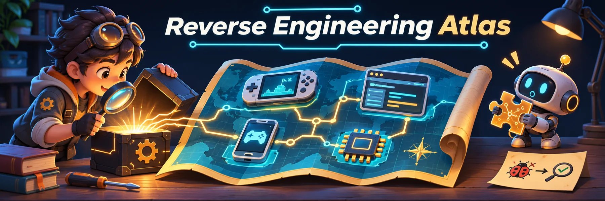

[English](README.md) · [简体中文](README.zh-CN.md) · [繁體中文](README.zh-TW.md) · [日本語](README.ja.md) · [한국어](README.ko.md)

# Reverse Engineering Atlas · リバースエンジニアリング・プロジェクトマップ

逆解析プロジェクト、ツール、エージェントのワークフローを対象・プラットフォーム・技術別に整理したカタログです。ゲームの逆コンパイルと再コンパイル、アプリの再実装、Android・JavaScript 解析、プロトコル、ファームウェアの既存成果を探せます。

**387 件の項目 · 381 個の GitHub リポジトリ · 10 種類の skill ワークフロー · 5 言語の README**

Switch 2 は編集上の優先項目であり、人気の実測順位ではありません。各分類は既存の累計 Star スナップショット順で、リアルタイムのトレンドではありません。取得日時は未記録、件数不明の項目は末尾です。全項目を保持しています。

> 特定ツールに依存しない独立したカタログで、REA などの公式ディレクトリではありません。掲載は推奨や、完成度・安全性・利用許諾の保証ではありません。

## 目次

- [使い始めるには](#atlas-start)
- [Skill 技術インデックス](#atlas-skills)
- [範囲・根拠・ライセンス](#atlas-policy)
- [ゲーム](#atlas-games)
  - [Nintendo Switch 2](#nintendo-switch-2)
  - [Nintendo Switch](#nintendo-switch)
  - [ファミコン / NES](#ファミコン--nes)
  - [スーパーファミコン / SNES](#スーパーファミコン--snes)
  - [メガドライブ / Genesis](#メガドライブ--genesis)
  - [セガサターン](#セガサターン)
  - [ゲームボーイ](#ゲームボーイ)
  - [ゲームボーイアドバンス](#ゲームボーイアドバンス)
  - [NINTENDO64](#nintendo64)
  - [ゲームキューブ](#ゲームキューブ)
  - [Wii](#wii)
  - [ニンテンドーDS](#ニンテンドーds)
  - [ニンテンドー3DS](#ニンテンドー3ds)
  - [PlayStation](#playstation)
  - [PlayStation 2](#playstation-2)
  - [Xbox / Xbox 360](#xbox--xbox-360)
  - [PC / DOS / PC-98](#pc--dos--pc-98)
- [アプリ / Electron / デスクトップ](#atlas-app)
- [プロトコル / ハードウェア](#atlas-protocol)
- [ファームウェア / ドライバ](#atlas-firmware)
- [セキュリティ / 評価](#atlas-security)
- [リバースエンジニアリングツール](#atlas-tooling)
- [REA 公式ショーケース](#atlas-official)
- [任意の表示：REA を使用したプロジェクト](#atlas-rea)
- [データと貢献](#atlas-data)

## 使い始めるには

- **既存の実装を探す:** [ゲームのプラットフォーム別一覧](#atlas-games)、[デスクトップアプリ / Electron](#atlas-app)、[プロトコル / ハードウェア](#atlas-protocol)、[ファームウェア / ドライバ](#atlas-firmware)を参照。
- **解析手法を選ぶ:** [10 種類の skill マップ](#atlas-skills)から Android、JavaScript、ネイティブバイナリ、CTF、クリーンルーム再実装の手法を探す。
- **ツールを選ぶ:** [逆解析ツール](#atlas-tooling)と[セキュリティ / 評価](#atlas-security)を参照。ツール、skill、再構築されたアプリは役割が異なります。
- **根拠と制限を確認する:** [詳細技術マップ](SKILL_MAP.md)で一次資料、ライセンス、保守状況、機能の制限を確認。

Ctrl+F / Cmd+F で対象名、所有者/リポジトリ、プラットフォームや APK、DEX、Electron、WASM、PS2、firmware などの形式を検索してください。依存関係や最新状況は上流の README で確認します。未掲載でも、関連プロジェクトが存在しないとは限りません。

## Skill 技術インデックス

10 個の skill と関連プロジェクトを技術別に整理しています。技術的な関連は、依存関係や REA の使用を意味しません。

[根拠・ライセンス・制限](SKILL_MAP.md) · [JSON](skill-map.json)

| Skill / 出典 | 技術分野 | 関連プロジェクト |
| --- | --- | --- |
| [REA](https://github.com/morluto/rea) | CLI / MCP、逆コンパイル、相互参照、証拠 | [7](SKILL_MAP.md#rea) |
| [reverse-skill](https://github.com/zhaoxuya520/reverse-skill) | 対象の振り分け、ツール探索、証拠に基づく作業フロー | [6](SKILL_MAP.md#reverse-skill) |
| [android-reverse-engineering-skill](https://github.com/SimoneAvogadro/android-reverse-engineering-skill) | APK / DEX、Kotlin メタデータ、HTTP API 解析 | [7](SKILL_MAP.md#android-reverse-engineering-skill) |
| [replica-skill](https://github.com/Jakeschincariol/replica-skill) | ブラックボックス観察、クリーンルーム仕様、動作テスト | [5](SKILL_MAP.md#replica-skill) |
| [leanrea](https://github.com/aicodeking/leanrea) | CLI の連携、対象の初期分類、証拠 | [6](SKILL_MAP.md#leanrea) |
| [ctf-skills](https://github.com/ljagiello/ctf-skills) | CTF リバース解析、シンボリック実行、エミュレーション | [6](SKILL_MAP.md#ctf-skills) |
| [reverse-skills](https://github.com/P4nda0s/reverse-skills) | 逆コンパイル結果の出力、型の再構築、計装 | [6](SKILL_MAP.md#reverse-skills) |
| [hello_js_reverse_skill](https://github.com/WhiteNightShadow/hello_js_reverse_skill) | JavaScript 抽象構文木、難読化解除、実行時解析 | [5](SKILL_MAP.md#hello-js-reverse-skill) |
| [Open-ReverseLab](https://github.com/LING71671/open-reverselab) | MCP ワークベンチ、ネイティブ / Android、事例レポート | [7](SKILL_MAP.md#open-reverselab) |
| [js-reverse-automation--skill](https://github.com/Fausto-404/js-reverse-automation--skill) | CDP、抽象構文木、ブラウザー実行環境、WASM | [7](SKILL_MAP.md#js-reverse-automation-skill) |

## 範囲・根拠・ライセンス

**対象：** 静的/動的解析、逆コンパイル、再コンパイル、クリーンルーム再実装、ソフトウェア保存に関する公開プロジェクトと資料。Skill は手順をまとめるもので、解析エンジンとは限りません。展開ツールは元のソースを復元せず、素材の再利用権も与えません。

**確認範囲：** 技術マップでは 2026-11-07 に 45 プロジェクトの文書を確認しました。古い全項目の再監査ではありません。この確認でプロジェクトのインストール・実行や、性能・安全性の独立した再現は行っていません。

**REA は任意の関係タグ：** Yes は公開された利用根拠がある場合、No は非 REA の手法や独立した代替、Unverified は関係が未確認の場合です。品質やライセンスの評価ではありません。ベンチマークの比較対象にするだけでは REA の実行時利用に当たりません。[REA サブセット](#atlas-rea)は任意の表示です。

**権限と許諾：** 所有するか明示的に許可された対象とデータのみ解析してください。クラック、DRM 回避、海賊版、無許諾のゲーム素材配布は対象外です。公開されていてもオープンソースとは限りません。不明確な許諾、サブディレクトリ限定の許諾、商用依存関係は上流で確認してください。正規に入手した素材が必要な場合があります。

**権利の区別：** このカタログの独自の貢献は [CC0-1.0](LICENSE) です。上流コード、画像、商標などの権利は別です。アーカイブ済みや初期アルファのプロジェクトは歴史的・実験的資料であり、標準的な推奨ではありません。

## ゲーム

### Nintendo Switch 2

#### 逆コンパイル / 再コンパイル

<table>
<tr><th width="220">ゲ&#8288;ー&#8288;ム&#8288;・&#8288;画&#8288;像&#8288;・&#8288;元&#8288;の&#8288;対&#8288;応&#8288;機&#8288;種</th><th width="500">概&#8288;要&#8288;・&#8288;実&#8288;行&#8288;条&#8288;件&#8288;・&#8288;画&#8288;像&#8288;の&#8288;出&#8288;典</th></tr>
<tr><td width="220"> <b>Pokémon Pokopia</b> <a href="https://github.com/Dittobyte/Recompia"><b>Recompia</b></a> Dittobyte &#160;Nintendo Switch 2</td><td width="500">Pokémon Pokopia（Switch 2）の再コンパイル。Windows 向けで、Linux ランチャーは Proton を使用します。自分の 2.0.1a データが必要。リポジトリのスクリーンショット SVG は仮画像で、検証済みプレイ画面ではありません。  rea 使用: いいえ 画像の出典: <a href="images/editorial/README.md">公式ゲーム画像・移植の動作画面ではありません</a></td></tr>
<tr><td width="220">— <b>The Legend of Zelda: Ocarina of Time</b> <a href="https://github.com/RealZotto/oot2-native"><b>oot2-native</b></a> RealZotto &#160;Nintendo Switch 2</td><td width="500">上流が Switch 2 版「時のオカリナ」リメイクとする対象の開発プレビュー研究。プレイ不可、リリースなし、描画バックエンド未実装。動作する PC 移植ではありません。  rea 使用: いいえ 画像の出典: —</td></tr>
</table>

#### リメイク / 移植

<table>
<tr><th width="220">ゲ&#8288;ー&#8288;ム&#8288;・&#8288;画&#8288;像&#8288;・&#8288;元&#8288;の&#8288;対&#8288;応&#8288;機&#8288;種</th><th width="500">概&#8288;要&#8288;・&#8288;実&#8288;行&#8288;条&#8288;件&#8288;・&#8288;画&#8288;像&#8288;の&#8288;出&#8288;典</th></tr>
<tr><td width="220"> <b>The Legend of Zelda: Ocarina of Time</b> <a href="https://github.com/NotRexed/Hookshot"><b>Hookshot</b></a> NotRexed &#160;Nintendo Switch 2</td><td width="500">「時のオカリナ」Switch 2 の実験的な Windows/Linux 向け再コンパイル。上流は序盤のプレイを報告していますが、他のエリアや GPU には問題が残ります。自分のゲームデータが必要。当カタログでは未実測です。  rea 使用: いいえ 画像の出典: リポジトリカード</td></tr>
<tr><td width="220"><a href="https://github.com/sostenesfreitas/ocarina-recomp">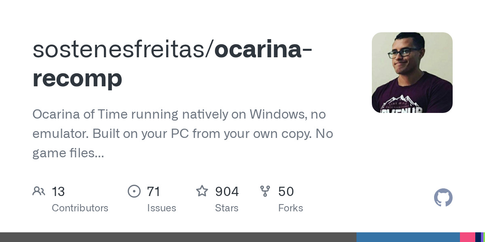</a> <b>The Legend of Zelda: Ocarina of Time</b> <a href="https://github.com/sostenesfreitas/ocarina-recomp"><b>ocarina-recomp</b></a> sostenesfreitas &#160;Nintendo Switch 2</td><td width="500">「時のオカリナ」Switch 2 の再コンパイル研究。現在は実装への貢献先を Hookshot に移し、ポルトガル語の支援・ガイドを維持。作者の報告は RTX 5090 での序盤テストのみで、全編の動作確認ではありません。自分のゲームデータが必要です。  rea 使用: いいえ 画像の出典: リポジトリカード</td></tr>
<tr><td width="220"> <b>Donkey Kong Bananza</b> <a href="https://github.com/Lucas-blip-png/dkb-pc-recomp"><b>dkb-pc-recomp</b></a> Lucas-blip-png &#160;Nintendo Switch 2</td><td width="500">Donkey Kong Bananza（Switch 2）の実験的再コンパイル。上流はまだプレイ不可と明記。チュートリアル洞窟で移動・攻撃できますが、クラッシュやエフェクト欠落があります。Windows 向け、Linux/macOS はプレビュー。自分のデータが必要です。  rea 使用: いいえ 画像の出典: リポジトリカード</td></tr>
<tr><td width="220"> <b>Star Fox</b> <a href="https://github.com/SerenityG4K/SpaceAnimalsRecomp"><b>SpaceAnimalsRecomp</b></a> SerenityG4K &#160;Nintendo Switch 2</td><td width="500">Star Fox（Switch 2 2.0.0）の Windows 向け再コンパイル。作者は Ryzen 9700X + RTX 5070 Ti でのみ 60 fps でのクリアを報告。未最適化で一部シェーダーは未変換。当カタログでは未検証。自分のゲームデータが必要です。  rea 使用: いいえ 画像の出典: リポジトリカード</td></tr>
<tr><td width="220"><a href="https://github.com/drakolordx7/switch2-recomp">プレビューを表示できません · 元のプロジェクトへ</a> <b>Pokémon Pokopia</b> <a href="https://github.com/drakolordx7/switch2-recomp"><b>switch2-recomp</b></a> drakolordx7 &#160;Nintendo Switch 2</td><td width="500">Nintendo Switch 2 の『ポケモン ポコピア』を、エミュレータなしで Windows 上でネイティブに動くプログラムに変換します。自分のゲームダンプを使います。  rea 使用: いいえ 画像の出典: <a href="https://github.com/drakolordx7/switch2-recomp">リポジトリカード</a></td></tr>
</table>

### Nintendo Switch

#### 逆コンパイル / 再コンパイル

<table>
<tr><th width="220">ゲ&#8288;ー&#8288;ム&#8288;・&#8288;画&#8288;像&#8288;・&#8288;元&#8288;の&#8288;対&#8288;応&#8288;機&#8288;種</th><th width="500">概&#8288;要&#8288;・&#8288;実&#8288;行&#8288;条&#8288;件&#8288;・&#8288;画&#8288;像&#8288;の&#8288;出&#8288;典</th></tr>
<tr><td width="220">— <b>Xenoblade Chronicles X: Definitive Edition</b> <a href="https://github.com/jmars125/xcx-recomp"><b>xcx-recomp</b></a> jmars125 &#160;Nintendo Switch</td><td width="500">クローズドソースの『ゼノブレイドクロス ディフィニティブエディション』（Switch）を静的再コンパイルして、Windows でネイティブに動くプログラムにしたもの。自分で合法的にダンプしたファイルが必要。  rea 使用: いいえ 画像の出典: —</td></tr>
<tr><td width="220"> <b>Xenoblade Chronicles 2</b> <a href="https://github.com/KevinBonnoron/xc2-decomp"><b>xc2-decomp</b></a> KevinBonnoron &#160;Nintendo Switch</td><td width="500">Nintendo Switch版『ゼノブレイド2』のマッチングデコンパイル：オリジナルのゲームバイナリを再現するソース。  rea 使用: いいえ 画像の出典: リポジトリカード</td></tr>
</table>

#### リメイク / 移植

<table>
<tr><th width="220">ゲ&#8288;ー&#8288;ム&#8288;・&#8288;画&#8288;像&#8288;・&#8288;元&#8288;の&#8288;対&#8288;応&#8288;機&#8288;種</th><th width="500">概&#8288;要&#8288;・&#8288;実&#8288;行&#8288;条&#8288;件&#8288;・&#8288;画&#8288;像&#8288;の&#8288;出&#8288;典</th></tr>
<tr><td width="220"> <b>The Legend of Zelda: Tears of the Kingdom</b> <a href="https://github.com/valentderah/totk-pc-recomp"><b>totk-pc-recomp</b></a> valentderah &#160;Nintendo Switch</td><td width="500">Nintendo Switch 版『ゼルダの伝説 ティアーズ オブ ザ キングダム』を、エミュレータなしで動くネイティブ Windows プログラムに静的再コンパイルします。ゲームファイルは自分で用意。  rea 使用: いいえ 画像の出典: リポジトリカード</td></tr>
<tr><td width="220"> <b>The Legend of Zelda: Link’s Awakening</b> <a href="https://github.com/peiikai/LASRecomp"><b>LASRecomp</b></a> peiikai &#160;Nintendo Switch</td><td width="500">2019年のNintendo Switch版『ゼルダの伝説 夢をみる島』を、Windows・macOS・Linuxでネイティブに動くプログラムに変換します。自分のゲームダンプを使います。  rea 使用: いいえ 画像の出典: リポジトリカード</td></tr>
<tr><td width="220">— <b>Super Mario Maker 2</b> <a href="https://github.com/smm2recomp/smm2recomp"><b>smm2recomp</b></a> smm2recomp &#160;Nintendo Switch</td><td width="500">クローズドソースの Switch『スーパーマリオメーカー2』を静的再コンパイルして PC・Mac・Linux などでネイティブに動くアプリにしたもの。自分のダンプが必要。  rea 使用: いいえ 画像の出典: —</td></tr>
<tr><td width="220">— <b>Metroid Prime 4: Beyond</b> <a href="https://github.com/linuxopt/mp4-recomp"><b>mp4-recomp</b></a> linuxopt &#160;Nintendo Switch</td><td width="500">任天堂Switchのゲーム『メトロイドプライム4 ビヨンド』の無料オープンソースLinuxネイティブ版。自分のゲームダンプを使ってエミュレータなしで遊べる。  rea 使用: いいえ 画像の出典: —</td></tr>
<tr><td width="220">— <b>Tomodachi Life: Living the Dream</b> <a href="https://github.com/RussoPhone/tomodachi-ltd-recomp"><b>tomodachi-ltd-recomp</b></a> RussoPhone &#160;Nintendo Switch</td><td width="500">Nintendo Switch の『トモダチコレクション 夢の暮らし』を静的再コンパイルして PC でネイティブに動かせる初期の無料オープンソース移植（自分のダンプが必要）。  rea 使用: いいえ 画像の出典: —</td></tr>
<tr><td width="220">— <a href="https://github.com/Zexyen/Witch-Time"><b>Witch-Time</b></a> Zexyen &#160;Nintendo Switch</td><td width="500">クローズドソースの『ベヨネッタ3』（Switch）を、自分のダンプがあればPCで動かせるネイティブ版に  rea 使用: いいえ 画像の出典: —</td></tr>
<tr><td width="220"><a href="https://github.com/Revivedx/SavageWindRecomp">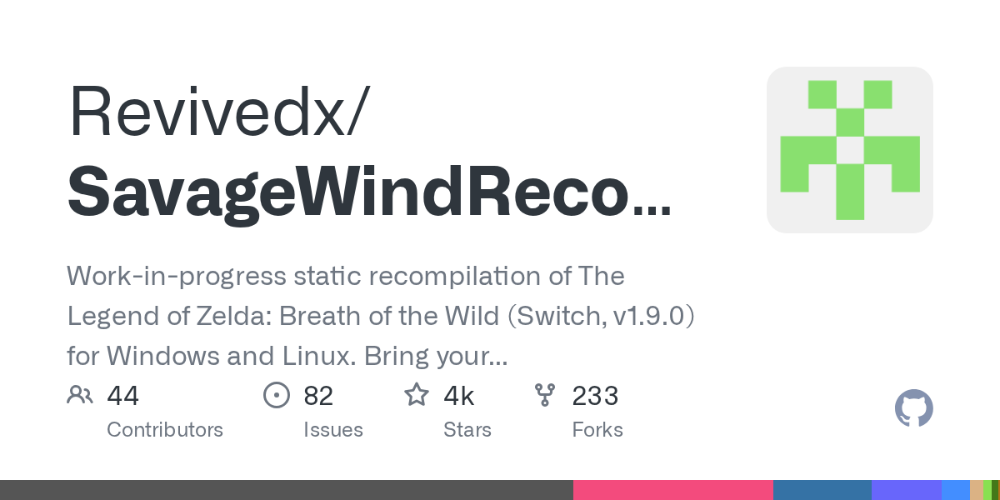</a> <a href="https://github.com/Revivedx/SavageWindRecomp"><b>SavageWindRecomp</b></a> Revivedx &#160;Nintendo Switch</td><td width="500">クローズドソースの『ゼルダの伝説 ブレス オブ ザ ワイルド』（Switch）を自分のダンプでPCネイティブに  rea 使用: いいえ 画像の出典: 当リポジトリの撮影</td></tr>
<tr><td width="220"><a href="https://github.com/captainj-sparrow/astral-chain-pc-recomp">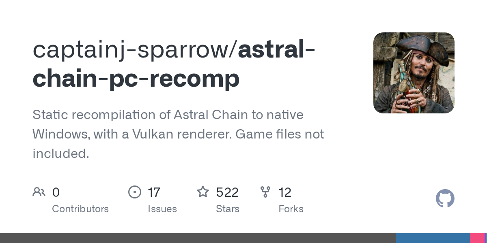</a> <a href="https://github.com/captainj-sparrow/astral-chain-pc-recomp"><b>astral-chain-pc-recomp</b></a> captainj-sparrow &#160;Nintendo Switch</td><td width="500">クローズドソースの『アストラルチェイン』（Switch）を自分のダンプでWindowsネイティブに  rea 使用: いいえ 画像の出典: 当リポジトリの撮影</td></tr>
<tr><td width="220">— <a href="https://github.com/yozander2009-stack/Metroid-Dread-Recomp"><b>Metroid-Dread-Recomp</b></a> yozander2009-stack &#160;Nintendo Switch</td><td width="500">クローズドソースの『メトロイド ドレッド』（Switch）を自分のダンプでPCネイティブに  rea 使用: いいえ 画像の出典: —</td></tr>
</table>

### ファミコン / NES

#### 逆コンパイル / 再コンパイル

<table>
<tr><th width="220">ゲ&#8288;ー&#8288;ム&#8288;・&#8288;画&#8288;像&#8288;・&#8288;元&#8288;の&#8288;対&#8288;応&#8288;機&#8288;種</th><th width="500">概&#8288;要&#8288;・&#8288;実&#8288;行&#8288;条&#8288;件&#8288;・&#8288;画&#8288;像&#8288;の&#8288;出&#8288;典</th></tr>
<tr><td width="220"> <a href="https://github.com/aldonunez/zelda1-disassembly"><b>zelda1-disassembly</b></a> aldonunez &#160;ファミコン / NES</td><td width="500">初代ゼルダの伝説（FC）を完全逆アセンブル  rea 使用: いいえ 画像の出典: <a href="https://upload.wikimedia.org/wikipedia/en/4/41/Legend_of_zelda_cover_%28with_cartridge%29_gold.png">Wikipedia（© 権利者）</a></td></tr>
</table>

#### アセット抽出・ツール

<table>
<tr><th width="220">ゲ&#8288;ー&#8288;ム&#8288;・&#8288;画&#8288;像&#8288;・&#8288;元&#8288;の&#8288;対&#8288;応&#8288;機&#8288;種</th><th width="500">概&#8288;要&#8288;・&#8288;実&#8288;行&#8288;条&#8288;件&#8288;・&#8288;画&#8288;像&#8288;の&#8288;出&#8288;典</th></tr>
<tr><td width="220"> <a href="https://github.com/SourMesen/Mesen2"><b>Mesen2</b></a> SourMesen &#160;ファミコン / NES</td><td width="500">強力なデバッグ機能付きのマルチシステムエミュレータ  rea 使用: いいえ 画像の出典: リポジトリカード</td></tr>
</table>

### スーパーファミコン / SNES

#### 逆コンパイル / 再コンパイル

<table>
<tr><th width="220">ゲ&#8288;ー&#8288;ム&#8288;・&#8288;画&#8288;像&#8288;・&#8288;元&#8288;の&#8288;対&#8288;応&#8288;機&#8288;種</th><th width="500">概&#8288;要&#8288;・&#8288;実&#8288;行&#8288;条&#8288;件&#8288;・&#8288;画&#8288;像&#8288;の&#8288;出&#8288;典</th></tr>
<tr><td width="220"> <a href="https://github.com/snesrev/zelda3"><b>zelda3</b></a> snesrev &#160;スーパーファミコン / SNES</td><td width="500">神々のトライフォースを C で再実装、ワイド対応（ROM は各自）  rea 使用: いいえ 画像の出典: <a href="https://upload.wikimedia.org/wikipedia/en/2/21/The_Legend_of_Zelda_A_Link_to_the_Past_SNES_Game_Cover.jpg">Wikipedia（© 権利者）</a></td></tr>
<tr><td width="220"> <a href="https://github.com/snesrev/sm"><b>sm</b></a> snesrev &#160;スーパーファミコン / SNES</td><td width="500">スーパーメトロイドを C で再実装（ROM は各自）  rea 使用: いいえ 画像の出典: <a href="https://upload.wikimedia.org/wikipedia/en/e/e4/Smetroidbox.jpg">Wikipedia（© 権利者）</a></td></tr>
</table>

#### リメイク / 移植

<table>
<tr><th width="220">ゲ&#8288;ー&#8288;ム&#8288;・&#8288;画&#8288;像&#8288;・&#8288;元&#8288;の&#8288;対&#8288;応&#8288;機&#8288;種</th><th width="500">概&#8288;要&#8288;・&#8288;実&#8288;行&#8288;条&#8288;件&#8288;・&#8288;画&#8288;像&#8288;の&#8288;出&#8288;典</th></tr>
<tr><td width="220"> <a href="https://github.com/snesrev/smw"><b>smw</b></a> snesrev &#160;スーパーファミコン / SNES</td><td width="500">スーパーマリオワールドを C で再実装（ROM は各自）  rea 使用: いいえ 画像の出典: <a href="https://upload.wikimedia.org/wikipedia/en/3/32/Super_Mario_World_Coverart.png">Wikipedia（© 権利者）</a></td></tr>
<tr><td width="220"> <a href="https://github.com/MrJackSpade/SuperMetroidDecomp"><b>SuperMetroidDecomp</b></a> MrJackSpade &#160;スーパーファミコン / SNES</td><td width="500">クローズドソースのSNESゲーム『スーパーメトロイド』をC#で再実装したソースポート。自分のROMからアセットを抽出し、モダンなWindowsとAndroidで動作。  rea 使用: いいえ 画像の出典: リポジトリカード</td></tr>
</table>

### メガドライブ / Genesis

#### 逆コンパイル / 再コンパイル

<table>
<tr><th width="220">ゲ&#8288;ー&#8288;ム&#8288;・&#8288;画&#8288;像&#8288;・&#8288;元&#8288;の&#8288;対&#8288;応&#8288;機&#8288;種</th><th width="500">概&#8288;要&#8288;・&#8288;実&#8288;行&#8288;条&#8288;件&#8288;・&#8288;画&#8288;像&#8288;の&#8288;出&#8288;典</th></tr>
<tr><td width="220"> <a href="https://github.com/sonicretro/s1disasm"><b>s1disasm</b></a> sonicretro &#160;メガドライブ / Genesis</td><td width="500">ソニック・ザ・ヘッジホッグ（メガドライブ）を完全逆アセンブル  rea 使用: いいえ 画像の出典: <a href="https://upload.wikimedia.org/wikipedia/en/b/ba/Sonic_the_Hedgehog_1_Genesis_box_art.jpg">Wikipedia（© 権利者）</a></td></tr>
<tr><td width="220"> <a href="https://github.com/sonicretro/s2disasm"><b>s2disasm</b></a> sonicretro &#160;メガドライブ / Genesis</td><td width="500">ソニック 2（メガドライブ）を完全逆アセンブル  rea 使用: いいえ 画像の出典: <a href="https://upload.wikimedia.org/wikipedia/en/0/0c/Sonic_2_US_Cover.jpg">Wikipedia（© 権利者）</a></td></tr>
<tr><td width="220"> <a href="https://github.com/sonicretro/skdisasm"><b>skdisasm</b></a> sonicretro &#160;メガドライブ / Genesis</td><td width="500">ソニック 3 &amp; ナックルズを完全逆アセンブル  rea 使用: いいえ 画像の出典: <a href="https://upload.wikimedia.org/wikipedia/en/d/d3/Sonic_%26_Knuckles_cover.jpg">Wikipedia（© 権利者）</a></td></tr>
<tr><td width="220">— <a href="https://github.com/crabsmack/xmen2-pc"><b>xmen2-pc</b></a> crabsmack &#160;メガドライブ / Genesis</td><td width="500">1995年のジェネシスゲーム『X-Men 2: Clone Wars』を完全なデコンパイルからネイティブPCゲームに再構築。ワイドスクリーン、高フレームレート、最大4人ローカル/オンライン対応。自分のROMが必要。  rea 使用: いいえ 画像の出典: —</td></tr>
</table>

#### リメイク / 移植

<table>
<tr><th width="220">ゲ&#8288;ー&#8288;ム&#8288;・&#8288;画&#8288;像&#8288;・&#8288;元&#8288;の&#8288;対&#8288;応&#8288;機&#8288;種</th><th width="500">概&#8288;要&#8288;・&#8288;実&#8288;行&#8288;条&#8288;件&#8288;・&#8288;画&#8288;像&#8288;の&#8288;出&#8288;典</th></tr>
<tr><td width="220"> <a href="https://github.com/RSDKModding/RSDKv4-Decompilation"><b>RSDKv4-Decompilation</b></a> RSDKModding &#160;メガドライブ / Genesis</td><td width="500">ソニック 1・2（2013）のエンジンを逆コンパイル  rea 使用: いいえ 画像の出典: プロジェクト README</td></tr>
<tr><td width="220"> <a href="https://github.com/RSDKModding/RSDKv5-Decompilation"><b>RSDKv5-Decompilation</b></a> RSDKModding &#160;メガドライブ / Genesis</td><td width="500">ソニックマニアのエンジンを逆コンパイル（手持ちのデータを使用）  rea 使用: いいえ 画像の出典: プロジェクト README</td></tr>
<tr><td width="220">— <a href="https://github.com/YuutaTsubasa/ChaotixRecompiled"><b>ChaotixRecompiled</b></a> YuutaTsubasa &#160;メガドライブ / Genesis</td><td width="500">1995年のセガ32Xゲーム『ナックルズ・カオティクス』のコードを事前翻訳して、真のワイドスクリーン対応のネイティブ多プラットフォーム版にした。自分のROMが必要。  rea 使用: いいえ 画像の出典: —</td></tr>
<tr><td width="220">— <a href="https://github.com/RuiNelson/StreetsOfRageProject"><b>StreetsOfRageProject</b></a> RuiNelson &#160;メガドライブ / Genesis</td><td width="500">セガのメガドライブ名作『ベア・ナックル』（Streets of Rage）をゼロから再コンパイルしたプロジェクト。自分の合法的なROMを使って現代のPCでプレイ・研究できます。  rea 使用: いいえ 画像の出典: —</td></tr>
</table>

### セガサターン

#### 逆コンパイル / 再コンパイル

<table>
<tr><th width="220">ゲ&#8288;ー&#8288;ム&#8288;・&#8288;画&#8288;像&#8288;・&#8288;元&#8288;の&#8288;対&#8288;応&#8288;機&#8288;種</th><th width="500">概&#8288;要&#8288;・&#8288;実&#8288;行&#8288;条&#8288;件&#8288;・&#8288;画&#8288;像&#8288;の&#8288;出&#8288;典</th></tr>
<tr><td width="220"> <a href="https://github.com/yaz0r/Azel"><b>Azel</b></a> yaz0r &#160;セガサターン</td><td width="500">アゼル -パンツァードラグーン RPG- を解析・再実装  rea 使用: いいえ 画像の出典: プロジェクト README</td></tr>
<tr><td width="220">— <a href="https://github.com/indieindie7/congo-decomp"><b>congo-decomp</b></a> indieindie7 &#160;セガサターン</td><td width="500">クローズドソースのセガサターンゲーム『コンゴ：失われたジンジの都』の名前のみの逆コンパイル。Ghidraの関数名を提供し、ゲームデータは含まない。  rea 使用: いいえ 画像の出典: —</td></tr>
</table>

#### リメイク / 移植

<table>
<tr><th width="220">ゲ&#8288;ー&#8288;ム&#8288;・&#8288;画&#8288;像&#8288;・&#8288;元&#8288;の&#8288;対&#8288;応&#8288;機&#8288;種</th><th width="500">概&#8288;要&#8288;・&#8288;実&#8288;行&#8288;条&#8288;件&#8288;・&#8288;画&#8288;像&#8288;の&#8288;出&#8288;典</th></tr>
<tr><td width="220">— <a href="https://github.com/mattkuhnQAAI/sfiii-native"><b>sfiii-native</b></a> mattkuhnQAAI &#160;セガサターン</td><td width="500">セガサターン『シャイニング・フォースIII』（シナリオ1～3）の実験的ネイティブ PC 静的再コンパイルポート。ワイドスクリーンプレビュー付き  rea 使用: いいえ 画像の出典: —</td></tr>
</table>

### ゲームボーイ

#### 逆コンパイル / 再コンパイル

<table>
<tr><th width="220">ゲ&#8288;ー&#8288;ム&#8288;・&#8288;画&#8288;像&#8288;・&#8288;元&#8288;の&#8288;対&#8288;応&#8288;機&#8288;種</th><th width="500">概&#8288;要&#8288;・&#8288;実&#8288;行&#8288;条&#8288;件&#8288;・&#8288;画&#8288;像&#8288;の&#8288;出&#8288;典</th></tr>
<tr><td width="220"> <b>Pokémon Red / Blue</b> <a href="https://github.com/pret/pokered"><b>pokered</b></a> pret &#160;ゲームボーイ</td><td width="500">ポケモン 赤・緑（Red/Blue）を完全逆アセンブル  rea 使用: いいえ 画像の出典: <a href="https://upload.wikimedia.org/wikipedia/en/a/af/Pok%C3%A9mon_Red_and_Blue_cover_art.webp">Wikipedia（© 権利者）</a></td></tr>
<tr><td width="220"> <b>Pokémon Crystal</b> <a href="https://github.com/pret/pokecrystal"><b>pokecrystal</b></a> pret &#160;ゲームボーイ</td><td width="500">ポケモン クリスタルを完全逆アセンブル  rea 使用: いいえ 画像の出典: メンテナー投稿</td></tr>
<tr><td width="220"> <a href="https://github.com/zladx/LADX-Disassembly"><b>LADX-Disassembly</b></a> zladx &#160;ゲームボーイ</td><td width="500">ゼルダの伝説 夢をみる島 DX を完全逆アセンブル  rea 使用: いいえ 画像の出典: プロジェクト README</td></tr>
<tr><td width="220"> <b>Pokémon Yellow</b> <a href="https://github.com/pret/pokeyellow"><b>pokeyellow</b></a> pret &#160;ゲームボーイ</td><td width="500">ポケモン ピカチュウ（Yellow）を完全逆アセンブル  rea 使用: いいえ 画像の出典: <a href="https://upload.wikimedia.org/wikipedia/en/a/af/Pok%C3%A9mon_Red_and_Blue_cover_art.webp">Wikipedia（© 権利者）</a></td></tr>
<tr><td width="220"> <b>Pokémon Gold / Silver</b> <a href="https://github.com/pret/pokegold"><b>pokegold</b></a> pret &#160;ゲームボーイ</td><td width="500">ポケモン 金・銀を完全逆アセンブル  rea 使用: いいえ 画像の出典: <a href="https://upload.wikimedia.org/wikipedia/en/4/4c/Pok%C3%A9mon_box_art_-_Gold_Version.png">Wikipedia（© 権利者）</a></td></tr>
</table>

### ゲームボーイアドバンス

#### 逆コンパイル / 再コンパイル

<table>
<tr><th width="220">ゲ&#8288;ー&#8288;ム&#8288;・&#8288;画&#8288;像&#8288;・&#8288;元&#8288;の&#8288;対&#8288;応&#8288;機&#8288;種</th><th width="500">概&#8288;要&#8288;・&#8288;実&#8288;行&#8288;条&#8288;件&#8288;・&#8288;画&#8288;像&#8288;の&#8288;出&#8288;典</th></tr>
<tr><td width="220"> <a href="https://github.com/pret/pokeemerald"><b>pokeemerald</b></a> pret &#160;ゲームボーイアドバンス</td><td width="500">ポケモン エメラルドの C ソース、数多の改造の土台  rea 使用: いいえ 画像の出典: メンテナー投稿</td></tr>
<tr><td width="220"> <a href="https://github.com/pret/pokefirered"><b>pokefirered</b></a> pret &#160;ゲームボーイアドバンス</td><td width="500">ポケモン ファイアレッド・リーフグリーンの C ソース  rea 使用: いいえ 画像の出典: <a href="https://upload.wikimedia.org/wikipedia/en/a/a7/Pokemon_LeafGreen_box.jpg">Wikipedia（© 権利者）</a></td></tr>
<tr><td width="220"> <a href="https://github.com/pret/pokeruby"><b>pokeruby</b></a> pret &#160;ゲームボーイアドバンス</td><td width="500">ポケモン ルビー・サファイアの C ソース  rea 使用: いいえ 画像の出典: <a href="https://upload.wikimedia.org/wikipedia/en/b/be/PokemonRubySapphireBox.jpg">Wikipedia（© 権利者）</a></td></tr>
<tr><td width="220"> <a href="https://github.com/zeldaret/tmc"><b>tmc</b></a> zeldaret &#160;ゲームボーイアドバンス</td><td width="500">ゼルダの伝説 ふしぎのぼうしを C へ逆コンパイル  rea 使用: いいえ 画像の出典: <a href="https://upload.wikimedia.org/wikipedia/en/0/0a/TLOZ-_Minish_Cap_NA_Box_art.png">Wikipedia（© 権利者）</a></td></tr>
<tr><td width="220"> <a href="https://github.com/pret/pmd-red"><b>pmd-red</b></a> pret &#160;ゲームボーイアドバンス</td><td width="500">ポケモン不思議のダンジョン 赤の救助隊を C へ逆コンパイル  rea 使用: いいえ 画像の出典: <a href="https://upload.wikimedia.org/wikipedia/en/d/d3/Pok%C3%A9mon_Mystery_Dungeon_Blue_and_Red_Rescue_Team_cover_arts.jpg">Wikipedia（© 権利者）</a></td></tr>
<tr><td width="220"> <a href="https://github.com/jiangzhengwenjz/katam"><b>katam</b></a> jiangzhengwenjz &#160;ゲームボーイアドバンス</td><td width="500">星のカービィ 鏡の大迷宮を C へ逆コンパイル  rea 使用: いいえ 画像の出典: <a href="https://upload.wikimedia.org/wikipedia/en/0/0b/Kirby_%26_the_Amazing_Mirror.jpg">Wikipedia（© 権利者）</a></td></tr>
</table>

### NINTENDO64

#### 逆コンパイル / 再コンパイル

<table>
<tr><th width="220">ゲ&#8288;ー&#8288;ム&#8288;・&#8288;画&#8288;像&#8288;・&#8288;元&#8288;の&#8288;対&#8288;応&#8288;機&#8288;種</th><th width="500">概&#8288;要&#8288;・&#8288;実&#8288;行&#8288;条&#8288;件&#8288;・&#8288;画&#8288;像&#8288;の&#8288;出&#8288;典</th></tr>
<tr><td width="220"> <b>Super Mario 64</b> <a href="https://github.com/n64decomp/sm64"><b>sm64</b></a> n64decomp &#160;NINTENDO64</td><td width="500">ビルド可能なスーパーマリオ 64 の C ソース（ROM は含まない）  rea 使用: いいえ 画像の出典: <a href="https://upload.wikimedia.org/wikipedia/en/e/e9/Super_Mario_64.png">Wikipedia（© 権利者）</a></td></tr>
<tr><td width="220"> <a href="https://github.com/N64Recomp/N64Recomp"><b>N64Recomp</b></a> N64Recomp &#160;NINTENDO64</td><td width="500">N64 ゲームをそのままネイティブコードへ再コンパイル  rea 使用: いいえ 画像の出典: リポジトリカード</td></tr>
<tr><td width="220"> <b>The Legend of Zelda: Ocarina of Time</b> <a href="https://github.com/zeldaret/oot"><b>oot</b></a> zeldaret &#160;NINTENDO64</td><td width="500">時のオカリナを C へ完全逆コンパイル（ROM は含まない）  rea 使用: いいえ 画像の出典: メンテナー投稿</td></tr>
<tr><td width="220"> <a href="https://github.com/HarbourMasters/Starship"><b>Starship</b></a> HarbourMasters &#160;NINTENDO64</td><td width="500">スターフォックス 64 を PC でネイティブに（ROM は各自）  rea 使用: いいえ 画像の出典: <a href="https://upload.wikimedia.org/wikipedia/en/6/63/StarFox64_N64_Game_Box.jpg">Wikipedia（© 権利者）</a></td></tr>
<tr><td width="220"> <a href="https://github.com/zeldaret/mm"><b>mm</b></a> zeldaret &#160;NINTENDO64</td><td width="500">ゼルダの伝説 ムジュラの仮面を C へ逆コンパイル  rea 使用: いいえ 画像の出典: メンテナー投稿</td></tr>
<tr><td width="220"> <a href="https://github.com/pmret/papermario"><b>papermario</b></a> pmret &#160;NINTENDO64</td><td width="500">マリオストーリー（N64）を C へ逆コンパイル  rea 使用: いいえ 画像の出典: <a href="https://upload.wikimedia.org/wikipedia/en/6/61/Papermario.jpg">Wikipedia（© 権利者）</a></td></tr>
<tr><td width="220"> <a href="https://github.com/n64decomp/mk64"><b>mk64</b></a> n64decomp &#160;NINTENDO64</td><td width="500">マリオカート 64 を C へ逆コンパイル  rea 使用: いいえ 画像の出典: <a href="https://upload.wikimedia.org/wikipedia/en/a/a1/Mario_Kart_64.jpg">Wikipedia（© 権利者）</a></td></tr>
<tr><td width="220"> <a href="https://github.com/n64decomp/perfect_dark"><b>perfect_dark</b></a> n64decomp &#160;NINTENDO64</td><td width="500">パーフェクトダーク（N64）を C へ逆コンパイル  rea 使用: いいえ 画像の出典: <a href="https://upload.wikimedia.org/wikipedia/en/3/32/Perfect_dark_box.jpg">Wikipedia（© 権利者）</a></td></tr>
<tr><td width="220"> <a href="https://github.com/DinosaurPlanetRecomp/dino-recomp"><b>dino-recomp</b></a> DinosaurPlanetRecomp &#160;NINTENDO64</td><td width="500">N64 プロトタイプの Dinosaur Planet を静的再コンパイルでネイティブ PC ポートに。  rea 使用: いいえ 画像の出典: リポジトリカード</td></tr>
<tr><td width="220">— <a href="https://github.com/fliperama86/cvlod_recomp"><b>cvlod_recomp</b></a> fliperama86 &#160;NINTENDO64</td><td width="500">N64Recomp を使って任天堂64の『悪魔城ドラキュラ 黙示録外伝』を、PCで直接動くネイティブ版にする。自分のROMが必要です。  rea 使用: いいえ 画像の出典: —</td></tr>
<tr><td width="220"> <a href="https://github.com/bryantmh/rush2recompiled"><b>rush2recompiled</b></a> bryantmh &#160;NINTENDO64</td><td width="500">N64 の Rush 2 を事前に翻訳して、ネイティブ PC で動かすプロジェクト。  rea 使用: いいえ 画像の出典: リポジトリカード</td></tr>
<tr><td width="220">— <a href="https://github.com/RetroReversing/v-rally-decomp"><b>v-rally-decomp</b></a> RetroReversing &#160;NINTENDO64</td><td width="500">N64ゲーム『V-Rally Edition 99』（欧州版）のマッチングデコンパイル。AI支援でROMから復元し、オリジナルROMとバイト単位で検証。  rea 使用: いいえ 画像の出典: —</td></tr>
<tr><td width="220"> <a href="https://github.com/alemigav/re2-64-decomp"><b>re2-64-decomp</b></a> alemigav &#160;NINTENDO64</td><td width="500">AIツール（REA + Ghidra）でニンテンドー64版『バイオハザード2』を解析。数千のデコンパイル関数と検証スイートあり。ゲームROMは含まれません。  rea 使用: ✅ はい 画像の出典: リポジトリカード</td></tr>
<tr><td width="220">— <a href="https://github.com/RetroReversing/turok-decomp"><b>turok-decomp</b></a> RetroReversing &#160;NINTENDO64</td><td width="500">N64ゲーム『Turok: Dinosaur Hunter』（欧州版）の部分マッチングデコンパイル。AI支援でROMから復元。自分のROMが必要。  rea 使用: いいえ 画像の出典: —</td></tr>
<tr><td width="220"><a href="https://github.com/RetroReversing/penny-racers-decomp">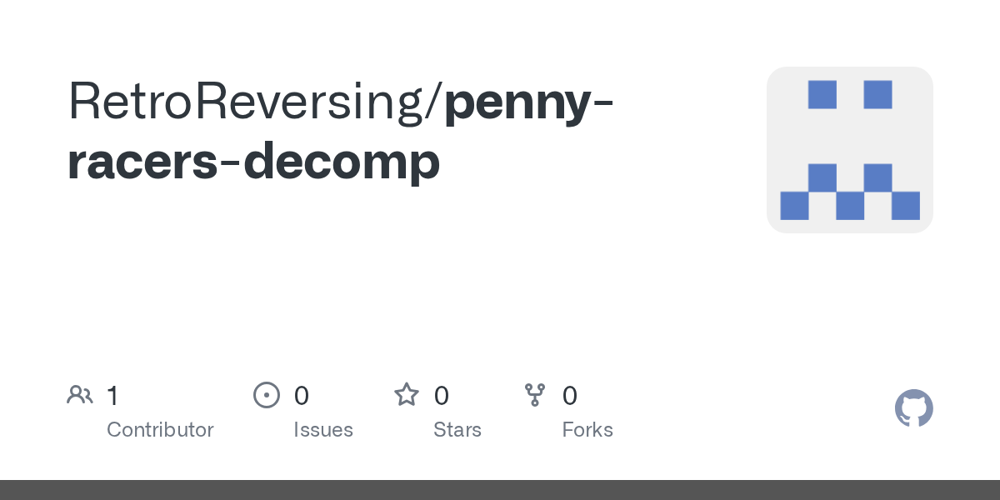</a> <a href="https://github.com/RetroReversing/penny-racers-decomp"><b>penny-racers-decomp</b></a> RetroReversing &#160;NINTENDO64</td><td width="500">ニンテンドウ64『Penny Racers』のマッチング逆コンパイルの公開進捗。AI エージェントは元のバイトを正確に再現する C だけを残す。  rea 使用: いいえ 画像の出典: リポジトリカード</td></tr>
</table>

#### リメイク / 移植

<table>
<tr><th width="220">ゲ&#8288;ー&#8288;ム&#8288;・&#8288;画&#8288;像&#8288;・&#8288;元&#8288;の&#8288;対&#8288;応&#8288;機&#8288;種</th><th width="500">概&#8288;要&#8288;・&#8288;実&#8288;行&#8288;条&#8288;件&#8288;・&#8288;画&#8288;像&#8288;の&#8288;出&#8288;典</th></tr>
<tr><td width="220"> <b>The Legend of Zelda: Majora’s Mask</b> <a href="https://github.com/Zelda64Recomp/Zelda64Recomp"><b>Zelda64Recomp</b></a> Zelda64Recomp &#160;NINTENDO64</td><td width="500">ムジュラの仮面を PC 向けに再コンパイル、現代的な操作に（ROM は各自）  rea 使用: いいえ 画像の出典: プロジェクト README</td></tr>
<tr><td width="220"> <b>The Legend of Zelda: Ocarina of Time</b> <a href="https://github.com/HarbourMasters/Shipwright"><b>Shipwright</b></a> HarbourMasters &#160;NINTENDO64</td><td width="500">ゼルダの伝説 時のオカリナを PC でネイティブに（ROM は各自）  rea 使用: いいえ 画像の出典: <a href="https://upload.wikimedia.org/wikipedia/en/5/57/The_Legend_of_Zelda_Ocarina_of_Time.jpg">Wikipedia（© 権利者）</a></td></tr>
<tr><td width="220"> <a href="https://github.com/2ship2harkinian/2ship2harkinian"><b>2ship2harkinian</b></a> 2ship2harkinian &#160;NINTENDO64</td><td width="500">ムジュラの仮面を PC でネイティブに（ROM は各自）  rea 使用: いいえ 画像の出典: <a href="https://upload.wikimedia.org/wikipedia/en/6/60/The_Legend_of_Zelda_-_Majora%27s_Mask_Box_Art.jpg">Wikipedia（© 権利者）</a></td></tr>
<tr><td width="220"> <a href="https://github.com/HarvestMoon64Recomp/HarvestMoon64Recomp"><b>HarvestMoon64Recomp</b></a> HarvestMoon64Recomp &#160;NINTENDO64</td><td width="500">現代PCで『牧場物語64』を遊べる：N64原作を静的再コンパイルしたネイティブ移植版。グラフィック強化とMOD対応。  rea 使用: いいえ 画像の出典: リポジトリカード</td></tr>
<tr><td width="220"><a href="https://github.com/TK22-26/JetForceGemini-Recomp">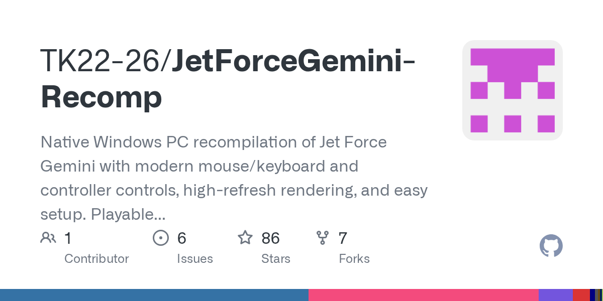</a> <a href="https://github.com/TK22-26/JetForceGemini-Recomp"><b>JetForceGemini-Recomp</b></a> TK22-26 &#160;NINTENDO64</td><td width="500">1999年のN64ゲーム『ジェットフォースジェミニ』のコードをWindowsでネイティブに動くプログラムに変換。自分のROMが必要。  rea 使用: いいえ 画像の出典: リポジトリカード</td></tr>
<tr><td width="220"> <a href="https://github.com/RetroPulse03/WinBackRecomp"><b>WinBackRecomp</b></a> RetroPulse03 &#160;NINTENDO64</td><td width="500">N64の『WinBack: Covert Operations』を静的リコンパイルで作ったネイティブPCポート。ROMは含まれません。  rea 使用: いいえ 画像の出典: リポジトリカード</td></tr>
</table>

#### アセット抽出・ツール

<table>
<tr><th width="220">ゲ&#8288;ー&#8288;ム&#8288;・&#8288;画&#8288;像&#8288;・&#8288;元&#8288;の&#8288;対&#8288;応&#8288;機&#8288;種</th><th width="500">概&#8288;要&#8288;・&#8288;実&#8288;行&#8288;条&#8288;件&#8288;・&#8288;画&#8288;像&#8288;の&#8288;出&#8288;典</th></tr>
<tr><td width="220"><a href="https://github.com/ethteck/splat">プレビューを表示できません · 元のプロジェクトへ</a> <a href="https://github.com/ethteck/splat"><b>splat</b></a> ethteck &#160;NINTENDO64</td><td width="500">N64・PS1 のバイナリを逆コンパイル用プロジェクトに分割  rea 使用: いいえ 画像の出典: <a href="https://github.com/ethteck/splat">リポジトリカード</a></td></tr>
<tr><td width="220"> <a href="https://github.com/NEstelami/ZAPD"><b>ZAPD</b></a> NEstelami &#160;NINTENDO64</td><td width="500">ゼルダ 64 のアセットを編集可能なソースへ変換  rea 使用: いいえ 画像の出典: プロジェクト README</td></tr>
</table>

### ゲームキューブ

#### 逆コンパイル / 再コンパイル

<table>
<tr><th width="220">ゲ&#8288;ー&#8288;ム&#8288;・&#8288;画&#8288;像&#8288;・&#8288;元&#8288;の&#8288;対&#8288;応&#8288;機&#8288;種</th><th width="500">概&#8288;要&#8288;・&#8288;実&#8288;行&#8288;条&#8288;件&#8288;・&#8288;画&#8288;像&#8288;の&#8288;出&#8288;典</th></tr>
<tr><td width="220"> <b>Super Smash Bros. Melee</b> <a href="https://github.com/doldecomp/melee"><b>melee</b></a> doldecomp &#160;ゲームキューブ</td><td width="500">大乱闘スマッシュブラザーズ DX を C へ逆コンパイル  rea 使用: いいえ 画像の出典: <a href="https://upload.wikimedia.org/wikipedia/en/7/75/Super_Smash_Bros_Melee_box_art.png">Wikipedia（© 権利者）</a></td></tr>
<tr><td width="220"> <b>The Legend of Zelda: Twilight Princess</b> <a href="https://github.com/zeldaret/tp"><b>tp</b></a> zeldaret &#160;ゲームキューブ</td><td width="500">ゼルダの伝説 トワイライトプリンセスを C++ へ逆コンパイル  rea 使用: いいえ 画像の出典: <a href="https://upload.wikimedia.org/wikipedia/en/0/0e/The_Legend_of_Zelda_Twilight_Princess_Game_Cover.jpg">Wikipedia（© 権利者）</a></td></tr>
<tr><td width="220"> <b>The Legend of Zelda: The Wind Waker</b> <a href="https://github.com/zeldaret/tww"><b>tww</b></a> zeldaret &#160;ゲームキューブ</td><td width="500">ゼルダの伝説 風のタクトを C へ逆コンパイル  rea 使用: いいえ 画像の出典: <a href="https://upload.wikimedia.org/wikipedia/en/7/79/The_Legend_of_Zelda_The_Wind_Waker.jpg">Wikipedia（© 権利者）</a></td></tr>
<tr><td width="220"> <a href="https://github.com/projectPiki/pikmin2"><b>pikmin2</b></a> projectPiki &#160;ゲームキューブ</td><td width="500">ピクミン 2 を C++ へ逆コンパイル  rea 使用: いいえ 画像の出典: <a href="https://upload.wikimedia.org/wikipedia/en/3/38/Pikmin_2_Case.jpg">Wikipedia（© 権利者）</a></td></tr>
<tr><td width="220"> <a href="https://github.com/doldecomp/sms"><b>sms</b></a> doldecomp &#160;ゲームキューブ</td><td width="500">スーパーマリオサンシャインを C++ へ逆コンパイル  rea 使用: いいえ 画像の出典: <a href="https://upload.wikimedia.org/wikipedia/en/0/05/Super_Mario_Sunshine_Box_Art.png">Wikipedia（© 権利者）</a></td></tr>
<tr><td width="220">— <a href="https://github.com/karamzov123/fzero-gx-decomp"><b>fzero-gx-decomp</b></a> karamzov123 &#160;ゲームキューブ</td><td width="500">ゲームキューブのレーサー『F-Zero GX』（北米版）のマッチングデコンパイル。元のバイナリをバイト単位で再現  rea 使用: いいえ 画像の出典: —</td></tr>
<tr><td width="220"> <a href="https://github.com/octavioCuatrochio/nfsu2-gcpc"><b>nfsu2-gcpc</b></a> octavioCuatrochio &#160;ゲームキューブ</td><td width="500">『ニード・フォー・スピード アンダーグラウンド2』を関数単位で書き換え、元のPC版の動作と一致させます。ゲームキューブ版のデバッグシンボルで名前と型を取得し、プロキシDLLで元のゲーム内で動作します。  rea 使用: いいえ 画像の出典: リポジトリカード</td></tr>
<tr><td width="220"> <a href="https://github.com/dev-camo/shadow-decomp"><b>shadow-decomp</b></a> dev-camo &#160;ゲームキューブ</td><td width="500">クローズドソースのゲームキューブゲーム『シャドウ・ザ・ヘッジホッグ』のマッチング逆コンパイル進行中プロジェクト。自分のゲームコピーが必要。  rea 使用: いいえ 画像の出典: リポジトリカード</td></tr>
</table>

#### リメイク / 移植

<table>
<tr><th width="220">ゲ&#8288;ー&#8288;ム&#8288;・&#8288;画&#8288;像&#8288;・&#8288;元&#8288;の&#8288;対&#8288;応&#8288;機&#8288;種</th><th width="500">概&#8288;要&#8288;・&#8288;実&#8288;行&#8288;条&#8288;件&#8288;・&#8288;画&#8288;像&#8288;の&#8288;出&#8288;典</th></tr>
<tr><td width="220">— <a href="https://github.com/Odrannnn/MetroidPrimePort"><b>MetroidPrimePort</b></a> Odrannnn &#160;ゲームキューブ</td><td width="500">非公開ソースのゲームキューブ版『メトロイドプライム』をマッチングデコンパイルからネイティブ移植。エミュなしで動作し、リマスター版モデルも読み込めます。  rea 使用: いいえ 画像の出典: —</td></tr>
<tr><td width="220">— <a href="https://github.com/Odrannnn/MetroidPrime2Port"><b>MetroidPrime2Port</b></a> Odrannnn &#160;ゲームキューブ</td><td width="500">非公開ソースのゲームキューブ版『メトロイドプライム2 エコーズ』をデコンパイルからネイティブ移植したもの。エミュレータなしでPCやAndroidなどで遊べます。  rea 使用: いいえ 画像の出典: —</td></tr>
<tr><td width="220"> <a href="https://github.com/Hero88go/melee-unlocked"><b>melee-unlocked</b></a> Hero88go &#160;ゲームキューブ</td><td width="500">Super Smash Bros. Melee のデコンパイルソースからネイティブ Windows ビルドを作り、フレームレートを解除。  rea 使用: いいえ 画像の出典: リポジトリカード</td></tr>
<tr><td width="220">— <a href="https://github.com/Trick230/DualizeRecomp"><b>DualizeRecomp</b></a> Trick230 &#160;ゲームキューブ</td><td width="500">Wii ゲーム『NiGHTS: Journey of Dreams』を静的再コンパイルでネイティブ PC プログラムに  rea 使用: いいえ 画像の出典: —</td></tr>
</table>

#### アセット抽出・ツール

<table>
<tr><th width="220">ゲ&#8288;ー&#8288;ム&#8288;・&#8288;画&#8288;像&#8288;・&#8288;元&#8288;の&#8288;対&#8288;応&#8288;機&#8288;種</th><th width="500">概&#8288;要&#8288;・&#8288;実&#8288;行&#8288;条&#8288;件&#8288;・&#8288;画&#8288;像&#8288;の&#8288;出&#8288;典</th></tr>
<tr><td width="220"> <a href="https://github.com/encounter/objdiff"><b>objdiff</b></a> encounter &#160;ゲームキューブ</td><td width="500">逆コンパイルした関数のどこが違うか一目で分かる  rea 使用: いいえ 画像の出典: プロジェクト README</td></tr>
<tr><td width="220"> <a href="https://github.com/encounter/decomp-toolkit"><b>decomp-toolkit</b></a> encounter &#160;ゲームキューブ</td><td width="500">多くの GameCube・Wii 逆コンパイルを支えるツールキット  rea 使用: いいえ 画像の出典: リポジトリカード</td></tr>
</table>

### Wii

#### 逆コンパイル / 再コンパイル

<table>
<tr><th width="220">ゲ&#8288;ー&#8288;ム&#8288;・&#8288;画&#8288;像&#8288;・&#8288;元&#8288;の&#8288;対&#8288;応&#8288;機&#8288;種</th><th width="500">概&#8288;要&#8288;・&#8288;実&#8288;行&#8288;条&#8288;件&#8288;・&#8288;画&#8288;像&#8288;の&#8288;出&#8288;典</th></tr>
<tr><td width="220"> <a href="https://github.com/zeldaret/ss"><b>ss</b></a> zeldaret &#160;Wii</td><td width="500">ゼルダの伝説 スカイウォードソードを C へ逆コンパイル  rea 使用: いいえ 画像の出典: <a href="https://upload.wikimedia.org/wikipedia/en/9/99/Legend_of_Zelda_Skyward_Sword_boxart.png">Wikipedia（© 権利者）</a></td></tr>
<tr><td width="220"> <a href="https://github.com/DarkRTA/rb3"><b>rb3</b></a> DarkRTA &#160;Wii</td><td width="500">ロックバンド 3（Wii）を C++ へ逆コンパイル  rea 使用: いいえ 画像の出典: <a href="https://upload.wikimedia.org/wikipedia/en/3/3b/Rock_Band_3_Game_Cover.jpg">Wikipedia（© 権利者）</a></td></tr>
<tr><td width="220">— <a href="https://github.com/frootloops-1/SlopSportsResort"><b>SlopSportsResort</b></a> frootloops-1 &#160;Wii</td><td width="500">クローズドソースの『Wii Sports Resort』をAI支援で逆コンパイルし、コードを再構築しようとするプロジェクト。  rea 使用: いいえ 画像の出典: —</td></tr>
</table>

#### リメイク / 移植

<table>
<tr><th width="220">ゲ&#8288;ー&#8288;ム&#8288;・&#8288;画&#8288;像&#8288;・&#8288;元&#8288;の&#8288;対&#8288;応&#8288;機&#8288;種</th><th width="500">概&#8288;要&#8288;・&#8288;実&#8288;行&#8288;条&#8288;件&#8288;・&#8288;画&#8288;像&#8288;の&#8288;出&#8288;典</th></tr>
<tr><td width="220">— <a href="https://github.com/josiahg2502-glitch/BrawlRecompiled"><b>BrawlRecompiled</b></a> josiahg2502-glitch &#160;Wii</td><td width="500">2008年のWiiゲーム『大乱闘スマッシュブラザーズX』のPowerPCコードを事前翻訳して、4K・高フレームレート・MOD対応のネイティブPC版にした。自分のディスクが必要。  rea 使用: いいえ 画像の出典: —</td></tr>
</table>

### ニンテンドーDS

#### 逆コンパイル / 再コンパイル

<table>
<tr><th width="220">ゲ&#8288;ー&#8288;ム&#8288;・&#8288;画&#8288;像&#8288;・&#8288;元&#8288;の&#8288;対&#8288;応&#8288;機&#8288;種</th><th width="500">概&#8288;要&#8288;・&#8288;実&#8288;行&#8288;条&#8288;件&#8288;・&#8288;画&#8288;像&#8288;の&#8288;出&#8288;典</th></tr>
<tr><td width="220"> <a href="https://github.com/pret/pokeheartgold"><b>pokeheartgold</b></a> pret &#160;ニンテンドーDS</td><td width="500">ポケモン ハートゴールド・ソウルシルバーを C へ逆コンパイル  rea 使用: いいえ 画像の出典: <a href="https://upload.wikimedia.org/wikipedia/en/c/cb/PokemonHGSSBox.jpg">Wikipedia（© 権利者）</a></td></tr>
<tr><td width="220"> <a href="https://github.com/pret/pokeplatinum"><b>pokeplatinum</b></a> pret &#160;ニンテンドーDS</td><td width="500">ポケモン プラチナの C ソース  rea 使用: いいえ 画像の出典: メンテナー投稿</td></tr>
<tr><td width="220"> <a href="https://github.com/tangosdev/sm64ds-decomp"><b>sm64ds-decomp</b></a> tangosdev &#160;ニンテンドーDS</td><td width="500">『スーパーマリオ64 DS』をゼロからバイト単位で一致させる逆コンパイルプロジェクト。元のDS版を読みやすいC/C++ソースに復元。  rea 使用: いいえ 画像の出典: リポジトリカード</td></tr>
<tr><td width="220"> <a href="https://github.com/zeldaret/ph"><b>ph</b></a> zeldaret &#160;ニンテンドーDS</td><td width="500">ゼルダの伝説 夢幻の砂時計を C へ逆コンパイル  rea 使用: いいえ 画像の出典: <a href="https://upload.wikimedia.org/wikipedia/en/5/5e/The_Legend_of_Zelda_Phantom_Hourglass_Game_Cover.jpg">Wikipedia（© 権利者）</a></td></tr>
<tr><td width="220">— <a href="https://github.com/fuddlesworth/pokebw2"><b>pokebw2</b></a> fuddlesworth &#160;ニンテンドーDS</td><td width="500">クローズドソースのニンテンドーDSゲーム『ポケットモンスター ブラック2 / ホワイト2』のデコンパイルプロジェクト。ソースを復元して理解と保存を進める。  rea 使用: いいえ 画像の出典: —</td></tr>
</table>

### ニンテンドー3DS

#### アセット抽出・ツール

<table>
<tr><th width="220">ゲ&#8288;ー&#8288;ム&#8288;・&#8288;画&#8288;像&#8288;・&#8288;元&#8288;の&#8288;対&#8288;応&#8288;機&#8288;種</th><th width="500">概&#8288;要&#8288;・&#8288;実&#8288;行&#8288;条&#8288;件&#8288;・&#8288;画&#8288;像&#8288;の&#8288;出&#8288;典</th></tr>
<tr><td width="220"> <a href="https://github.com/3DSGuy/Project_CTR"><b>Project_CTR</b></a> 3DSGuy &#160;ニンテンドー3DS</td><td width="500">3DS のファイル形式を作成・解析（ctrtool / makerom）  rea 使用: いいえ 画像の出典: リポジトリカード</td></tr>
</table>

### PlayStation

#### 逆コンパイル / 再コンパイル

<table>
<tr><th width="220">ゲ&#8288;ー&#8288;ム&#8288;・&#8288;画&#8288;像&#8288;・&#8288;元&#8288;の&#8288;対&#8288;応&#8288;機&#8288;種</th><th width="500">概&#8288;要&#8288;・&#8288;実&#8288;行&#8288;条&#8288;件&#8288;・&#8288;画&#8288;像&#8288;の&#8288;出&#8288;典</th></tr>
<tr><td width="220"> <a href="https://github.com/Xeeynamo/sotn-decomp"><b>sotn-decomp</b></a> Xeeynamo &#160;PlayStation</td><td width="500">悪魔城ドラキュラX 月下の夜想曲を C へ逆コンパイル  rea 使用: いいえ 画像の出典: メンテナー投稿</td></tr>
<tr><td width="220"> <a href="https://github.com/shdecompilations/silent-hill-decomp"><b>silent-hill-decomp</b></a> shdecompilations &#160;PlayStation</td><td width="500">サイレントヒル（PS1）を C へ逆コンパイル中  rea 使用: いいえ 画像の出典: <a href="https://upload.wikimedia.org/wikipedia/en/9/96/Silent_Hill_video_game_cover.png">Wikipedia（© 権利者）</a></td></tr>
<tr><td width="220"> <a href="https://github.com/SlickAmogus/silent-hill-decomp"><b>silent-hill-decomp</b></a> SlickAmogus &#160;PlayStation</td><td width="500">オリジナルの『サイレントヒル1』（PS1版）を逆コンパイルして作った、現代のPCで遊べるオープンソース移植版。  rea 使用: いいえ 画像の出典: リポジトリカード</td></tr>
<tr><td width="220">— <a href="https://github.com/TekRantGaming/muppet-racemania-recompiled"><b>muppet-racemania-recompiled</b></a> TekRantGaming &#160;PlayStation</td><td width="500">クローズドソースの『Muppet RaceMania』（PlayStation）を静的再コンパイルして作った PC ネイティブ版。16:9 と 60fps 対応。  rea 使用: いいえ 画像の出典: —</td></tr>
<tr><td width="220"> <a href="https://github.com/raulcorreia7/bof3-decomp"><b>bof3-decomp</b></a> raulcorreia7 &#160;PlayStation</td><td width="500">クローズドソースのプレイステーションゲーム『ブレス オブ ファイアIII』（北米版）のマッチング逆コンパイル。  rea 使用: いいえ 画像の出典: リポジトリカード</td></tr>
<tr><td width="220"><a href="https://github.com/cdlewis/snowboardkidsplus-decomp">プレビューを表示できません · 元のプロジェクトへ</a> <a href="https://github.com/cdlewis/snowboardkidsplus-decomp"><b>snowboardkidsplus-decomp</b></a> cdlewis &#160;PlayStation</td><td width="500">クローズドソースのプレイステーションゲーム『スノーボードキッズプラス』のマッチング逆コンパイル。  rea 使用: いいえ 画像の出典: <a href="https://github.com/cdlewis/snowboardkidsplus-decomp">リポジトリカード</a></td></tr>
</table>

#### リメイク / 移植

<table>
<tr><th width="220">ゲ&#8288;ー&#8288;ム&#8288;・&#8288;画&#8288;像&#8288;・&#8288;元&#8288;の&#8288;対&#8288;応&#8288;機&#8288;種</th><th width="500">概&#8288;要&#8288;・&#8288;実&#8288;行&#8288;条&#8288;件&#8288;・&#8288;画&#8288;像&#8288;の&#8288;出&#8288;典</th></tr>
<tr><td width="220">— <a href="https://github.com/AndrewAltimit/legend-of-legaia-re"><b>legend-of-legaia-re</b></a> AndrewAltimit &#160;PlayStation</td><td width="500">Ghidra で逆解析したフォーマットとロジックに基づき、1999年のクローズドソース PS1 ゲーム『レジェンド・オブ・レガイア』を Rust でゼロから再実装したプロジェクト。自分のディスクイメージが必要。  rea 使用: いいえ 画像の出典: —</td></tr>
</table>

### PlayStation 2

#### 逆コンパイル / 再コンパイル

<table>
<tr><th width="220">ゲ&#8288;ー&#8288;ム&#8288;・&#8288;画&#8288;像&#8288;・&#8288;元&#8288;の&#8288;対&#8288;応&#8288;機&#8288;種</th><th width="500">概&#8288;要&#8288;・&#8288;実&#8288;行&#8288;条&#8288;件&#8288;・&#8288;画&#8288;像&#8288;の&#8288;出&#8288;典</th></tr>
<tr><td width="220"> <a href="https://github.com/ran-j/PS2Recomp"><b>PS2Recomp</b></a> ran-j &#160;PlayStation 2</td><td width="500">PS2 ゲームをネイティブ PC 実行ファイルへ再コンパイル  rea 使用: いいえ 画像の出典: リポジトリカード</td></tr>
<tr><td width="220"> <b>Jak and Daxter / Jak II</b> <a href="https://github.com/open-goal/jak-project"><b>jak-project</b></a> open-goal &#160;PlayStation 2</td><td width="500">ジャック×ダクスターを PC でネイティブに（ディスクは各自）  rea 使用: いいえ 画像の出典: プロジェクト README</td></tr>
<tr><td width="220"> <a href="https://github.com/OpenRAC/rac1-decomp"><b>rac1-decomp</b></a> OpenRAC &#160;PlayStation 2</td><td width="500">オリジナルPS2『ラチェット＆クランク』のマッチングデコンパイル：小売版実行ファイルをバイト単位で再現するC/C++ソース。  rea 使用: いいえ 画像の出典: リポジトリカード</td></tr>
<tr><td width="220">— <a href="https://github.com/Yaz-Myst/ZOE-Recompiled"><b>ZOE-Recompiled</b></a> Yaz-Myst &#160;PlayStation 2</td><td width="500">クローズドソースの『ゾーン・オブ・エンダーズ』（PS2）を静的再コンパイルして Windows でネイティブに動くようにしたもの。自分のディスクが必要。  rea 使用: いいえ 画像の出典: —</td></tr>
<tr><td width="220"> <a href="https://github.com/TheRealestNwah/sotc-decomp"><b>sotc-decomp</b></a> TheRealestNwah &#160;PlayStation 2</td><td width="500">『ワンダと巨像』（PS2版）のマッチング逆コンパイル。オリジナルのゲームコードを復元し、ネイティブPC移植を目指す。  rea 使用: いいえ 画像の出典: リポジトリカード</td></tr>
<tr><td width="220">— <a href="https://github.com/OpenRAC/rac2-decomp"><b>rac2-decomp</b></a> OpenRAC &#160;PlayStation 2</td><td width="500">クローズドソースの PlayStation 2 ゲーム『Ratchet &amp; Clank: Going Commando』（USA v1.01）のバイト単位一致再構築ツールとマッチングデコンパイル研究。ゲームアセットなし。  rea 使用: いいえ 画像の出典: —</td></tr>
<tr><td width="220"><a href="https://github.com/Destinity13/TimeSplitters-2-Native-Linux-Recomp">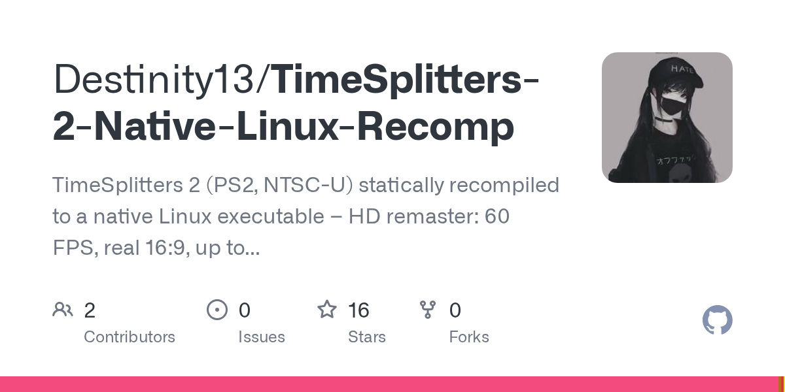</a> <a href="https://github.com/Destinity13/TimeSplitters-2-Native-Linux-Recomp"><b>TimeSplitters-2-Native-Linux-Recomp</b></a> Destinity13 &#160;PlayStation 2</td><td width="500">オリジナルの PlayStation 2『TimeSplitters 2』を、自分のディスクを使って Linux と Steam Deck で 60fps・本物のワイドスクリーンで動くネイティブゲームに変える。  rea 使用: いいえ 画像の出典: リポジトリカード</td></tr>
<tr><td width="220"><a href="https://github.com/C-GBL/P3FES-Decompilation">プレビューを表示できません · 元のプロジェクトへ</a> <a href="https://github.com/C-GBL/P3FES-Decompilation"><b>P3FES-Decompilation</b></a> C-GBL &#160;PlayStation 2</td><td width="500">クローズドソースの『ペルソナ3 FES』（PS2）を静的再コンパイルして C++ にし、Windows でネイティブに動くようにしたもの。自分のコピーが必要。  rea 使用: いいえ 画像の出典: <a href="https://github.com/C-GBL/P3FES-Decompilation">プロジェクト README</a></td></tr>
<tr><td width="220"> <a href="https://github.com/TekRantGaming/cartoon-network-racing-recompiled"><b>cartoon-network-racing-recompiled</b></a> TekRantGaming &#160;PlayStation 2</td><td width="500">クローズドソースの『Cartoon Network Racing』（PS2）を静的再コンパイルして作った PC ネイティブ版。ワイドスクリーンと高フレームレート対応。自分のディスクが必要。  rea 使用: いいえ 画像の出典: プロジェクト README</td></tr>
<tr><td width="220">— <a href="https://github.com/OpenRAC/rac5-sm-decomp"><b>rac5-sm-decomp</b></a> OpenRAC &#160;PlayStation 2</td><td width="500">PS2 ゲーム『ラチェット＆クランク サイズ・マターズ』のマッチング逆コンパイル。元のバイナリを生成できる可読 C コードの復元を目指す。  rea 使用: いいえ 画像の出典: —</td></tr>
<tr><td width="220">— <a href="https://github.com/Megami-Decomps/smt3-decomp"><b>smt3-decomp</b></a> Megami-Decomps &#160;PlayStation 2</td><td width="500">PS2 RPG『真・女神転生III NOCTURNE』のマッチング逆コンパイルプロジェクト。元に近い C コードの復元を行う。  rea 使用: いいえ 画像の出典: —</td></tr>
<tr><td width="220">— <a href="https://github.com/andrewnakas/thug-decomp"><b>thug-decomp</b></a> andrewnakas &#160;PlayStation 2</td><td width="500">PlayStation 2のゲーム『トニー・ホークス アンダーグラウンド』のマッチングデコンパイル。元のC++ソースを関数ごとに復元し、小売版とバイト単位で一致する。  rea 使用: いいえ 画像の出典: —</td></tr>
<tr><td width="220"> <a href="https://github.com/WeAreTommyBruh/Legaia2-Decomp"><b>Legaia2-Decomp</b></a> WeAreTommyBruh &#160;PlayStation 2</td><td width="500">クローズドソースの PlayStation 2 ゲーム『Legaia 2: Duel Saga』を可読な C にデコンパイルし、元の実行ファイルをバイト単位で一致させて再構築することを目指すプロジェクト。  rea 使用: いいえ 画像の出典: プロジェクト README</td></tr>
<tr><td width="220"> <a href="https://github.com/Megami-Decomps/raidou-decomp"><b>raidou-decomp</b></a> Megami-Decomps &#160;PlayStation 2</td><td width="500">『真・女神転生 デビルサマナー 葛葉ライドウ』1と2（PS2）の閉ソースを、元のバイナリと完全一致するCコードに再構築するマッチング逆コンパイル。  rea 使用: いいえ 画像の出典: リポジトリカード</td></tr>
</table>

#### リメイク / 移植

<table>
<tr><th width="220">ゲ&#8288;ー&#8288;ム&#8288;・&#8288;画&#8288;像&#8288;・&#8288;元&#8288;の&#8288;対&#8288;応&#8288;機&#8288;種</th><th width="500">概&#8288;要&#8288;・&#8288;実&#8288;行&#8288;条&#8288;件&#8288;・&#8288;画&#8288;像&#8288;の&#8288;出&#8288;典</th></tr>
<tr><td width="220">— <a href="https://github.com/gothamor/gta-vcs-recomp"><b>gta-vcs-recomp</b></a> gothamor &#160;PlayStation 2</td><td width="500">元の PS2 ゲーム『グランド・セフト・オート：バイスシティ・ストーリーズ』の実行ファイルを再コンパイルして、ネイティブの Windows / Linux 版を作ります。ディスクイメージは自分で用意。  rea 使用: いいえ 画像の出典: —</td></tr>
<tr><td width="220">— <a href="https://github.com/AsobiCodes/rac-rs"><b>rac-rs</b></a> AsobiCodes &#160;PlayStation 2</td><td width="500">2002年のPS2ゲーム『ラチェット＆クランク』のコードを事前に翻訳して、エミュレーターなしで動くネイティブPC版にした。自分のディスクが必要。  rea 使用: いいえ 画像の出典: —</td></tr>
<tr><td width="220"> <a href="https://github.com/thiagordsfx/urban-reign-recomp"><b>urban-reign-recomp</b></a> thiagordsfx &#160;PlayStation 2</td><td width="500">PS2の格闘ゲーム『Urban Reign』を静的リコンパイルしてネイティブPC移植版に。60FPS・高解像度・HDテクスチャ対応。  rea 使用: いいえ 画像の出典: リポジトリカード</td></tr>
<tr><td width="220"> <a href="https://github.com/TheBozos/VP2S_Recomp"><b>VP2S_Recomp</b></a> TheBozos &#160;PlayStation 2</td><td width="500">クローズドソースのプレイステーション2ゲーム『ヴァルキリープロファイル2 シルメリア』を静的再コンパイルでネイティブPC移植。自分のディスクが必要、ゲームファイルは含まず。  rea 使用: いいえ 画像の出典: リポジトリカード</td></tr>
<tr><td width="220">— <a href="https://github.com/Renzo-MGRR/Tenkaichi3Decomp"><b>Tenkaichi3Decomp</b></a> Renzo-MGRR &#160;PlayStation 2</td><td width="500">既存の逆コンパイル成果を基に、クローズドソースの『ドラゴンボールZ 武道会3』をPS3に移植したプロジェクト。  rea 使用: いいえ 画像の出典: —</td></tr>
<tr><td width="220">— <a href="https://github.com/TheBozos/ChampionsOfNorrath_Recomp"><b>ChampionsOfNorrath_Recomp</b></a> TheBozos &#160;PlayStation 2</td><td width="500">PS2 アクション RPG『Champions of Norrath』を静的再コンパイルして PC でネイティブに動かせるコードにする（自分のディスクが必要）。  rea 使用: いいえ 画像の出典: —</td></tr>
<tr><td width="220">— <a href="https://github.com/Ptraaah/godhand-recompiled-android"><b>godhand-recompiled-android</b></a> Ptraaah &#160;PlayStation 2</td><td width="500">PS2 のベルトスクロールアクション『God Hand』を静的再コンパイルして Android スマホでネイティブに動かせる無料プロジェクト（自分のコピーが必要）。  rea 使用: いいえ 画像の出典: —</td></tr>
</table>

### Xbox / Xbox 360

#### 逆コンパイル / 再コンパイル

<table>
<tr><th width="220">ゲ&#8288;ー&#8288;ム&#8288;・&#8288;画&#8288;像&#8288;・&#8288;元&#8288;の&#8288;対&#8288;応&#8288;機&#8288;種</th><th width="500">概&#8288;要&#8288;・&#8288;実&#8288;行&#8288;条&#8288;件&#8288;・&#8288;画&#8288;像&#8288;の&#8288;出&#8288;典</th></tr>
<tr><td width="220"> <a href="https://github.com/hedge-dev/XenonRecomp"><b>XenonRecomp</b></a> hedge-dev &#160;Xbox / Xbox 360</td><td width="500">Xbox 360 ゲームをネイティブ C++ へ再コンパイル  rea 使用: いいえ 画像の出典: リポジトリカード</td></tr>
<tr><td width="220">— <a href="https://github.com/RenanQueiroz/mcla-recomp"><b>mcla-recomp</b></a> RenanQueiroz &#160;Xbox / Xbox 360</td><td width="500">静的再コンパイルで Xbox 360 の『ミッドナイトクラブ：ロサンゼルス』コンプリートエディションを、PC（と PS5）で直接動くネイティブ版にする。自分のディスクイメージからビルドします。  rea 使用: いいえ 画像の出典: —</td></tr>
<tr><td width="220"><a href="https://github.com/phobos665/split2-recomp">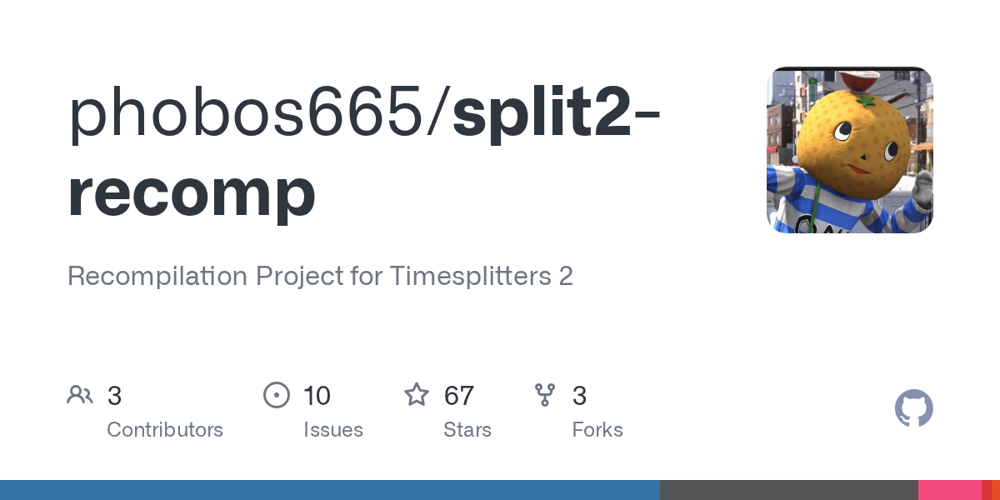</a> <a href="https://github.com/phobos665/split2-recomp"><b>split2-recomp</b></a> phobos665 &#160;Xbox / Xbox 360</td><td width="500">オリジナルの Xbox『TimeSplitters 2』を、自分のディスクから Windows・Mac・Linux 向けのネイティブプログラムに再コンパイルする。  rea 使用: いいえ 画像の出典: リポジトリカード</td></tr>
<tr><td width="220"> <a href="https://github.com/cdetv/conker-live-recompiled"><b>conker-live-recompiled</b></a> cdetv &#160;Xbox / Xbox 360</td><td width="500">クローズドソースの『コンカー：ライブ＆リローデッド』（初代 Xbox）を静的再コンパイルして、Windows でネイティブに動くようにしたもの。  rea 使用: いいえ 画像の出典: プロジェクト README</td></tr>
<tr><td width="220">— <a href="https://github.com/comoria08/defjam_recomp"><b>defjam_recomp</b></a> comoria08 &#160;Xbox / Xbox 360</td><td width="500">静的再コンパイルで初代 Xbox の『Def Jam: Fight for NY』を、Windows で直接動くネイティブ版にする。自分のディスクからビルドします。  rea 使用: いいえ 画像の出典: —</td></tr>
<tr><td width="220">— <a href="https://github.com/jkoehler11/stargate-alliance-decomp"><b>stargate-alliance-decomp</b></a> jkoehler11 &#160;Xbox / Xbox 360</td><td width="500">クローズドソースの 2005 年 Xbox プロトタイプ『Stargate SG-1: The Alliance』のデコンパイル。UnrealScript、ネイティブシンボルマップ、起動可能な再構築を含む。ゲームデータなし。  rea 使用: いいえ 画像の出典: —</td></tr>
<tr><td width="220">— <a href="https://github.com/NextrixVFX/Hydro-Recomp"><b>Hydro-Recomp</b></a> NextrixVFX &#160;Xbox / Xbox 360</td><td width="500">Xbox 360 のボートレースゲーム『Hydro Thunder Hurricane』の進行中マッチング逆コンパイル（C++ で記述）。  rea 使用: いいえ 画像の出典: —</td></tr>
</table>

#### リメイク / 移植

<table>
<tr><th width="220">ゲ&#8288;ー&#8288;ム&#8288;・&#8288;画&#8288;像&#8288;・&#8288;元&#8288;の&#8288;対&#8288;応&#8288;機&#8288;種</th><th width="500">概&#8288;要&#8288;・&#8288;実&#8288;行&#8288;条&#8288;件&#8288;・&#8288;画&#8288;像&#8288;の&#8288;出&#8288;典</th></tr>
<tr><td width="220"> <a href="https://github.com/hedge-dev/UnleashedRecomp"><b>UnleashedRecomp</b></a> hedge-dev &#160;Xbox / Xbox 360</td><td width="500">ソニック ワールドアドベンチャーを PC でネイティブに（製品は各自）  rea 使用: いいえ 画像の出典: <a href="https://upload.wikimedia.org/wikipedia/en/a/a0/Sonic_unleashed_boxart.jpg">Wikipedia（© 権利者）</a></td></tr>
<tr><td width="220">— <a href="https://github.com/Shagg88/COGBox"><b>COGBox</b></a> Shagg88 &#160;Xbox / Xbox 360</td><td width="500">Xbox 360 版『Gears of War 2』『3』『Judgment』を静的再コンパイルして Windows PC でネイティブに動かせる無料オープンソースプロジェクト（自分の正規版が必要）。  rea 使用: いいえ 画像の出典: —</td></tr>
<tr><td width="220">— <a href="https://github.com/NoRain211/doaxvb-re"><b>doaxvb-re</b></a> NoRain211 &#160;Xbox / Xbox 360</td><td width="500">Xboxの『Dead or Alive Xtreme Beach Volleyball』を静的再コンパイルでネイティブPC版にしたポート。自分のディスクが必要。  rea 使用: いいえ 画像の出典: —</td></tr>
<tr><td width="220">— <a href="https://github.com/i2kiselev/fm4-static-recomp"><b>fm4-static-recomp</b></a> i2kiselev &#160;Xbox / Xbox 360</td><td width="500">Xbox 360のレーシングゲーム『Forza Motorsport 4』を高フレームレート・DLSS/FSR・最大4K対応のネイティブWindows版にした。自分のディスクが必要。  rea 使用: いいえ 画像の出典: —</td></tr>
<tr><td width="220"> <a href="https://github.com/YuutaTsubasa/Free-Riders-Recompiled"><b>Free-Riders-Recompiled</b></a> YuutaTsubasa &#160;Xbox / Xbox 360</td><td width="500">Xbox 360の『ソニック・フリーライダーズ』を静的再コンパイルしてWindows・Linux・Androidでネイティブに動くようにした非公式移植。自分のゲームディスクが必要です。  rea 使用: いいえ 画像の出典: リポジトリカード</td></tr>
<tr><td width="220"> <a href="https://github.com/hk21x/pgr2-recomp"><b>pgr2-recomp</b></a> hk21x &#160;Xbox / Xbox 360</td><td width="500">オリジナルXboxの『プロジェクトゴッサムレーシング2』を静的リコンパイルして作ったネイティブPC版。自分のディスクが必要。  rea 使用: いいえ 画像の出典: プロジェクト README</td></tr>
<tr><td width="220">— <a href="https://github.com/MysteriousAeon/rayman3-hd-recompiled"><b>rayman3-hd-recompiled</b></a> MysteriousAeon &#160;Xbox / Xbox 360</td><td width="500">クローズドソースの Xbox 360『レイマン3 HD』を静的再コンパイルして Windows でネイティブに動くプログラムにしたもの。自分のゲームパッケージが必要。  rea 使用: いいえ 画像の出典: —</td></tr>
<tr><td width="220">— <a href="https://github.com/ElKev118/ghostrecon2-recomp"><b>ghostrecon2-recomp</b></a> ElKev118 &#160;Xbox / Xbox 360</td><td width="500">非公開ソースの初代Xbox版『ゴーストリコン2』を静的リコンパイルしてネイティブWindows移植。Vulkanレンダラーで動作。  rea 使用: いいえ 画像の出典: —</td></tr>
<tr><td width="220">— <a href="https://github.com/itsbybanshee/wwe2k14-pc"><b>wwe2k14-pc</b></a> itsbybanshee &#160;Xbox / Xbox 360</td><td width="500">Xbox 360のレスリングゲーム『WWE 2K14』をランチャー付きのネイティブPC版に。MOD対応、高解像度、現代的な操作。自分のゲームファイルが必要。  rea 使用: いいえ 画像の出典: —</td></tr>
<tr><td width="220">— <a href="https://github.com/MrPowerUp82/superman_returns_recomp"><b>superman_returns_recomp</b></a> MrPowerUp82 &#160;Xbox / Xbox 360</td><td width="500">ReXGlue を使ってクローズドソースの Xbox 360 ゲーム『Superman Returns』をネイティブ PC に実験的に静的再コンパイル。ゲームファイルは含まれず自分で用意。  rea 使用: いいえ 画像の出典: —</td></tr>
<tr><td width="220">— <a href="https://github.com/sp00nznet/saintsrow"><b>saintsrow</b></a> sp00nznet &#160;Xbox / Xbox 360</td><td width="500">2006年のクローズドソース Xbox 360 ゲーム『セインツロウ』の PowerPC コードをネイティブ x86-64 C++ に静的再コンパイルし、エミュレータなしで現代の Windows 上で動かすプロジェクト。自分のゲームファイルが必要。  rea 使用: いいえ 画像の出典: —</td></tr>
<tr><td width="220">— <a href="https://github.com/ElKev118/summitstrike-recomp"><b>summitstrike-recomp</b></a> ElKev118 &#160;Xbox / Xbox 360</td><td width="500">非公開ソースのXbox拡張『ゴーストリコン2：サミットストライク』を静的リコンパイルしたネイティブWindows移植。  rea 使用: いいえ 画像の出典: —</td></tr>
<tr><td width="220">— <a href="https://github.com/Minuteworld94/Dawn-of-the-dragon-recomp"><b>Dawn-of-the-dragon-recomp</b></a> Minuteworld94 &#160;Xbox / Xbox 360</td><td width="500">クローズドソースの『スパイロ：ドーン・オブ・ザ・ドラゴン』（Xbox 360）を自分のディスクでWindowsネイティブに  rea 使用: いいえ 画像の出典: —</td></tr>
</table>

#### アセット抽出・ツール

<table>
<tr><th width="220">ゲ&#8288;ー&#8288;ム&#8288;・&#8288;画&#8288;像&#8288;・&#8288;元&#8288;の&#8288;対&#8288;応&#8288;機&#8288;種</th><th width="500">概&#8288;要&#8288;・&#8288;実&#8288;行&#8288;条&#8288;件&#8288;・&#8288;画&#8288;像&#8288;の&#8288;出&#8288;典</th></tr>
<tr><td width="220"> <a href="https://github.com/xemu-project/xemu"><b>xemu</b></a> xemu-project &#160;Xbox / Xbox 360</td><td width="500">初代 Xbox のゲームを Windows・macOS・Linux で  rea 使用: いいえ 画像の出典: メンテナー投稿</td></tr>
</table>

### PC / DOS / PC-98

#### 逆コンパイル / 再コンパイル

<table>
<tr><th width="220">ゲ&#8288;ー&#8288;ム&#8288;・&#8288;画&#8288;像&#8288;・&#8288;元&#8288;の&#8288;対&#8288;応&#8288;機&#8288;種</th><th width="500">概&#8288;要&#8288;・&#8288;実&#8288;行&#8288;条&#8288;件&#8288;・&#8288;画&#8288;像&#8288;の&#8288;出&#8288;典</th></tr>
<tr><td width="220"> <b>Diablo</b> <a href="https://github.com/diasurgical/DevilutionX"><b>DevilutionX</b></a> diasurgical &#160;PC / DOS / PC-98</td><td width="500">ディアブロを現行 OS で（手持ちの DIABDAT.MPQ を使用）  rea 使用: いいえ 画像の出典: プロジェクト README</td></tr>
<tr><td width="220"> <a href="https://github.com/isledecomp/isle"><b>isle</b></a> isledecomp &#160;PC / DOS / PC-98</td><td width="500">レゴアイランド（1997）を C++ へ逆コンパイル  rea 使用: いいえ 画像の出典: <a href="https://upload.wikimedia.org/wikipedia/en/a/a1/Lego-island.jpg">Wikipedia（© 権利者）</a></td></tr>
<tr><td width="220">— <a href="https://github.com/timboat/demons-souls-recomp"><b>demons-souls-recomp</b></a> timboat &#160;PC / DOS / PC-98</td><td width="500">ps3recomp による静的再コンパイルで、クローズドソースの『Demon&#x27;s Souls』（PS3）を Windows でネイティブに動くようにしたもの。自分のディスクイメージが必要。  rea 使用: いいえ 画像の出典: —</td></tr>
<tr><td width="220"> <a href="https://github.com/Open-BFME/Open-BFME-1"><b>Open-BFME-1</b></a> Open-BFME &#160;PC / DOS / PC-98</td><td width="500">ゼロから C++ で『ロード・オブ・ザ・リング：バトル・フォー・ミドルアース』1 を書き直し、元のゲーム EXE とバイト単位で一致するコードに  rea 使用: いいえ 画像の出典: プロジェクト README</td></tr>
<tr><td width="220"> <a href="https://github.com/openblack/bw1-decomp"><b>bw1-decomp</b></a> openblack &#160;PC / DOS / PC-98</td><td width="500">クラシックPC神ゲーム『Black &amp; White 1』の逆コンパイル。元のクローズドソースをオープンソースに再構築。  rea 使用: いいえ 画像の出典: リポジトリカード</td></tr>
<tr><td width="220">— <a href="https://github.com/isledecomp/racers"><b>racers</b></a> isledecomp &#160;PC / DOS / PC-98</td><td width="500">1999年のクローズドソースPCゲーム『LEGO レーサーズ』を、元の機械語とほぼ一致する読みやすい C++ ソースコードに逆コンパイルしたプロジェクト。再コンパイルしたものはすでにプレイ可能。  rea 使用: いいえ 画像の出典: —</td></tr>
<tr><td width="220"> <a href="https://github.com/N0zoM1z0/dx-ball"><b>dx-ball</b></a> N0zoM1z0 &#160;PC / DOS / PC-98</td><td width="500">DX-Ball 1.07 を C/C++ で再構築、元の x86 と照合テスト  rea 使用: ✅ はい 画像の出典: プロジェクト README</td></tr>
<tr><td width="220"> <a href="https://github.com/N0zoM1z0/th08"><b>th08</b></a> N0zoM1z0 &#160;PC / DOS / PC-98</td><td width="500">東方永夜抄をソースコードとして再構築  rea 使用: ❔ 未確認 画像の出典: プロジェクト README</td></tr>
<tr><td width="220"> <a href="https://github.com/LemonHaze420/shenmue"><b>shenmue</b></a> LemonHaze420 &#160;PC / DOS / PC-98</td><td width="500">完成したデコンパイルに基づき、元々クローズドソースだった『シェンムー I &amp; II』（ドリームキャスト、Xbox、PC版）を C/C++ でゼロから書き直したもの。  rea 使用: いいえ 画像の出典: リポジトリカード</td></tr>
<tr><td width="220"> <a href="https://github.com/N0zoM1z0/th04"><b>th04</b></a> N0zoM1z0 &#160;PC / DOS / PC-98</td><td width="500">東方幻想郷（PC-98）を読めるソースに、当時のコンパイラで検証  rea 使用: ✅ はい 画像の出典: プロジェクト README</td></tr>
<tr><td width="220"> <a href="https://github.com/N0zoM1z0/th105"><b>th105</b></a> N0zoM1z0 &#160;PC / DOS / PC-98</td><td width="500">東方緋想天をソースコードとして再構築  rea 使用: ❔ 未確認 画像の出典: プロジェクト README</td></tr>
<tr><td width="220">— <a href="https://github.com/0xd34db8/LF2-decomp"><b>LF2-decomp</b></a> 0xd34db8 &#160;PC / DOS / PC-98</td><td width="500">クローズドソースの『Little Fighter 2』を現代の C++20 ソースに完全に逆コンパイルしたもの。元の x86 機械語とバイト単位で一致する。  rea 使用: いいえ 画像の出典: —</td></tr>
<tr><td width="220">— <a href="https://github.com/phys-winner/pc_decomp_ut3"><b>pc_decomp_ut3</b></a> phys-winner &#160;PC / DOS / PC-98</td><td width="500">クローズドソースの『Unreal Tournament 3』（PC版）を静的再コンパイルして Android ARM64 ネイティブコードにしたもの。元の Win32/Direct3D 9 呼び出し用の互換レイヤー付き。  rea 使用: いいえ 画像の出典: —</td></tr>
<tr><td width="220">— <a href="https://github.com/kazuyette/senjin-recomped"><b>senjin-recomped</b></a> kazuyette &#160;PC / DOS / PC-98</td><td width="500">クローズドソースのアーケードゲーム『戦刃』/Senjin Aleste（APM3）を静的再コンパイルして Linux x86-64 ネイティブバイナリにしたもの。Windows 用の置換 DLL も付属。  rea 使用: いいえ 画像の出典: —</td></tr>
<tr><td width="220"> <a href="https://github.com/N0zoM1z0/th095"><b>th095</b></a> N0zoM1z0 &#160;PC / DOS / PC-98</td><td width="500">東方文花帖をソースコードとして再構築  rea 使用: ❔ 未確認 画像の出典: プロジェクト README</td></tr>
</table>

このカテゴリをすべて表示 (+9)

<table>
<tr><th width="220">ゲ&#8288;ー&#8288;ム&#8288;・&#8288;画&#8288;像&#8288;・&#8288;元&#8288;の&#8288;対&#8288;応&#8288;機&#8288;種</th><th width="500">概&#8288;要&#8288;・&#8288;実&#8288;行&#8288;条&#8288;件&#8288;・&#8288;画&#8288;像&#8288;の&#8288;出&#8288;典</th></tr>
<tr><td width="220"> <a href="https://github.com/N0zoM1z0/th10"><b>th10</b></a> N0zoM1z0 &#160;PC / DOS / PC-98</td><td width="500">東方風神録をソースコードとして再構築  rea 使用: ❔ 未確認 画像の出典: プロジェクト README</td></tr>
<tr><td width="220"> <a href="https://github.com/N0zoM1z0/touhou-reverse-engineering"><b>touhou-reverse-engineering</b></a> N0zoM1z0 &#160;PC / DOS / PC-98</td><td width="500">証拠重視の東方 IDA ノート、実行時パッチ実験付き  rea 使用: いいえ 画像の出典: リポジトリカード</td></tr>
<tr><td width="220"> <a href="https://github.com/N0zoM1z0/th09"><b>th09</b></a> N0zoM1z0 &#160;PC / DOS / PC-98</td><td width="500">東方花映塚をソースコードとして再構築  rea 使用: ❔ 未確認 画像の出典: プロジェクト README</td></tr>
<tr><td width="220">— <a href="https://github.com/yamahuser/mhfz-decomp"><b>mhfz-decomp</b></a> yamahuser &#160;PC / DOS / PC-98</td><td width="500">『モンスターハンター フロンティアZ』オンラインクライアントのリバースエンジニアリング：関数名、仕様、補助ツール。カプコンのオリジナルコードは含みません。  rea 使用: いいえ 画像の出典: —</td></tr>
<tr><td width="220"> <a href="https://github.com/LuckyLuke00/sadx-decomp"><b>sadx-decomp</b></a> LuckyLuke00 &#160;PC / DOS / PC-98</td><td width="500">クローズドソースの2014年Steam版『ソニックアドベンチャーDX』のマッチング逆コンパイル、マシンコードがバイト単位で一致することを目指す。  rea 使用: いいえ 画像の出典: リポジトリカード</td></tr>
<tr><td width="220"> <a href="https://github.com/bmbelo87/decomp-it-up-Perfect-Collection"><b>decomp-it-up-Perfect-Collection</b></a> bmbelo87 &#160;PC / DOS / PC-98</td><td width="500">クローズドソースのDOS版『Pump It Up Perfect Collection』（2000年のPIU.EXE）をCで一から再実装し、元のゲームと同じように遊べるようにしたもの。  rea 使用: いいえ 画像の出典: プロジェクト README</td></tr>
<tr><td width="220">— <a href="https://github.com/awkto/deadly-tide-decomp"><b>deadly-tide-decomp</b></a> awkto &#160;PC / DOS / PC-98</td><td width="500">1996年のクローズドソースゲーム『Deadly Tide』のリバースエンジニアリングと、現代の WebAssembly による再実装。元のゲームデータは含まれない。  rea 使用: いいえ 画像の出典: —</td></tr>
<tr><td width="220">— <a href="https://github.com/albovsky/nd-blackmoor-decomp"><b>nd-blackmoor-decomp</b></a> albovsky &#160;PC / DOS / PC-98</td><td width="500">PC アドベンチャー『Nancy Drew: Curse of Blackmoor Manor』の実行ファイルをマッチングするネイティブ C コードに再構築し、macOS ARM64 移植も提供するプロジェクト。  rea 使用: いいえ 画像の出典: —</td></tr>
<tr><td width="220"> <a href="https://github.com/LostArtefacts/tr01"><b>tr01</b></a> LostArtefacts &#160;PC / DOS / PC-98</td><td width="500">1996 年の DOS 版『トゥームレイダー』のマッチング逆コンパイル。C とアセンブリが元の TOMB.EXE とバイト単位で一致する  rea 使用: いいえ 画像の出典: プロジェクト README</td></tr>
</table>

#### リメイク / 移植

<table>
<tr><th width="220">ゲ&#8288;ー&#8288;ム&#8288;・&#8288;画&#8288;像&#8288;・&#8288;元&#8288;の&#8288;対&#8288;応&#8288;機&#8288;種</th><th width="500">概&#8288;要&#8288;・&#8288;実&#8288;行&#8288;条&#8288;件&#8288;・&#8288;画&#8288;像&#8288;の&#8288;出&#8288;典</th></tr>
<tr><td width="220"> <a href="https://github.com/OpenRA/OpenRA"><b>OpenRA</b></a> OpenRA &#160;PC / DOS / PC-98</td><td width="500">名作コマンド＆コンカーを現代のオンライン対戦向けに再構築  rea 使用: いいえ 画像の出典: プロジェクト README</td></tr>
<tr><td width="220"> <b>RollerCoaster Tycoon 2</b> <a href="https://github.com/OpenRCT2/OpenRCT2"><b>OpenRCT2</b></a> OpenRCT2 &#160;PC / DOS / PC-98</td><td width="500">ローラーコースタータイクーン 2 をオープンソースで現行 OS に  rea 使用: いいえ 画像の出典: プロジェクト README</td></tr>
<tr><td width="220"> <a href="https://github.com/OpenTTD/OpenTTD"><b>OpenTTD</b></a> OpenTTD &#160;PC / DOS / PC-98</td><td width="500">トランスポートタイクーン デラックスをオープンソースで、今も進化中  rea 使用: いいえ 画像の出典: <a href="https://upload.wikimedia.org/wikipedia/commons/b/ba/OpenTTD-15.3-en.png">Wikipedia（© 権利者）</a></td></tr>
<tr><td width="220"> <a href="https://github.com/OpenMW/openmw"><b>openmw</b></a> OpenMW &#160;PC / DOS / PC-98</td><td width="500">モロウウィンドを最新のオープンソースエンジンで  rea 使用: いいえ 画像の出典: <a href="https://upload.wikimedia.org/wikipedia/commons/9/9e/OpenMW_with_example_suit_2.png">Wikipedia（© 権利者）</a></td></tr>
<tr><td width="220"> <a href="https://github.com/Interkarma/daggerfall-unity"><b>daggerfall-unity</b></a> Interkarma &#160;PC / DOS / PC-98</td><td width="500">ダガーフォールを Unity で再現（手持ちのゲームデータを使用）  rea 使用: いいえ 画像の出典: プロジェクト README</td></tr>
<tr><td width="220"> <a href="https://github.com/scummvm/scummvm"><b>scummvm</b></a> scummvm &#160;PC / DOS / PC-98</td><td width="500">名作ポイント＆クリック ADV をほぼ何でも動かす  rea 使用: いいえ 画像の出典: プロジェクト README</td></tr>
<tr><td width="220"> <a href="https://github.com/OpenXcom/OpenXcom"><b>OpenXcom</b></a> OpenXcom &#160;PC / DOS / PC-98</td><td width="500">初代 UFO / X-COM を最新のオープンソースエンジンで  rea 使用: いいえ 画像の出典: リポジトリカード</td></tr>
<tr><td width="220"> <a href="https://github.com/perfect-dark-pc-port/perfect_dark"><b>perfect_dark</b></a> perfect-dark-pc-port &#160;PC / DOS / PC-98</td><td width="500">パーフェクトダークを PC でネイティブに（ROM は各自）  rea 使用: いいえ 画像の出典: <a href="https://upload.wikimedia.org/wikipedia/en/3/32/Perfect_dark_box.jpg">Wikipedia（© 権利者）</a></td></tr>
<tr><td width="220"> <a href="https://github.com/julianxhokaxhiu/FFNx"><b>FFNx</b></a> julianxhokaxhiu &#160;PC / DOS / PC-98</td><td width="500">PC 版 FF7/FF8 向けの最新ドライバー兼 Mod 基盤  rea 使用: いいえ 画像の出典: プロジェクト README</td></tr>
<tr><td width="220">— <a href="https://github.com/AksharDP/xc2-recomp"><b>xc2-recomp</b></a> AksharDP &#160;PC / DOS / PC-98</td><td width="500">任天堂Switchのゲーム『ゼノブレイド2』の無料オープンソースWindowsネイティブ版。自分のゲームダンプを静的リコンパイルしてVulkanレンダラー付きのネイティブ実行ファイルにする。  rea 使用: いいえ 画像の出典: —</td></tr>
<tr><td width="220">— <a href="https://github.com/BLSNCVS/Castlevania-Grimoire-of-Souls-Recomp"><b>Castlevania-Grimoire-of-Souls-Recomp</b></a> BLSNCVS &#160;PC / DOS / PC-98</td><td width="500">Apple Arcade / macOS版『悪魔城ドラキュラ ソウル魔典』をエミュレーターなしで動くネイティブWindows版にしたもの。自分のゲームファイルが必要。  rea 使用: いいえ 画像の出典: —</td></tr>
<tr><td width="220"> <a href="https://github.com/tmcleroy/cps2recomp"><b>cps2recomp</b></a> tmcleroy &#160;PC / DOS / PC-98</td><td width="500">カプコンCPS-2アーケードゲーム（ストリートファイターα2など）を静的リコンパイルで作った非公式ネイティブPC移植版。ROMは自分で用意。  rea 使用: いいえ 画像の出典: リポジトリカード</td></tr>
<tr><td width="220"> <a href="https://github.com/fallout2-ce/fallout2-ce"><b>fallout2-ce</b></a> fallout2-ce &#160;PC / DOS / PC-98</td><td width="500">Fallout 2 を現行 OS で（手持ちのゲームデータを使用）  rea 使用: いいえ 画像の出典: プロジェクト README</td></tr>
<tr><td width="220">— <a href="https://github.com/pablocpas/OpenCMR2"><b>OpenCMR2</b></a> pablocpas &#160;PC / DOS / PC-98</td><td width="500">マッチング逆コンパイルを基に、2000年のクローズドソース PC ゲーム『Colin McRae Rally 2.0』を現代のマルチプラットフォーム向けネイティブ移植にしたもの。古い DirectX の代わりに SDL3 を使用。自分のゲームファイルが必要。  rea 使用: いいえ 画像の出典: —</td></tr>
<tr><td width="220">— <a href="https://github.com/cheviman/outrunners-port"><b>outrunners-port</b></a> cheviman &#160;PC / DOS / PC-98</td><td width="500">1992年セガアーケードゲーム『OutRunners』を、一致する C デコンパイルを基に PC とコンソール向けネイティブ移植。ROM は自分で用意。  rea 使用: いいえ 画像の出典: —</td></tr>
</table>

このカテゴリをすべて表示 (+22)

<table>
<tr><th width="220">ゲ&#8288;ー&#8288;ム&#8288;・&#8288;画&#8288;像&#8288;・&#8288;元&#8288;の&#8288;対&#8288;応&#8288;機&#8288;種</th><th width="500">概&#8288;要&#8288;・&#8288;実&#8288;行&#8288;条&#8288;件&#8288;・&#8288;画&#8288;像&#8288;の&#8288;出&#8288;典</th></tr>
<tr><td width="220">— <a href="https://github.com/mr-finster/vf3-recomp"><b>vf3-recomp</b></a> mr-finster &#160;PC / DOS / PC-98</td><td width="500">1996年のクローズドソース Sega Model 3 アーケードゲーム『バーチャファイター3』の PowerPC プログラムをネイティブ PC コードに静的再コンパイルし、最大6倍解像度と120fpsに対応。自分の ROM が必要。  rea 使用: いいえ 画像の出典: —</td></tr>
<tr><td width="220"> <a href="https://github.com/Moxnatiy/OpenBattlefield2"><b>OpenBattlefield2</b></a> Moxnatiy &#160;PC / DOS / PC-98</td><td width="500">バトルフィールド 2 のエンジンを C++20 でクリーンルーム再実装（手持ちの製品版を使用）  rea 使用: ✅ はい 画像の出典: プロジェクト README</td></tr>
<tr><td width="220">— <a href="https://github.com/Mava-b/folklore-decomp"><b>folklore-decomp</b></a> Mava-b &#160;PC / DOS / PC-98</td><td width="500">2007 年の PS3 ゲーム『Folklore』を静的再コンパイルで Windows ネイティブポート（60FPS・ウルトラワイド対応）  rea 使用: いいえ 画像の出典: —</td></tr>
<tr><td width="220">— <a href="https://github.com/Karlos-fr/fun-tracks-recomp-releases"><b>fun-tracks-recomp-releases</b></a> Karlos-fr &#160;PC / DOS / PC-98</td><td width="500">クローズドソースの 1997 年ゲーム『Fun Tracks』のデコンパイル／再コンパイルのマルチプラットフォーム（Windows、Android）リリース。オリジナルのゲームファイルが必要。  rea 使用: いいえ 画像の出典: —</td></tr>
<tr><td width="220">— <a href="https://github.com/vahokif/I26"><b>I26</b></a> vahokif &#160;PC / DOS / PC-98</td><td width="500">1997年のカーコンバットゲーム『Interstate &#x27;76』をGodotで一から書き直した無料のオープンソース版。現代的なグラフィックとマルチプレイ対応。  rea 使用: いいえ 画像の出典: —</td></tr>
<tr><td width="220"> <a href="https://github.com/OpenReliant/openreliant"><b>openreliant</b></a> OpenReliant &#160;PC / DOS / PC-98</td><td width="500">2000年の宇宙戦闘ゲーム『スターランサー』を現代のPCで：クリーンルームで書き直したエンジン。自分のゲームファイルを使い、高解像度とMOD対応。  rea 使用: いいえ 画像の出典: リポジトリカード</td></tr>
<tr><td width="220"> <a href="https://github.com/gminustwo/RondoRecomp"><b>RondoRecomp</b></a> gminustwo &#160;PC / DOS / PC-98</td><td width="500">クラシックなPCエンジンゲーム『悪魔城ドラキュラX 血の輪廻』を静的再コンパイルして、自分のディスクイメージからネイティブWindowsやLinuxアプリにします。巻き戻し、セーブ、RetroAchievementsに対応。  rea 使用: いいえ 画像の出典: リポジトリカード</td></tr>
<tr><td width="220">— <a href="https://github.com/ccbury/MGSPOStaticRecomp"><b>MGSPOStaticRecomp</b></a> ccbury &#160;PC / DOS / PC-98</td><td width="500">PSPゲーム『メタルギアソリッド ポータブル・オプス』をエミュレーターなしのネイティブWindows版に静的再コンパイル。現在ゲーム内まで到達。  rea 使用: いいえ 画像の出典: —</td></tr>
<tr><td width="220"> <a href="https://github.com/AsyncFinn/rook"><b>rook</b></a> AsyncFinn &#160;PC / DOS / PC-98</td><td width="500">Studio と照合してテストする Rust 製 Roblox 互換エンジン  rea 使用: いいえ 画像の出典: リポジトリカード</td></tr>
<tr><td width="220"> <a href="https://github.com/N0zoM1z0/th08-web"><b>th08-web</b></a> N0zoM1z0 &#160;PC / DOS / PC-98</td><td width="500">th08 の再構築をもとにブラウザで遊べる永夜抄  rea 使用: ❔ 未確認 画像の出典: プロジェクト README</td></tr>
<tr><td width="220"> <a href="https://github.com/tallowmere/free-heroes4"><b>free-heroes4</b></a> tallowmere &#160;PC / DOS / PC-98</td><td width="500">マイト・アンド・マジック ヒーローズ IV を C++23 の新エンジンで（GOG 版を使用）  rea 使用: いいえ 画像の出典: <a href="https://upload.wikimedia.org/wikipedia/en/c/cc/Heroes_of_Might_and_Magic_IV_box.jpg">Wikipedia（© 権利者）</a></td></tr>
<tr><td width="220">— <a href="https://github.com/ectrc/dishonoredrecompiled"><b>dishonoredrecompiled</b></a> ectrc &#160;PC / DOS / PC-98</td><td width="500">Claude AIエージェントを使って2012年PCゲーム『Dishonored』のWin32実行ファイルから機能的に再構築。メニュー起動と序盤ミッションプレイ可能。自分のゲームファイルが必要。  rea 使用: いいえ 画像の出典: —</td></tr>
<tr><td width="220"> <a href="https://github.com/ucodia/desktop-games-nostalgia"><b>desktop-games-nostalgia</b></a> ucodia &#160;PC / DOS / PC-98</td><td width="500">デスクトップをまた壊そう：Gemtree の 2000 年作を macOS とブラウザへ  rea 使用: ✅ はい 画像の出典: プロジェクト README</td></tr>
<tr><td width="220"><a href="https://github.com/a-barzanti/ai-rebuilds">プレビューを表示できません · 元のプロジェクトへ</a> <a href="https://github.com/a-barzanti/ai-rebuilds"><b>ai-rebuilds</b></a> a-barzanti &#160;PC / DOS / PC-98</td><td width="500">見捨てられたゲームをブラウザで復活、元ファイルは含まない  rea 使用: ✅ はい 画像の出典: <a href="https://github.com/a-barzanti/ai-rebuilds">リポジトリカード</a></td></tr>
<tr><td width="220"> <a href="https://github.com/OpenRsG/GunZRs"><b>GunZRs</b></a> OpenRsG &#160;PC / DOS / PC-98</td><td width="500">GunZ: The Duel を Rust + Bevy で復活  rea 使用: ✅ はい 画像の出典: プロジェクト README</td></tr>
<tr><td width="220"> <a href="https://github.com/tuunanet/rea-ski-or-die-reconstruction"><b>rea-ski-or-die-reconstruction</b></a> tuunanet &#160;PC / DOS / PC-98</td><td width="500">Ski or Die の雪合戦を Rust + SDL2 で再現（素材は各自用意）  rea 使用: ✅ はい 画像の出典: プロジェクト README</td></tr>
<tr><td width="220">— <a href="https://github.com/NostalgiaRealm/A2-Racer-4"><b>A2-Racer-4</b></a> NostalgiaRealm &#160;PC / DOS / PC-98</td><td width="500">クローズドソースの『A2 Racer 4』（Davilex、2000年）のブラウザ／デスクトップ移植版。ゲームの x86 コードを WebAssembly に再コンパイルし、メニューは手書きで書き直したもの。  rea 使用: いいえ 画像の出典: —</td></tr>
<tr><td width="220">— <a href="https://github.com/YuutaTsubasa/MarbleKnightsRecompiled"><b>MarbleKnightsRecompiled</b></a> YuutaTsubasa &#160;PC / DOS / PC-98</td><td width="500">クローズドソースの Apple Arcade ゲーム『Marble Knights』（Unity IL2CPP、iOS ARM64）を静的再コンパイルしてネイティブ Windows ビルドにする非公式プロジェクト。ゲームデータは含まれず、自分で用意する必要あり。  rea 使用: いいえ 画像の出典: —</td></tr>
<tr><td width="220">— <a href="https://github.com/carlhako/keen-clone"><b>keen-clone</b></a> carlhako &#160;PC / DOS / PC-98</td><td width="500">REA + Ghidra で関数単位に復元した Commander Keen 1 のネイティブ Linux/SDL2 再実装  rea 使用: ✅ はい 画像の出典: —</td></tr>
<tr><td width="220">— <a href="https://github.com/NathanKanaeru/samp-client-re"><b>samp-client-re</b></a> NathanKanaeru &#160;PC / DOS / PC-98</td><td width="500">REA/Ghidra でアーキテクチャを復元した SA-MP 0.3.DL-R1 のクリーンルームクライアント再実装  rea 使用: ✅ はい 画像の出典: —</td></tr>
<tr><td width="220">— <a href="https://github.com/openage/openage"><b>openage</b></a> openage &#160;PC / DOS / PC-98</td><td width="500">Age of Empires II など RTS のオープンソースエンジン再実装  rea 使用: いいえ 画像の出典: —</td></tr>
<tr><td width="220">— <a href="https://github.com/thepoprock/mudbrick"><b>mudbrick</b></a> thepoprock &#160;PC / DOS / PC-98</td><td width="500">クローズドソースの『シド・マイヤーのシヴィライゼーション II』（1996年）を、クリーンルーム方式でゼロから TypeScript で書き直した無料オープンソースのブラウザ版。MIT ライセンス。  rea 使用: いいえ 画像の出典: —</td></tr>
</table>

#### アセット抽出・ツール

<table>
<tr><th width="220">ゲ&#8288;ー&#8288;ム&#8288;・&#8288;画&#8288;像&#8288;・&#8288;元&#8288;の&#8288;対&#8288;応&#8288;機&#8288;種</th><th width="500">概&#8288;要&#8288;・&#8288;実&#8288;行&#8288;条&#8288;件&#8288;・&#8288;画&#8288;像&#8288;の&#8288;出&#8288;典</th></tr>
<tr><td width="220"> <a href="https://github.com/Perfare/AssetStudio"><b>AssetStudio</b></a> Perfare &#160;PC / DOS / PC-98</td><td width="500">Unity ゲームのアセットを閲覧・書き出し  rea 使用: いいえ 画像の出典: リポジトリカード</td></tr>
<tr><td width="220"> <a href="https://github.com/AssetRipper/AssetRipper"><b>AssetRipper</b></a> AssetRipper &#160;PC / DOS / PC-98</td><td width="500">Unity のビルドを編集可能なプロジェクトに戻す  rea 使用: いいえ 画像の出典: プロジェクト README</td></tr>
<tr><td width="220"> <a href="https://github.com/ata4/disunity"><b>disunity</b></a> ata4 &#160;PC / DOS / PC-98</td><td width="500">Unity アセットファイルを調べる初期のツール群  rea 使用: いいえ 画像の出典: リポジトリカード</td></tr>
<tr><td width="220"> <a href="https://github.com/ladislav-zezula/CascLib"><b>CascLib</b></a> ladislav-zezula &#160;PC / DOS / PC-98</td><td width="500">Blizzard の CASC アーカイブを読み込む  rea 使用: いいえ 画像の出典: リポジトリカード</td></tr>
<tr><td width="220">— <a href="https://github.com/rodneypantonial/sims3-modernization"><b>sims3-modernization</b></a> rodneypantonial &#160;PC / DOS / PC-98</td><td width="500">最新 PC でシムズ3 のカクつきとクラッシュを減らす  rea 使用: ✅ はい 画像の出典: —</td></tr>
<tr><td width="220"> <a href="https://github.com/N0zoM1z0/touhou-reconstruction-factory"><b>touhou-reconstruction-factory</b></a> N0zoM1z0 &#160;PC / DOS / PC-98</td><td width="500">東方シリーズ再構築を支えるエージェントパイプライン  rea 使用: ❔ 未確認 画像の出典: リポジトリカード</td></tr>
</table>

## アプリ / Electron / デスクトップ

<table>
<tr><th width="220">ゲ&#8288;ー&#8288;ム&#8288;・&#8288;画&#8288;像&#8288;・&#8288;元&#8288;の&#8288;対&#8288;応&#8288;機&#8288;種</th><th width="500">概&#8288;要&#8288;・&#8288;実&#8288;行&#8288;条&#8288;件&#8288;・&#8288;画&#8288;像&#8288;の&#8288;出&#8288;典</th></tr>
<tr><td width="220"> <a href="https://github.com/storytold/photocraft"><b>photocraft</b></a> storytold</td><td width="500">Adobe Photoshop のような写真編集ソフトをゼロから書き直した無料のオープンソース版。Rust 製でレイヤー・マスク・PSD に対応するが、Adobe のコードは一切使っていない。  rea 使用: いいえ 画像の出典: プロジェクト README</td></tr>
<tr><td width="220">— <a href="https://github.com/storytold/pdfcraft"><b>pdfcraft</b></a> storytold</td><td width="500">純 Rust のクリーンルーム PDF リーダー/エディタ  rea 使用: いいえ 画像の出典: —</td></tr>
<tr><td width="220">— <a href="https://github.com/storytold/filmcraft"><b>filmcraft</b></a> storytold</td><td width="500">Adobe Premiere Pro のような動画編集ソフトをゼロから作った無料のオープンソース版。Rust 製で、Adobe のコードは使っていない。  rea 使用: いいえ 画像の出典: —</td></tr>
<tr><td width="220">— <a href="https://github.com/storytold/wordcraft"><b>wordcraft</b></a> storytold</td><td width="500">純 Rust のクリーンルームワードプロセッサ  rea 使用: いいえ 画像の出典: —</td></tr>
<tr><td width="220"> <a href="https://github.com/storytold/lightcraft"><b>lightcraft</b></a> storytold</td><td width="500">Adobe Lightroom のような写真管理・RAW 現像ツールをゼロから書き直したオープンソース版。純 Rust 製。  rea 使用: いいえ 画像の出典: リポジトリカード</td></tr>
<tr><td width="220"> <a href="https://github.com/storytold/vectorcraft"><b>vectorcraft</b></a> storytold</td><td width="500">Adobe Illustrator のようなベクター描画ツールをゼロから書き直したオープンソース版。純 Rust 製で、Adobe のコードは使っていない。  rea 使用: いいえ 画像の出典: リポジトリカード</td></tr>
<tr><td width="220">— <a href="https://github.com/storytold/effectcraft"><b>effectcraft</b></a> storytold</td><td width="500">Adobe After Effects のようなモーショングラフィックスと VFX ソフトをゼロから書き直したオープンソース版。Rust 製。  rea 使用: いいえ 画像の出典: —</td></tr>
<tr><td width="220">— <a href="https://github.com/storytold/cadcraft"><b>cadcraft</b></a> storytold</td><td width="500">AutoCAD のような CAD・製図ソフトをゼロから書き直したオープンソース版。純 Rust 製。  rea 使用: いいえ 画像の出典: —</td></tr>
<tr><td width="220">— <a href="https://github.com/storytold/gridcraft"><b>gridcraft</b></a> storytold</td><td width="500">Excel のようなスプレッドシートをゼロから作った無料のオープンソース版。Rust 製。  rea 使用: いいえ 画像の出典: —</td></tr>
<tr><td width="220">— <a href="https://github.com/storytold/designcraft"><b>designcraft</b></a> storytold</td><td width="500">Adobe InDesign のようなページレイアウト・出版エディタをゼロから書き直したオープンソース版。Rust 製。  rea 使用: いいえ 画像の出典: —</td></tr>
<tr><td width="220">— <a href="https://github.com/storytold/figcraft"><b>figcraft</b></a> storytold</td><td width="500">Figma のような UI デザインとプロトタイピングツールをゼロから作った無料のオープンソース版。Rust 製。  rea 使用: いいえ 画像の出典: —</td></tr>
<tr><td width="220">— <a href="https://github.com/storytold/deckcraft"><b>deckcraft</b></a> storytold</td><td width="500">PowerPoint のようなプレゼンソフトをゼロから書き直したオープンソース版。Rust 製。  rea 使用: いいえ 画像の出典: —</td></tr>
<tr><td width="220">— <a href="https://github.com/storytold/soundcraft"><b>soundcraft</b></a> storytold</td><td width="500">Pro Tools のような DAW をゼロから書き直したオープンソース版。Rust 製。  rea 使用: いいえ 画像の出典: —</td></tr>
<tr><td width="220"> <a href="https://github.com/electron/asar"><b>asar</b></a> electron</td><td width="500">Electron アプリ内のアーカイブを作成・展開  rea 使用: いいえ 画像の出典: 当リポジトリの撮影</td></tr>
<tr><td width="220">— <a href="https://github.com/Caho1/open-claude-ui"><b>open-claude-ui</b></a> Caho1</td><td width="500">REA で Claude Desktop の UI とインタラクション物理を抽出した高忠実度リビルド  rea 使用: ✅ はい 画像の出典: —</td></tr>
</table>

このカテゴリをすべて表示 (+20)

<table>
<tr><th width="220">ゲ&#8288;ー&#8288;ム&#8288;・&#8288;画&#8288;像&#8288;・&#8288;元&#8288;の&#8288;対&#8288;応&#8288;機&#8288;種</th><th width="500">概&#8288;要&#8288;・&#8288;実&#8288;行&#8288;条&#8288;件&#8288;・&#8288;画&#8288;像&#8288;の&#8288;出&#8288;典</th></tr>
<tr><td width="220"> <a href="https://github.com/GLinnik21/plx-native"><b>plx-native</b></a> GLinnik21</td><td width="500">LG テレビ向けの高速なネイティブ Plex クライアント  rea 使用: いいえ 画像の出典: プロジェクト README</td></tr>
<tr><td width="220"> <a href="https://github.com/michaelshimeles/terminal-rs"><b>terminal-rs</b></a> michaelshimeles</td><td width="500">Rust 製の Bloomberg 風トレーディング端末  rea 使用: ✅ はい 画像の出典: プロジェクト README</td></tr>
<tr><td width="220">— <a href="https://github.com/pingw33n/openrb-338"><b>openrb-338</b></a> pingw33n</td><td width="500">1997年のソフトウェアシンセ ReBirth RB-338 を一から書き直した無料版。音はオリジナルとバイト単位で一致。  rea 使用: いいえ 画像の出典: —</td></tr>
<tr><td width="220">— <a href="https://github.com/fabox-os/Pro-Wave"><b>Pro-Wave</b></a> fabox-os</td><td width="500">Apple の Logic Pro に似たワークフローを持つ、純粋な Rust でゼロから書き直した無料のオープンソース音楽制作ソフト。  rea 使用: いいえ 画像の出典: —</td></tr>
<tr><td width="220">— <a href="https://github.com/Xiangyu-CAS/rea-capcut"><b>rea-capcut</b></a> Xiangyu-CAS</td><td width="500">REA で CapCut を調べて作り直したオープンソースのオフライン動画編集  rea 使用: ✅ はい 画像の出典: —</td></tr>
<tr><td width="220"> <a href="https://github.com/michaelshimeles/rec-rs"><b>rec-rs</b></a> michaelshimeles</td><td width="500">OBS を参考にした Rust 製の高速 macOS 録画ツール  rea 使用: ✅ はい 画像の出典: プロジェクト README</td></tr>
<tr><td width="220"> <a href="https://github.com/michaelshimeles/sketch"><b>sketch</b></a> michaelshimeles</td><td width="500">Paper を研究して作った Rust 製の無限デザインキャンバス  rea 使用: ✅ はい 画像の出典: プロジェクト README</td></tr>
<tr><td width="220">— <a href="https://github.com/glauberlima/open-scrantic"><b>open-scrantic</b></a> glauberlima</td><td width="500">REA で逆解析した 1992 年 Johnny Castaway スクリーンセーバーの Rust 再実装  rea 使用: ✅ はい 画像の出典: —</td></tr>
<tr><td width="220"> <a href="https://github.com/lxistired/ledger-reborn"><b>ledger-reborn</b></a> lxistired</td><td width="500">QuickBooks for Mac を参考にしたローカル優先の会計アプリ  rea 使用: ✅ はい 画像の出典: プロジェクト README</td></tr>
<tr><td width="220"> <a href="https://github.com/LilZeeCN/zee-rp"><b>zee-rp</b></a> LilZeeCN</td><td width="500">CLI や MCP から Axure RP のプロトタイプを読み書き  rea 使用: ❔ 未確認 画像の出典: プロジェクト README</td></tr>
<tr><td width="220"> <a href="https://github.com/cudanexus/vd-streamer-linux"><b>vd-streamer-linux</b></a> cudanexus</td><td width="500">Linux デスクトップを Quest・Pico へストリーミング  rea 使用: ✅ はい 画像の出典: リポジトリカード</td></tr>
<tr><td width="220"> <a href="https://github.com/laaielichter/Reverseport"><b>Reverseport</b></a> laaielichter</td><td width="500">解析結果を Godot・Unity・Unreal・three.js へ移植  rea 使用: ❔ 未確認 画像の出典: プロジェクト README</td></tr>
<tr><td width="220">— <a href="https://github.com/Dicklesworthstone/frankentorch"><b>frankentorch</b></a> Dicklesworthstone</td><td width="500">PyTorchと同じように動くことを目指した、安全なRustによるゼロからの再実装。勾配計算も含め、決定性と耐久性を追加。  rea 使用: いいえ 画像の出典: —</td></tr>
<tr><td width="220"> <a href="https://github.com/sickpyramid/ReaFuse"><b>ReaFuse</b></a> sickpyramid</td><td width="500">REA を使って 2 つの JS/TS プロジェクトを融合  rea 使用: ✅ はい 画像の出典: リポジトリカード</td></tr>
<tr><td width="220"> <a href="https://github.com/iammukeshm/hexgrab"><b>hexgrab</b></a> iammukeshm</td><td width="500">PowerToys のバイナリを調べて作った小さな Windows カラーピッカー  rea 使用: ✅ はい 画像の出典: リポジトリカード</td></tr>
<tr><td width="220"> <a href="https://github.com/monatis/okur"><b>okur</b></a> monatis</td><td width="500">JAWS のように動くオープンソースのスクリーンリーダー。JAWS の発話を観察してゼロから再実装。  rea 使用: いいえ 画像の出典: リポジトリカード</td></tr>
<tr><td width="220"> <a href="https://github.com/az9713/wispr-flow-rea-teardown"><b>wispr-flow-rea-teardown</b></a> az9713</td><td width="500">Wispr Flow の音声パイプラインを分解、64 行の再実装付き  rea 使用: ✅ はい 画像の出典: <a href="https://img.youtube.com/vi/FnB9tHKBJXQ/maxresdefault.jpg">動画サムネイル</a></td></tr>
<tr><td width="220"> <a href="https://github.com/KarlssonChristoffer/DiskLens"><b>DiskLens</b></a> KarlssonChristoffer</td><td width="500">WinDirStat 風に Windows 11 のディスク使用量を可視化  rea 使用: ✅ はい 画像の出典: リポジトリカード</td></tr>
<tr><td width="220"> <a href="https://github.com/AdamLinCodes/AdamTerm"><b>AdamTerm</b></a> AdamLinCodes</td><td width="500">Ghostty を調べて作ったミニマルな macOS ターミナル  rea 使用: ✅ はい 画像の出典: プロジェクト README</td></tr>
<tr><td width="220">— <a href="https://github.com/chilliesdev/fmseasonhub-re"><b>fmseasonhub-re</b></a> chilliesdev</td><td width="500">REA で FM Season Hub アプリを解析したノート  rea 使用: ✅ はい 画像の出典: —</td></tr>
</table>

## プロトコル / ハードウェア

<table>
<tr><th width="220">ゲ&#8288;ー&#8288;ム&#8288;・&#8288;画&#8288;像&#8288;・&#8288;元&#8288;の&#8288;対&#8288;応&#8288;機&#8288;種</th><th width="500">概&#8288;要&#8288;・&#8288;実&#8288;行&#8288;条&#8288;件&#8288;・&#8288;画&#8288;像&#8288;の&#8288;出&#8288;典</th></tr>
<tr><td width="220"> <a href="https://github.com/mitmproxy/mitmproxy"><b>mitmproxy</b></a> mitmproxy</td><td width="500">HTTPS 通信をその場で見て書き換える  rea 使用: いいえ 画像の出典: プロジェクト README</td></tr>
<tr><td width="220"> <a href="https://github.com/wireshark/wireshark"><b>wireshark</b></a> wireshark</td><td width="500">ネットワーク上のパケットをすべてデコードして見る  rea 使用: いいえ 画像の出典: 当リポジトリの撮影</td></tr>
<tr><td width="220"> <a href="https://github.com/postlund/pyatv"><b>pyatv</b></a> postlund</td><td width="500">Python から Apple TV や AirPlay 機器を操作  rea 使用: いいえ 画像の出典: リポジトリカード</td></tr>
<tr><td width="220"> <a href="https://github.com/a-funk/open-appleremote"><b>open-appleremote</b></a> a-funk</td><td width="500">初代 Siri Remote を Linux で、ジェスチャーまで対応  rea 使用: ❔ 未確認 画像の出典: リポジトリカード</td></tr>
<tr><td width="220"> <a href="https://github.com/Slyvan25/OpenGHub"><b>OpenGHub</b></a> Slyvan25</td><td width="500">G HUB なしで Linux から Logitech 機器を操作  rea 使用: いいえ 画像の出典: プロジェクト README</td></tr>
<tr><td width="220">— <a href="https://github.com/EndLess728/MiTV-Remote"><b>MiTV-Remote</b></a> EndLess728</td><td width="500">Mac・Android・iPhone から Wi-Fi で Xiaomi テレビを操作  rea 使用: ✅ はい 画像の出典: —</td></tr>
<tr><td width="220">— <a href="https://github.com/B-Howell/soundconnect-desktop"><b>soundconnect-desktop</b></a> B-Howell</td><td width="500">Windows デスクトップから Sony の Bluetooth ヘッドホンを操作  rea 使用: ✅ はい 画像の出典: —</td></tr>
<tr><td width="220">— <a href="https://github.com/ethanntann/massage-chair-mcp"><b>massage-chair-mcp</b></a> ethanntann</td><td width="500">クローズドソースのOSIM uDiva3マッサージチェアのBluetooth LEプロトコルを逆解析し、AIエージェントが椅子を操作できるMCPサーバーにした。  rea 使用: いいえ 画像の出典: —</td></tr>
</table>

## ファームウェア / ドライバ

<table>
<tr><th width="220">ゲ&#8288;ー&#8288;ム&#8288;・&#8288;画&#8288;像&#8288;・&#8288;元&#8288;の&#8288;対&#8288;応&#8288;機&#8288;種</th><th width="500">概&#8288;要&#8288;・&#8288;実&#8288;行&#8288;条&#8288;件&#8288;・&#8288;画&#8288;像&#8288;の&#8288;出&#8288;典</th></tr>
<tr><td width="220"> <a href="https://github.com/ReFirmLabs/binwalk"><b>binwalk</b></a> ReFirmLabs</td><td width="500">ファームウェアイメージの中身を見つけて取り出す  rea 使用: いいえ 画像の出典: プロジェクト README</td></tr>
<tr><td width="220"> <a href="https://github.com/qilingframework/qiling"><b>qiling</b></a> qilingframework</td><td width="500">OS や CPU をまたいでバイナリをエミュレート・計測  rea 使用: いいえ 画像の出典: プロジェクト README</td></tr>
<tr><td width="220"> <a href="https://github.com/onekey-sec/unblob"><b>unblob</b></a> onekey-sec</td><td width="500">ほぼあらゆるファームやコンテナ形式を再帰的に展開  rea 使用: いいえ 画像の出典: 当リポジトリの撮影</td></tr>
<tr><td width="220"><a href="https://github.com/attify/firmware-analysis-toolkit">プレビューを表示できません · 元のプロジェクトへ</a> <a href="https://github.com/attify/firmware-analysis-toolkit"><b>firmware-analysis-toolkit</b></a> attify</td><td width="500">IoT ファームをエミュレートして安全に調べる  rea 使用: いいえ 画像の出典: <a href="https://github.com/attify/firmware-analysis-toolkit">リポジトリカード</a></td></tr>
<tr><td width="220"><a href="https://github.com/travisgoodspeed/md380tools">プレビューを表示できません · 元のプロジェクトへ</a> <a href="https://github.com/travisgoodspeed/md380tools"><b>md380tools</b></a> travisgoodspeed</td><td width="500">TYT MD-380 無線機用のカスタムファームパッチ  rea 使用: いいえ 画像の出典: <a href="https://github.com/travisgoodspeed/md380tools">リポジトリカード</a></td></tr>
<tr><td width="220"> <a href="https://github.com/ghidraninja/game-and-watch-backup"><b>game-and-watch-backup</b></a> ghidraninja</td><td width="500">手持ちの Game &amp; Watch のファームをバックアップ・復元  rea 使用: いいえ 画像の出典: <a href="https://img.youtube.com/vi/-MzmoEFs0bQ/maxresdefault.jpg">動画サムネイル</a></td></tr>
<tr><td width="220">— <a href="https://github.com/nicolvus/a6000-fw-decomp"><b>a6000-fw-decomp</b></a> nicolvus</td><td width="500">REA と Ghidra で Sony A6000 のファームウェアを解析  rea 使用: ✅ はい 画像の出典: —</td></tr>
<tr><td width="220"> <a href="https://github.com/mwdmwd/sc26re"><b>sc26re</b></a> mwdmwd</td><td width="500">2026年のSteamコントローラー公式ファームウェアを置き換えることを目指した実験的なオープンソースファームウェアと、その解析ツール。  rea 使用: いいえ 画像の出典: リポジトリカード</td></tr>
<tr><td width="220"> <a href="https://github.com/grisuno/VSL-DSP"><b>VSL-DSP</b></a> grisuno</td><td width="500">PreSonus AudioBox VSL 用の Linux カーネルモジュール  rea 使用: ✅ はい 画像の出典: リポジトリカード</td></tr>
</table>

## セキュリティ / 評価

<table>
<tr><th width="220">ゲ&#8288;ー&#8288;ム&#8288;・&#8288;画&#8288;像&#8288;・&#8288;元&#8288;の&#8288;対&#8288;応&#8288;機&#8288;種</th><th width="500">概&#8288;要&#8288;・&#8288;実&#8288;行&#8288;条&#8288;件&#8288;・&#8288;画&#8288;像&#8288;の&#8288;出&#8288;典</th></tr>
<tr><td width="220"> <a href="https://github.com/morluto/rea/discussions/2254"><b>REA discussion #2254</b></a></td><td width="500">シンボルなし bzip2 を解析し、元のビルドと照合  rea 使用: ✅ はい 画像の出典: 当リポジトリの撮影</td></tr>
<tr><td width="220">— <a href="https://github.com/MobSF/Mobile-Security-Framework-MobSF"><b>Mobile-Security-Framework-MobSF</b></a> MobSF</td><td width="500">Automated mobile application security assessment workbench with static and dynamic analysis; not a source-reconstruction engine.  rea 使用: ❔ 未確認 画像の出典: —</td></tr>
<tr><td width="220">— <a href="https://github.com/ljagiello/ctf-skills"><b>ctf-skills</b></a> ljagiello</td><td width="500">CTF agent skills for reversing and related challenge categories, with challenge routing and reproducible writeups.  rea 使用: ❔ 未確認 画像の出典: —</td></tr>
<tr><td width="220">— <a href="https://github.com/RyanDFIR/hindsight"><b>hindsight</b></a> RyanDFIR</td><td width="500">Browser-forensics parser that correlates Chromium and Firefox profile artifacts into timelines and exportable reports.  rea 使用: ❔ 未確認 画像の出典: —</td></tr>
<tr><td width="220">— <a href="https://github.com/doyensec/electronegativity"><b>electronegativity</b></a> doyensec</td><td width="500">Archived Electron static-analysis scanner for security misconfigurations and anti-patterns.  rea 使用: ❔ 未確認 画像の出典: —</td></tr>
<tr><td width="220"> <a href="https://github.com/pablodiazjorge/rea-lab"><b>rea-lab</b></a> pablodiazjorge</td><td width="500">Windows + Ghidra の演習と事前登録した REA 評価  rea 使用: ✅ はい 画像の出典: リポジトリカード</td></tr>
<tr><td width="220">— <a href="https://github.com/doyensec/ElectroNG"><b>ElectroNG</b></a> doyensec</td><td width="500">Open-source successor to Electronegativity for auditing Electron security configurations and implementation patterns.  rea 使用: ❔ 未確認 画像の出典: —</td></tr>
<tr><td width="220"> <a href="https://github.com/NullLabTests/OpenBSD_netcat_REA"><b>OpenBSD_netcat_REA</b></a> NullLabTests</td><td width="500">REA と Ghidra で netcat-openbsd を静的解析  rea 使用: ✅ はい 画像の出典: プロジェクト README</td></tr>
<tr><td width="220"> <a href="https://github.com/az9713/REA-demo"><b>REA-demo</b></a> az9713</td><td width="500">REA が自分自身を解析、反証可能な予測付き  rea 使用: ✅ はい 画像の出典: リポジトリカード</td></tr>
<tr><td width="220"> <a href="https://github.com/UnknownHacker1/rea-groundtruth"><b>rea-groundtruth</b></a> UnknownHacker1</td><td width="500">REA のレポートを実際のソースと突き合わせる  rea 使用: ✅ はい 画像の出典: リポジトリカード</td></tr>
</table>

## リバースエンジニアリングツール

<table>
<tr><th width="220">ゲ&#8288;ー&#8288;ム&#8288;・&#8288;画&#8288;像&#8288;・&#8288;元&#8288;の&#8288;対&#8288;応&#8288;機&#8288;種</th><th width="500">概&#8288;要&#8288;・&#8288;実&#8288;行&#8288;条&#8288;件&#8288;・&#8288;画&#8288;像&#8288;の&#8288;出&#8288;典</th></tr>
<tr><td width="220">— <a href="https://github.com/morluto/rea"><b>rea</b></a> morluto</td><td width="500">Evidence-oriented CLI and MCP toolkit for native, Android, JavaScript/Electron and firmware analysis; third-party engines are separate.  rea 使用: ❔ 未確認 画像の出典: —</td></tr>
<tr><td width="220"> <a href="https://github.com/NationalSecurityAgency/ghidra"><b>ghidra</b></a> NationalSecurityAgency</td><td width="500">NSA が公開する無料の逆コンパイラ・逆アセンブラ  rea 使用: いいえ 画像の出典: 当リポジトリの撮影</td></tr>
<tr><td width="220"> <a href="https://github.com/WerWolv/ImHex"><b>ImHex</b></a> WerWolv</td><td width="500">構造を自動で読み解くパターン言語付きの HEX エディタ  rea 使用: いいえ 画像の出典: 当リポジトリの撮影</td></tr>
<tr><td width="220">— <a href="https://github.com/ChromeDevTools/chrome-devtools-mcp"><b>chrome-devtools-mcp</b></a> ChromeDevTools</td><td width="500">Official Chrome DevTools integration for agent-driven browser inspection, network debugging, performance traces and automation.  rea 使用: ❔ 未確認 画像の出典: —</td></tr>
<tr><td width="220"> <a href="https://github.com/skylot/jadx"><b>jadx</b></a> skylot</td><td width="500">Android APK を読める Java に戻す  rea 使用: いいえ 画像の出典: プロジェクト README</td></tr>
<tr><td width="220"> <a href="https://github.com/x64dbg/x64dbg"><b>x64dbg</b></a> x64dbg</td><td width="500">Windows バイナリ定番のオープンソースデバッガ  rea 使用: いいえ 画像の出典: プロジェクト README</td></tr>
<tr><td width="220">— <a href="https://github.com/zhaoxuya520/reverse-skill"><b>reverse-skill</b></a> zhaoxuya520</td><td width="500">Agent skill router and playbooks for Android, native binaries, JavaScript, CTF and firmware, with evidence and reporting workflows.  rea 使用: ❔ 未確認 画像の出典: —</td></tr>
<tr><td width="220">— <a href="https://github.com/microsoft/playwright-mcp"><b>playwright-mcp</b></a> microsoft</td><td width="500">Official Playwright MCP server for structured accessibility-based browser interaction and exploratory testing.  rea 使用: ❔ 未確認 画像の出典: —</td></tr>
<tr><td width="220">— <a href="https://github.com/storytold/craft-anything"><b>craft-anything</b></a> storytold</td><td width="500">Web・アプリ・ゲーム向けの Rust 製逆解析・AI 再構築基盤。CLI/MCP 対応の初期アルファ版で、一部の動的解析・エージェント連携は未検証。  rea 使用: いいえ 画像の出典: —</td></tr>
<tr><td width="220"> <a href="https://github.com/iBotPeaches/Apktool"><b>Apktool</b></a> iBotPeaches</td><td width="500">Android APK を展開・解析・再ビルド  rea 使用: いいえ 画像の出典: 当リポジトリの撮影</td></tr>
<tr><td width="220"> <a href="https://github.com/icsharpcode/ILSpy"><b>ILSpy</b></a> icsharpcode</td><td width="500">どんな .NET アセンブリも C# に戻す  rea 使用: いいえ 画像の出典: リポジトリカード</td></tr>
<tr><td width="220"> <a href="https://github.com/radareorg/radare2"><b>radare2</b></a> radareorg</td><td width="500">スクリプト可能なコマンドラインのリバースエンジニアリング基盤  rea 使用: いいえ 画像の出典: プロジェクト README</td></tr>
<tr><td width="220"> <a href="https://github.com/frida/frida"><b>frida</b></a> frida</td><td width="500">実行中のアプリにフックし、その場で挙動を書き換える  rea 使用: いいえ 画像の出典: 当リポジトリの撮影</td></tr>
<tr><td width="220"> <a href="https://github.com/rizinorg/cutter"><b>cutter</b></a> rizinorg</td><td width="500">Rizin ベースの使いやすいリバースエンジニアリング GUI  rea 使用: いいえ 画像の出典: プロジェクト README</td></tr>
<tr><td width="220">— <a href="https://github.com/microsoft/playwright-cli"><b>playwright-cli</b></a> microsoft</td><td width="500">Playwright command-line browser actions and reusable agent skills for screenshots, selectors, recordings and testing.  rea 使用: ❔ 未確認 画像の出典: —</td></tr>
</table>

このカテゴリをすべて表示 (+96)

<table>
<tr><th width="220">ゲ&#8288;ー&#8288;ム&#8288;・&#8288;画&#8288;像&#8288;・&#8288;元&#8288;の&#8288;対&#8288;応&#8288;機&#8288;種</th><th width="500">概&#8288;要&#8288;・&#8288;実&#8288;行&#8288;条&#8288;件&#8288;・&#8288;画&#8288;像&#8288;の&#8288;出&#8288;典</th></tr>
<tr><td width="220">— <a href="https://github.com/Gallopsled/pwntools"><b>pwntools</b></a> Gallopsled</td><td width="500">Python framework for CTF experiments and binary-analysis automation; component licenses vary.  rea 使用: ❔ 未確認 画像の出典: —</td></tr>
<tr><td width="220"> <a href="https://github.com/mrexodia/ida-pro-mcp"><b>ida-pro-mcp</b></a> mrexodia</td><td width="500">IDA Pro 用 MCP ブリッジ。現在は公式 HexRaysSA/ida-mcp を推奨。  rea 使用: いいえ 画像の出典: プロジェクト README</td></tr>
<tr><td width="220"> <a href="https://github.com/LaurieWired/GhidraMCP"><b>GhidraMCP</b></a> LaurieWired</td><td width="500">AI アシスタント（Claude など）が無料のリバースエンジニアリングツール Ghidra を直接操作できるようにする橋。AI がデコンパイルや関数リネームを代行できる。  rea 使用: いいえ 画像の出典: プロジェクト README</td></tr>
<tr><td width="220"> <a href="https://github.com/dnSpyEx/dnSpy"><b>dnSpy</b></a> dnSpyEx</td><td width="500">ソースなしで .NET アセンブリをデバッグ・編集  rea 使用: いいえ 画像の出典: プロジェクト README</td></tr>
<tr><td width="220">— <a href="https://github.com/pwndbg/pwndbg"><b>pwndbg</b></a> pwndbg</td><td width="500">GDB and LLDB extension for low-level debugging and reverse engineering; LLDB support is still early-stage.  rea 使用: ❔ 未確認 画像の出典: —</td></tr>
<tr><td width="220">— <a href="https://github.com/wtsxdev/reverse-engineering"><b>reverse-engineering</b></a> wtsxDev</td><td width="500">クラシックなリバースエンジニアリングのリソース・ツール・学習資料リスト  rea 使用: いいえ 画像の出典: —</td></tr>
<tr><td width="220">— <a href="https://github.com/unicorn-engine/unicorn"><b>unicorn</b></a> unicorn-engine</td><td width="500">Multi-architecture CPU emulation framework for isolated code execution, instrumentation and reverse-engineering experiments.  rea 使用: ❔ 未確認 画像の出典: —</td></tr>
<tr><td width="220">— <a href="https://github.com/sensepost/objection"><b>objection</b></a> sensepost</td><td width="500">Frida-based runtime exploration and security assessment toolkit for authorized Android and iOS applications.  rea 使用: ❔ 未確認 画像の出典: —</td></tr>
<tr><td width="220"><a href="https://github.com/angr/angr">プレビューを表示できません · 元のプロジェクトへ</a> <a href="https://github.com/angr/angr"><b>angr</b></a> angr</td><td width="500">Python でシンボリック実行とバイナリ解析  rea 使用: いいえ 画像の出典: <a href="https://github.com/angr/angr">リポジトリカード</a></td></tr>
<tr><td width="220">— <a href="https://github.com/Jakeschincariol/replica-skill"><b>replica-skill</b></a> Jakeschincariol</td><td width="500">A clean-room product-reconstruction skill suite for researching public interfaces, planning original implementations and checking functional and visual parity.  rea 使用: ❔ 未確認 画像の出典: —</td></tr>
<tr><td width="220">— <a href="https://github.com/SimoneAvogadro/android-reverse-engineering-skill"><b>android-reverse-engineering-skill</b></a> SimoneAvogadro</td><td width="500">Android static-analysis skill for APK/XAPK/JAR/AAR inspection, Kotlin metadata recovery and HTTP API documentation.  rea 使用: ❔ 未確認 画像の出典: —</td></tr>
<tr><td width="220"> <a href="https://github.com/avast/retdec"><b>retdec</b></a> avast</td><td width="500">多様なアーキテクチャの機械語を C へ逆コンパイル  rea 使用: いいえ 画像の出典: メンテナー投稿</td></tr>
<tr><td width="220">— <a href="https://github.com/WebAssembly/wabt"><b>wabt</b></a> WebAssembly</td><td width="500">WebAssembly toolkit for binary/text conversion, validation, disassembly, interpretation and C translation.  rea 使用: ❔ 未確認 画像の出典: —</td></tr>
<tr><td width="220">— <a href="https://github.com/albertan017/LLM4Decompile"><b>LLM4Decompile</b></a> albertan017</td><td width="500">LLM ベースのバイナリデコンパイル向け研究モデルとツール（オープンウェイト）。  rea 使用: いいえ 画像の出典: —</td></tr>
<tr><td width="220">— <a href="https://github.com/androguard/androguard"><b>androguard</b></a> androguard</td><td width="500">Python framework for APK/DEX structure and cross-reference analysis; development-branch capabilities may differ from PyPI releases.  rea 使用: ❔ 未確認 画像の出典: —</td></tr>
<tr><td width="220"> <a href="https://github.com/mandiant/capa"><b>capa</b></a> mandiant</td><td width="500">実行ファイルに「何ができるか」を聞き、ATT&amp;CK 付きで答えを得る  rea 使用: いいえ 画像の出典: プロジェクト README</td></tr>
<tr><td width="220"><a href="https://github.com/qybaihe/bla">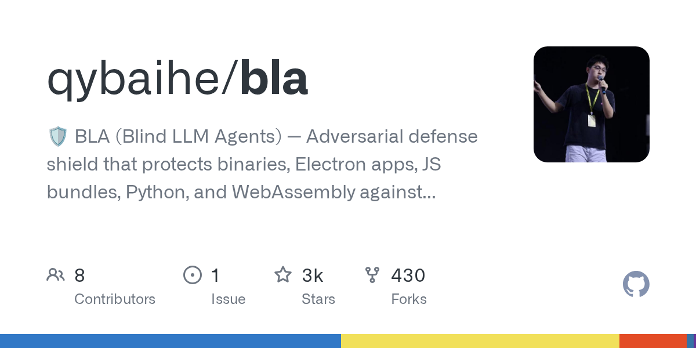</a> <a href="https://github.com/qybaihe/bla"><b>bla</b></a> qybaihe</td><td width="500">ソフトウェアのビルド成果物にデコイとノイズを加えて、AI 逆解析ツールがトークンを浪費するようにし、プログラム自体は全く同じように動作させる。  rea 使用: いいえ 画像の出典: リポジトリカード</td></tr>
<tr><td width="220">— <a href="https://github.com/alphaSeclab/awesome-reverse-engineering"><b>awesome-reverse-engineering</b></a> alphaSeclab</td><td width="500">主要プラットフォームと領域をカバーする大規模なリバースエンジニアリングツール/リソース集。  rea 使用: いいえ 画像の出典: —</td></tr>
<tr><td width="220">— <a href="https://github.com/aicodeking/leanrea"><b>leanrea</b></a> aicodeking</td><td width="500">REA の MCP 層を置き換える軽量スキル。エージェントが CLI ツールを直接駆動  rea 使用: いいえ 画像の出典: —</td></tr>
<tr><td width="220"> <a href="https://github.com/mandiant/flare-floss"><b>flare-floss</b></a> mandiant</td><td width="500">マルウェアに隠された難読化文字列を取り出す  rea 使用: いいえ 画像の出典: 当リポジトリの撮影</td></tr>
<tr><td width="220"> <a href="https://github.com/rizinorg/rizin"><b>rizin</b></a> rizinorg</td><td width="500">radare2 から派生した UNIX 流のリバースエンジニアリング基盤  rea 使用: いいえ 画像の出典: プロジェクト README</td></tr>
<tr><td width="220">— <a href="https://github.com/JusticeRage/Gepetto"><b>Gepetto</b></a> JusticeRage</td><td width="500">IDA Pro プラグイン。言語モデルで関数の説明・リネーム・コメントを支援。  rea 使用: いいえ 画像の出典: —</td></tr>
<tr><td width="220"> <a href="https://github.com/google/bindiff"><b>bindiff</b></a> google</td><td width="500">2 つのバイナリ間の違いを見つける  rea 使用: いいえ 画像の出典: プロジェクト README</td></tr>
<tr><td width="220">— <a href="https://github.com/j4k0xb/webcrack"><b>webcrack</b></a> j4k0xb</td><td width="500">JavaScript deobfuscation and bundle-unpacking tool for supported obfuscator.io, webpack and Browserify patterns.  rea 使用: ❔ 未確認 画像の出典: —</td></tr>
<tr><td width="220">— <a href="https://github.com/SubmitGame/awesome-decomp-games"><b>awesome-decomp-games</b></a> SubmitGame</td><td width="500">評価付き・自動更新のゲーム decomp / recomp / ソースポート / エンジンリメイク一覧  rea 使用: いいえ 画像の出典: —</td></tr>
<tr><td width="220">— <a href="https://github.com/zinja-coder/jadx-ai-mcp"><b>jadx-ai-mcp</b></a> zinja-coder</td><td width="500">JADX 用 MCP プラグイン。AI エージェントが Android APK/DEX をデコンパイル・ナビゲート可能。  rea 使用: いいえ 画像の出典: —</td></tr>
<tr><td width="220">— <a href="https://github.com/P4nda0s/reverse-skills"><b>reverse-skills</b></a> P4nda0s</td><td width="500">Skills for interpreting IDA exports, recovering symbols and structures, and Frida/Unicorn-assisted analysis; MIT is claimed only in the README.  rea 使用: ❔ 未確認 画像の出典: —</td></tr>
<tr><td width="220">— <a href="https://github.com/cranebeaker/coop-anything"><b>coop-anything</b></a> cranebeaker</td><td width="500">REA でエントリポイントを調査し、シングルプレイゲームに協力モードを追加する MCP サーバー  rea 使用: ✅ はい 画像の出典: —</td></tr>
<tr><td width="220">— <a href="https://github.com/morluto/awesome-reverse-engineering"><b>awesome-reverse-engineering</b></a> morluto</td><td width="500">RE ツールと学習リソースの厳選入門リスト（バイナリ、アプリ、ファームウェア、フォーマット、プロトコル）。REA 作者による。  rea 使用: いいえ 画像の出典: —</td></tr>
<tr><td width="220">— <a href="https://github.com/P4nda0s/IDA-NO-MCP"><b>IDA-NO-MCP</b></a> P4nda0s</td><td width="500">Exports IDA decompilation and call relationships into agent-readable files; no explicit root license file was found.  rea 使用: ❔ 未確認 画像の出典: —</td></tr>
<tr><td width="220"> <a href="https://github.com/HexRaysSA/ida-mcp"><b>ida-mcp</b></a> HexRaysSA</td><td width="500">Hex-Rays 公式の IDA 用 MCP サーバー  rea 使用: いいえ 画像の出典: リポジトリカード</td></tr>
<tr><td width="220">— <a href="https://github.com/WhiteNightShadow/hello_js_reverse_skill"><b>hello_js_reverse_skill</b></a> WhiteNightShadow</td><td width="500">A JavaScript-analysis skill that routes signature, obfuscation, cookie and WASM investigations through controlled experiments and browser evidence.  rea 使用: ❔ 未確認 画像の出典: —</td></tr>
<tr><td width="220">— <a href="https://github.com/LING71671/open-reverselab"><b>open-reverselab</b></a> LING71671</td><td width="500">Agent-oriented reverse-engineering workbench combining MCP tools, a knowledge base and evidence workspaces; review the license and disclaimer.  rea 使用: ❔ 未確認 画像の出典: —</td></tr>
<tr><td width="220">— <a href="https://github.com/alexgaoth/awesome-reverse-engineered"><b>awesome-reverse-engineered</b></a> alexgaoth</td><td width="500">誰かがクローズドなアプリ・ゲーム・API・デバイスをリバースエンジニアリングした結果生まれたオープンソースプロジェクトを 1.7 万以上集めた検索可能なカタログ。検索サイトと MCP サーバー付き。  rea 使用: いいえ 画像の出典: —</td></tr>
<tr><td width="220">— <a href="https://github.com/webrecorder/browsertrix-crawler"><b>browsertrix-crawler</b></a> webrecorder</td><td width="500">High-fidelity browser-based crawler that captures web content through CDP inside a standalone container.  rea 使用: ❔ 未確認 画像の出典: —</td></tr>
<tr><td width="220"> <a href="https://github.com/ghidraninja/ghidra_scripts"><b>ghidra_scripts</b></a> ghidraninja</td><td width="500">binwalk 連携から YARA まで、便利な Ghidra スクリプト集  rea 使用: いいえ 画像の出典: プロジェクト README</td></tr>
<tr><td width="220">— <a href="https://github.com/pionxzh/wakaru"><b>wakaru</b></a> pionxzh</td><td width="500">JavaScript decompiler and bundle unpacker that recovers readable modules and modern syntax from minified or transpiled production builds.  rea 使用: ❔ 未確認 画像の出典: —</td></tr>
<tr><td width="220"> <a href="https://github.com/cyberkaida/reverse-engineering-assistant"><b>reverse-engineering-assistant</b></a> cyberkaida</td><td width="500">AI が Ghidra（NSA の無料リバースエンジニアリングツール）を操作するもう一つの方法。AI に小さく集中したツールを与え、大きなプログラムでも混乱しにくくする。  rea 使用: いいえ 画像の出典: リポジトリカード</td></tr>
<tr><td width="220">— <a href="https://github.com/MiaAI-Lab/sparkDash"><b>sparkDash</b></a> MiaAI-Lab</td><td width="500">長時間の REA 分析ジョブを統合し、結果をオンデマンドで読み込むマルチデバイスダッシュボード  rea 使用: ✅ はい 画像の出典: —</td></tr>
<tr><td width="220">— <a href="https://github.com/zinja-coder/jadx-mcp-server"><b>jadx-mcp-server</b></a> zinja-coder</td><td width="500">MCP server that exposes Android decompilation context through the companion JADX-AI-MCP plugin.  rea 使用: ❔ 未確認 画像の出典: —</td></tr>
<tr><td width="220">— <a href="https://github.com/symgraph/GhidrAssist"><b>GhidrAssist</b></a> symgraph</td><td width="500">Ghidra 用 LLM 拡張。デコンパイル結果のリネーム・説明・解析を支援。  rea 使用: いいえ 画像の出典: —</td></tr>
<tr><td width="220">— <a href="https://github.com/nforest/awesome-decompilation"><b>awesome-decompilation</b></a> nforest</td><td width="500">デコンパイル関連リソース、論文、中間表現、プロジェクトの厳選リスト。  rea 使用: いいえ 画像の出典: —</td></tr>
<tr><td width="220"> <a href="https://github.com/decompme/decomp.me"><b>decomp.me</b></a> decompme</td><td width="500">ブラウザで共同逆コンパイル、一致ビルドを目指す  rea 使用: いいえ 画像の出典: リポジトリカード</td></tr>
<tr><td width="220">— <a href="https://github.com/Fausto-404/js-reverse-automation--skill"><b>js-reverse-automation--skill</b></a> Fausto-404</td><td width="500">An evidence-driven JavaScript workflow that combines Chrome DevTools MCP with runtime probes and JSRPC, Flask and Burp artifact generation.  rea 使用: ❔ 未確認 画像の出典: —</td></tr>
<tr><td width="220">— <a href="https://github.com/1llu50ry/mcp-reverse"><b>mcp-reverse</b></a> 1llu50ry</td><td width="500">多数のリバースエンジニアリングツールとスキルベースをまとめた MCP サーバー。AI エージェントがバイナリやゲームを解析できる  rea 使用: いいえ 画像の出典: —</td></tr>
<tr><td width="220">— <a href="https://github.com/WhiteNightShadow/camoufox-reverse-mcp"><b>camoufox-reverse-mcp</b></a> WhiteNightShadow</td><td width="500">Camoufox-based MCP server for JavaScript runtime inspection, script search, network capture, hooks and offline signer verification.  rea 使用: ❔ 未確認 画像の出典: —</td></tr>
<tr><td width="220">— <a href="https://github.com/radareorg/r2ai"><b>r2ai</b></a> radareorg</td><td width="500">radare2 用の LLM ベースのリバースツールとプラグイン  rea 使用: いいえ 画像の出典: —</td></tr>
<tr><td width="220">— <a href="https://github.com/dnakov/frida-mcp"><b>frida-mcp</b></a> dnakov</td><td width="500">Community MCP bridge for Frida devices, processes and JavaScript sessions; check maintenance and version compatibility.  rea 使用: ❔ 未確認 画像の出典: —</td></tr>
<tr><td width="220">— <a href="https://github.com/fosdickio/binary_ninja_mcp"><b>binary_ninja_mcp</b></a> fosdickio</td><td width="500">LLM エージェントが Binary Ninja を操作できる MCP サーバー（デコンパイル、xref、リネームなど）。  rea 使用: いいえ 画像の出典: —</td></tr>
<tr><td width="220">— <a href="https://github.com/radareorg/radare2-mcp"><b>radare2-mcp</b></a> radareorg</td><td width="500">radare2 公式 MCP stdio サーバー  rea 使用: いいえ 画像の出典: —</td></tr>
<tr><td width="220">— <a href="https://github.com/lemonadesaltbagel/crab"><b>crab</b></a> lemonadesaltbagel</td><td width="500">どんなソフトウェアでもコードを見ずに純粋なブラックボックスとして観察し、動作が一致するクリーンルーム版をAIに作らせるMCPツール。  rea 使用: いいえ 画像の出典: —</td></tr>
<tr><td width="220">— <a href="https://github.com/n-delic/decompdecomp"><b>decompdecomp</b></a> n-delic</td><td width="500">自分が所有するゲームを、AIエージェントがバイト単位で一致するC/C++にデコンパイルするデスクトップアプリ。  rea 使用: いいえ 画像の出典: —</td></tr>
<tr><td width="220">— <a href="https://github.com/exoteric33/ps2-native-recomp"><b>ps2-native-recomp</b></a> exoteric33</td><td width="500">自分の持っている PS2 ディスクを静的再コンパイルでネイティブ Windows/Linux プログラムに  rea 使用: いいえ 画像の出典: —</td></tr>
<tr><td width="220">— <a href="https://github.com/crowdere/Awesome-RE-MCP"><b>Awesome-RE-MCP</b></a> crowdere</td><td width="500">MCP サーバーを持つリバースエンジニアリングツールの厳選リスト。AI アシスタントが Ghidra や IDA などを駆動できるようにする。  rea 使用: いいえ 画像の出典: —</td></tr>
<tr><td width="220">— <a href="https://github.com/sp00nznet/pcrecomp"><b>pcrecomp</b></a> sp00nznet</td><td width="500">古いPCソフト（DOS、Windows 16/32/64bitなど）を分解して、エミュレータなしで現代のネイティブコードとして再構築する統合ツールボックス。  rea 使用: いいえ 画像の出典: —</td></tr>
<tr><td width="220"> <a href="https://github.com/ShadowSwaps/REA-Reconstruction-Companion"><b>REA-Reconstruction-Companion</b></a> ShadowSwaps</td><td width="500">再構築を常に証拠と結びつけるエージェントスキル  rea 使用: ✅ はい 画像の出典: リポジトリカード</td></tr>
<tr><td width="220"><a href="https://github.com/seifhassine/REasy">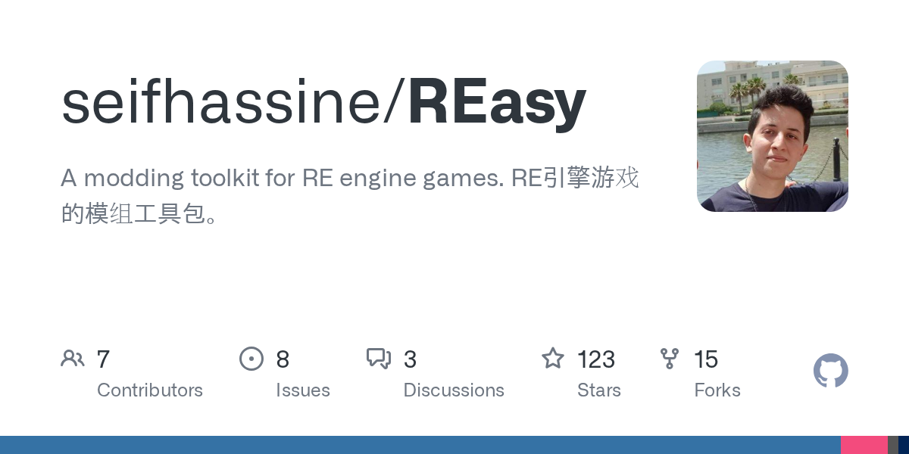</a> <a href="https://github.com/seifhassine/REasy"><b>REasy</b></a> seifhassine</td><td width="500">カプコンのREエンジンを使うゲーム（バイオハザードやモンスターハンターなど）のファイルを開いて編集・再パックできる無料ツールキット。  rea 使用: いいえ 画像の出典: リポジトリカード</td></tr>
<tr><td width="220"> <a href="https://github.com/SwitchRECOMP-Dev/Switch2RECOMP"><b>Switch2RECOMP</b></a> SwitchRECOMP-Dev</td><td width="500">任天堂SwitchとSwitch 2のゲームのマシンコードを一度翻訳して、ネイティブのWindowsやLinuxプログラムに変える無料のオープンソースツール。自分のコピーをエミュレータなしでPCで遊べます。  rea 使用: いいえ 画像の出典: リポジトリカード</td></tr>
<tr><td width="220">— <a href="https://github.com/giveen/decomp.anything"><b>decomp.anything</b></a> giveen</td><td width="500">更新停止したマッチング型デコンパイラ decomp.wtf の継続フォーク。Windows/Linux バイナリ対応と REA 連携を追加し、ゲーム以外のプログラムもエージェントが解析できるようにした。  rea 使用: ✅ はい 画像の出典: —</td></tr>
<tr><td width="220">— <a href="https://github.com/FurkanAnc/totk-launcher"><b>totk-launcher</b></a> FurkanAnc</td><td width="500">既存の『ゼルダの伝説 ティアーズ オブ ザ キングダム』PC 再コンパイル版用のランチャー。設定変更、キー割り当て、実績、セーブバックアップ、チートができる。  rea 使用: いいえ 画像の出典: —</td></tr>
<tr><td width="220"> <a href="https://github.com/czcdr/dsh-plugin-rea"><b>dsh-plugin-rea</b></a> czcdr</td><td width="500">DeepSeek Harness で REA を、Ghidra も自動導入  rea 使用: ✅ はい 画像の出典: プロジェクト README</td></tr>
<tr><td width="220"> <a href="https://github.com/rizinorg/jsdec"><b>jsdec</b></a> rizinorg</td><td width="500">手書きアセンブリからも読みやすい疑似 C を出す Rizin 用デコンパイラ  rea 使用: いいえ 画像の出典: リポジトリカード</td></tr>
<tr><td width="220"> <a href="https://github.com/0xshlomil/ida-free-mcp"><b>ida-free-mcp</b></a> 0xshlomil</td><td width="500">MCP 経由で AI エージェントから IDA Free を使う  rea 使用: ✅ はい 画像の出典: リポジトリカード</td></tr>
<tr><td width="220"> <a href="https://github.com/dav1dngy/era-agent"><b>era-agent</b></a> dav1dngy</td><td width="500">証拠駆動で自己改善を試みるリバースエンジニアリング用エージェント  rea 使用: ❔ 未確認 画像の出典: プロジェクト README</td></tr>
<tr><td width="220">— <a href="https://github.com/tanepiper/game-frame"><b>game-frame</b></a> tanepiper</td><td width="500">配布ファイルからエージェントがゲームを解析するフレームワーク  rea 使用: ✅ はい 画像の出典: —</td></tr>
<tr><td width="220">— <a href="https://github.com/gryszzz/reverse-engineer-everything"><b>reverse-engineer-everything</b></a> gryszzz</td><td width="500">REA エンジン上に構築されたローカルワークベンチと調査スタジオ。ファイルをアップロードせずに証拠に基づくソフトウェア分析を行う。  rea 使用: ✅ はい 画像の出典: —</td></tr>
<tr><td width="220"> <a href="https://github.com/BurnoutDecomp/BP-Decomp_Workflow"><b>BP-Decomp_Workflow</b></a> BurnoutDecomp</td><td width="500">『バーンアウトパラダイス』の逆解析・デコンパイルを助けるツールとワークフローのリポジトリ。スクリプト、IDAデータベース、エージェント調整を含む。  rea 使用: いいえ 画像の出典: リポジトリカード</td></tr>
<tr><td width="220">— <a href="https://github.com/veritr1x/recomp-kit"><b>recomp-kit</b></a> veritr1x</td><td width="500">古い32ビットx86 Windowsゲームを、エミュレータやJITなしでmacOS/iOS/Android/Linux/Windowsのネイティブアプリに変換する静的再コンパイルキット。  rea 使用: いいえ 画像の出典: —</td></tr>
<tr><td width="220"> <a href="https://github.com/alexmi256/rea-agent-docker"><b>rea-agent-docker</b></a> alexmi256</td><td width="500">Ghidra・Hopper・IDA 版がある REA の Docker イメージ  rea 使用: ✅ はい 画像の出典: リポジトリカード</td></tr>
<tr><td width="220"> <a href="https://github.com/sp00nznet/snesrecomp"><b>snesrecomp</b></a> sp00nznet</td><td width="500">再コンパイルしたSNESゲームコードを、本物の画面と音付きのネイティブ移植にするためのハードウェアライブラリ。  rea 使用: いいえ 画像の出典: リポジトリカード</td></tr>
<tr><td width="220">— <a href="https://github.com/yefan911/automated-recompilers"><b>automated-recompilers</b></a> yefan911</td><td width="500">コンソール ROM の実行ファイルを静的再コンパイルでネイティブ PC アプリケーションに自動翻訳するフレームワーク。  rea 使用: いいえ 画像の出典: —</td></tr>
<tr><td width="220"> <a href="https://github.com/DatanoiseTV/revenant"><b>revenant</b></a> DatanoiseTV</td><td width="500">放棄されたファームウェアやバイナリを LLM で自動解析し、ピンマップや再実装を生成。  rea 使用: いいえ 画像の出典: リポジトリカード</td></tr>
<tr><td width="220"> <a href="https://github.com/Nowng/rea-mcp"><b>rea-mcp</b></a> Nowng</td><td width="500">LM Studio のローカルモデルで REA を使う  rea 使用: ✅ はい 画像の出典: リポジトリカード</td></tr>
<tr><td width="220">— <a href="https://github.com/ValveResourceFormat/Source2Mcp"><b>Source2Mcp</b></a> ValveResourceFormat</td><td width="500">CS2やDota 2、DeadlockなどのSource 2ゲームをAIが起動・操作できるようにするMCPサーバー。コンソールコマンド、カメラ移動、スクリーンショット。  rea 使用: いいえ 画像の出典: —</td></tr>
<tr><td width="220"> <a href="https://github.com/jaenster/ghidra-reconstruct"><b>ghidra-reconstruct</b></a> jaenster</td><td width="500">Ghidra が吐き出すごちゃごちゃした逆コンパイル結果を、きれいに整理されたコンパイル可能な C++ ソースに変換します。  rea 使用: いいえ 画像の出典: リポジトリカード</td></tr>
<tr><td width="220"> <a href="https://github.com/zhaofeng130/dsh-rea"><b>dsh-rea</b></a> zhaofeng130</td><td width="500">DeepSeek Harness に REA のスキルとツールを追加  rea 使用: ✅ はい 画像の出典: リポジトリカード</td></tr>
<tr><td width="220"><a href="https://github.com/andrewnakas/recompsoftware">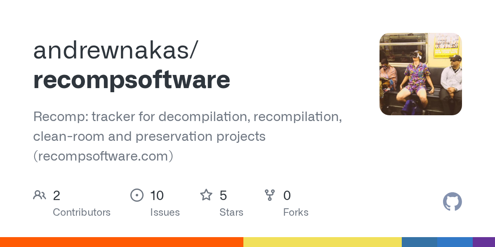</a> <a href="https://github.com/andrewnakas/recompsoftware"><b>recompsoftware</b></a> andrewnakas</td><td width="500">機械語から古いゲームやソフトを再構築している数千のプロジェクトをリアルタイムで追跡するサイト。進捗グラフとリリース情報付き。  rea 使用: いいえ 画像の出典: リポジトリカード</td></tr>
<tr><td width="220"> <a href="https://github.com/pablodiazjorge/rea-casebook"><b>rea-casebook</b></a> pablodiazjorge</td><td width="500">Claude Code の結論すべてに実際の REA 証拠を引用させる  rea 使用: ✅ はい 画像の出典: プロジェクト README</td></tr>
<tr><td width="220"> <a href="https://github.com/sheilacraig/dsh-rea-mcp"><b>dsh-rea-mcp</b></a> sheilacraig</td><td width="500">設定だけで DeepSeek Harness に REA を組み込む  rea 使用: ✅ はい 画像の出典: リポジトリカード</td></tr>
<tr><td width="220">— <a href="https://github.com/agioracle/rea-unity-game"><b>rea-unity-game</b></a> agioracle</td><td width="500">エージェントで Unity ゲームを解析するワークフロー  rea 使用: ❔ 未確認 画像の出典: —</td></tr>
<tr><td width="220"> <a href="https://github.com/itsgrimetime/decomp-me-mcp"><b>decomp-me-mcp</b></a> itsgrimetime</td><td width="500">AIコーディングエージェントが decomp.me 上のマッチング逆コンパイル作業を調べ、コンパイルし、改善できるようにする MCP サーバー。  rea 使用: いいえ 画像の出典: リポジトリカード</td></tr>
<tr><td width="220"> <a href="https://github.com/ya123-4/rea-dsh-plugin"><b>rea-dsh-plugin</b></a> ya123-4</td><td width="500">DeepSeek Harness に REA の MCP ツールを登録  rea 使用: ✅ はい 画像の出典: リポジトリカード</td></tr>
<tr><td width="220"> <a href="https://github.com/Sage-is/CleanRoom"><b>CleanRoom</b></a> Sage-is</td><td width="500">REA のローカル版を Python でシンプルに再実装した MCP サーバーと CLI。  rea 使用: いいえ 画像の出典: リポジトリカード</td></tr>
<tr><td width="220">— <a href="https://github.com/jaenster/setup-msvc"><b>setup-msvc</b></a> jaenster</td><td width="500">CI で正確な歴史的 Microsoft Visual C++ ツールチェーン（6.0～2010）をセットアップするヘルパー。逆コンパイル／再コンパイルプロジェクトが元のコンパイラとバイト単位で一致できるようにする。  rea 使用: いいえ 画像の出典: —</td></tr>
<tr><td width="220"><a href="https://github.com/cognixws/picode-rea">プレビューを表示できません · 元のプロジェクトへ</a> <a href="https://github.com/cognixws/picode-rea"><b>picode-rea</b></a> cognixws</td><td width="500">PiCode から REA の静的解析ツールを使う  rea 使用: ✅ はい 画像の出典: <a href="https://github.com/cognixws/picode-rea">リポジトリカード</a></td></tr>
<tr><td width="220"> <a href="https://github.com/jinshi666888/rea-playbook"><b>rea-playbook</b></a> jinshi666888</td><td width="500">小さな Electron ターゲット付きの REA ハンズオン  rea 使用: ✅ はい 画像の出典: プロジェクト README</td></tr>
<tr><td width="220">— <a href="https://github.com/Stijnus/dsh-rev-eng"><b>dsh-rev-eng</b></a> Stijnus</td><td width="500">REA スキルとオプションの MCP をパッケージした DSH プラグイン。リバースエンジニアリングと Mac アプリ構築用。  rea 使用: ✅ はい 画像の出典: —</td></tr>
<tr><td width="220">— <a href="https://github.com/MarkMcCaskey/dolphin-decomp-mcp"><b>dolphin-decomp-mcp</b></a> MarkMcCaskey</td><td width="500">AIエージェントがDolphinエミュレータ上で動くGameCubeとWiiのゲームをライブデバッグできるMCPサーバーとコマンドラインツール。リバースエンジニアリングやマッチングデコンパイルに便利。  rea 使用: いいえ 画像の出典: —</td></tr>
<tr><td width="220"> <a href="https://github.com/orikami048/gea"><b>gea</b></a> orikami048</td><td width="500">ゲームのリバースエンジニアリング、アセット抽出、Cocos/Three.js 再現のための MCP と CLI。morluto/rea に着想。  rea 使用: いいえ 画像の出典: リポジトリカード</td></tr>
<tr><td width="220">— <a href="https://github.com/CurLeaf/dsh-command-rea"><b>dsh-command-rea</b></a> CurLeaf</td><td width="500">DSH の /rea スラッシュコマンド。リクエストを REA スキルと MCP ツールにルーティング。  rea 使用: ✅ はい 画像の出典: —</td></tr>
<tr><td width="220">— <a href="https://github.com/LostArtefacts/decomp-tools"><b>decomp-tools</b></a> LostArtefacts</td><td width="500">Windows 版トゥームレイダー2～5の一致するデコンパイルを支援するツール。Wine 上でオリジナルの MSVC 5/6 コンパイラを使用。  rea 使用: いいえ 画像の出典: —</td></tr>
<tr><td width="220">— <a href="https://github.com/MistblastClear/UEBulkExport-rpocket"><b>UEBulkExport-rpocket</b></a> MistblastClear</td><td width="500">Unreal Engine のゲームコンテナ（.pak / .utoc / .ucas）を丸ごと、テクスチャ・メッシュ・アニメ・音声・レベルが入ったフォルダに一括書き出すコマンドラインツール。  rea 使用: いいえ 画像の出典: —</td></tr>
<tr><td width="220">— <a href="https://github.com/zarvox32/vb-native-decompiler"><b>vb-native-decompiler</b></a> zarvox32</td><td width="500">クローズドソースの Visual Basic 5/6 ネイティブコードプログラムを読みやすい VB ソースに逆コンパイルし、すべてのプロシージャを元の機械語と照合して検証するツール。  rea 使用: いいえ 画像の出典: —</td></tr>
<tr><td width="220">— <a href="https://github.com/austinkregel/corpus_mcp"><b>corpus_mcp</b></a> austinkregel</td><td width="500">AIエージェントがGhidraの逆コンパイル結果やLuaコード、プロジェクト文書を検索できるようにするMCPサーバー。クローズドソースの逆解析を高速化。  rea 使用: いいえ 画像の出典: —</td></tr>
<tr><td width="220">— <a href="https://github.com/romangalaxys10-spec/zcode-rea"><b>zcode-rea</b></a> romangalaxys10-spec</td><td width="500">公式REAツールキットをラップしたZCodeプラグイン。AIエージェントが証拠付きでクローズドソースのバイナリやアプリ、サイトを逆解析できるようにする。  rea 使用: ✅ はい 画像の出典: —</td></tr>
<tr><td width="220">— <a href="https://github.com/sosiman/re-code-mode"><b>re-code-mode</b></a> sosiman</td><td width="500">AIエージェントにradare2やbinwalkなどの逆解析ツールを提供するツールボックス。クローズドソースのバイナリを分析し、大きな出力をローカルでフィルタしてモデルを溢れさせない。  rea 使用: いいえ 画像の出典: —</td></tr>
</table>

## REA 公式ショーケース

<table>
<tr><th width="220">ゲ&#8288;ー&#8288;ム&#8288;・&#8288;画&#8288;像&#8288;・&#8288;元&#8288;の&#8288;対&#8288;応&#8288;機&#8288;種</th><th width="500">概&#8288;要&#8288;・&#8288;実&#8288;行&#8288;条&#8288;件&#8288;・&#8288;画&#8288;像&#8288;の&#8288;出&#8288;典</th></tr>
<tr><td width="220"> <a href="https://rea.tools/showcase/dx-ball/"><b>DX-Ball: sound-pan function</b></a></td><td width="500">REA が DX-Ball の音響関数をバイト単位で一致する C に戻す過程  rea 使用: ✅ はい 画像の出典: 当リポジトリの撮影</td></tr>
<tr><td width="220"> <a href="https://rea.tools/showcase/notion/"><b>Notion: Electron clipboard bridge</b></a></td><td width="500">Notion のコピー操作をページから IPC、メインプロセスまで追跡  rea 使用: ✅ はい 画像の出典: 当リポジトリの撮影</td></tr>
<tr><td width="220"> <a href="https://rea.tools/showcase/th04/"><b>TH04: PC-98 bullet-ring maths</b></a></td><td width="500">16 ビット DOS コードから東方幻想郷の弾幕角度計算を復元  rea 使用: ✅ はい 画像の出典: 当リポジトリの撮影</td></tr>
<tr><td width="220"> <a href="https://rea.tools/showcase/aegis/"><b>Aegis: TOTP code generation</b></a></td><td width="500">Aegis（Android）が二段階認証コードを生成する仕組みを解明  rea 使用: ✅ はい 画像の出典: 当リポジトリの撮影</td></tr>
<tr><td width="220"> <a href="https://rea.tools/showcase/ctf/"><b>CTF: flag checker</b></a></td><td width="500">DownUnderCTF 2023 のリバーシング問題を順に解く  rea 使用: ✅ はい 画像の出典: 当リポジトリの撮影</td></tr>
</table>

## 任意の表示：REA を使用したプロジェクト

この根拠付きサブセットは上のプラットフォーム・分野別一覧の項目を再掲します。REA に依存しない独立したツールやプロジェクトも収録しています。

REA タグ付き 58 項目を展開

<table>
<tr><th width="220">ゲ&#8288;ー&#8288;ム&#8288;・&#8288;画&#8288;像&#8288;・&#8288;元&#8288;の&#8288;対&#8288;応&#8288;機&#8288;種</th><th width="500">概&#8288;要&#8288;・&#8288;実&#8288;行&#8288;条&#8288;件&#8288;・&#8288;画&#8288;像&#8288;の&#8288;出&#8288;典</th></tr>
<tr><td width="220"> <a href="https://github.com/morluto/rea/discussions/2254"><b>REA discussion #2254</b></a></td><td width="500">シンボルなし bzip2 を解析し、元のビルドと照合  rea 使用: ✅ はい 画像の出典: 当リポジトリの撮影</td></tr>
<tr><td width="220">— <a href="https://github.com/cranebeaker/coop-anything"><b>coop-anything</b></a> cranebeaker</td><td width="500">REA でエントリポイントを調査し、シングルプレイゲームに協力モードを追加する MCP サーバー  rea 使用: ✅ はい 画像の出典: —</td></tr>
<tr><td width="220">— <a href="https://github.com/Caho1/open-claude-ui"><b>open-claude-ui</b></a> Caho1</td><td width="500">REA で Claude Desktop の UI とインタラクション物理を抽出した高忠実度リビルド  rea 使用: ✅ はい 画像の出典: —</td></tr>
<tr><td width="220">— <a href="https://github.com/MiaAI-Lab/sparkDash"><b>sparkDash</b></a> MiaAI-Lab</td><td width="500">長時間の REA 分析ジョブを統合し、結果をオンデマンドで読み込むマルチデバイスダッシュボード  rea 使用: ✅ はい 画像の出典: —</td></tr>
<tr><td width="220"> <a href="https://github.com/michaelshimeles/terminal-rs"><b>terminal-rs</b></a> michaelshimeles</td><td width="500">Rust 製の Bloomberg 風トレーディング端末  rea 使用: ✅ はい 画像の出典: プロジェクト README</td></tr>
<tr><td width="220">— <a href="https://github.com/Xiangyu-CAS/rea-capcut"><b>rea-capcut</b></a> Xiangyu-CAS</td><td width="500">REA で CapCut を調べて作り直したオープンソースのオフライン動画編集  rea 使用: ✅ はい 画像の出典: —</td></tr>
<tr><td width="220"> <a href="https://github.com/ShadowSwaps/REA-Reconstruction-Companion"><b>REA-Reconstruction-Companion</b></a> ShadowSwaps</td><td width="500">再構築を常に証拠と結びつけるエージェントスキル  rea 使用: ✅ はい 画像の出典: リポジトリカード</td></tr>
<tr><td width="220"> <a href="https://github.com/michaelshimeles/rec-rs"><b>rec-rs</b></a> michaelshimeles</td><td width="500">OBS を参考にした Rust 製の高速 macOS 録画ツール  rea 使用: ✅ はい 画像の出典: プロジェクト README</td></tr>
<tr><td width="220"> <a href="https://github.com/N0zoM1z0/dx-ball"><b>dx-ball</b></a> N0zoM1z0 &#160;PC / DOS / PC-98</td><td width="500">DX-Ball 1.07 を C/C++ で再構築、元の x86 と照合テスト  rea 使用: ✅ はい 画像の出典: プロジェクト README</td></tr>
<tr><td width="220"> <a href="https://github.com/michaelshimeles/sketch"><b>sketch</b></a> michaelshimeles</td><td width="500">Paper を研究して作った Rust 製の無限デザインキャンバス  rea 使用: ✅ はい 画像の出典: プロジェクト README</td></tr>
<tr><td width="220">— <a href="https://github.com/giveen/decomp.anything"><b>decomp.anything</b></a> giveen</td><td width="500">更新停止したマッチング型デコンパイラ decomp.wtf の継続フォーク。Windows/Linux バイナリ対応と REA 連携を追加し、ゲーム以外のプログラムもエージェントが解析できるようにした。  rea 使用: ✅ はい 画像の出典: —</td></tr>
<tr><td width="220"> <a href="https://github.com/czcdr/dsh-plugin-rea"><b>dsh-plugin-rea</b></a> czcdr</td><td width="500">DeepSeek Harness で REA を、Ghidra も自動導入  rea 使用: ✅ はい 画像の出典: プロジェクト README</td></tr>
<tr><td width="220"> <a href="https://github.com/Moxnatiy/OpenBattlefield2"><b>OpenBattlefield2</b></a> Moxnatiy &#160;PC / DOS / PC-98</td><td width="500">バトルフィールド 2 のエンジンを C++20 でクリーンルーム再実装（手持ちの製品版を使用）  rea 使用: ✅ はい 画像の出典: プロジェクト README</td></tr>
<tr><td width="220"> <a href="https://github.com/0xshlomil/ida-free-mcp"><b>ida-free-mcp</b></a> 0xshlomil</td><td width="500">MCP 経由で AI エージェントから IDA Free を使う  rea 使用: ✅ はい 画像の出典: リポジトリカード</td></tr>
<tr><td width="220">— <a href="https://github.com/glauberlima/open-scrantic"><b>open-scrantic</b></a> glauberlima</td><td width="500">REA で逆解析した 1992 年 Johnny Castaway スクリーンセーバーの Rust 再実装  rea 使用: ✅ はい 画像の出典: —</td></tr>
<tr><td width="220"> <a href="https://github.com/lxistired/ledger-reborn"><b>ledger-reborn</b></a> lxistired</td><td width="500">QuickBooks for Mac を参考にしたローカル優先の会計アプリ  rea 使用: ✅ はい 画像の出典: プロジェクト README</td></tr>
<tr><td width="220">— <a href="https://github.com/nicolvus/a6000-fw-decomp"><b>a6000-fw-decomp</b></a> nicolvus</td><td width="500">REA と Ghidra で Sony A6000 のファームウェアを解析  rea 使用: ✅ はい 画像の出典: —</td></tr>
<tr><td width="220"> <a href="https://github.com/N0zoM1z0/th04"><b>th04</b></a> N0zoM1z0 &#160;PC / DOS / PC-98</td><td width="500">東方幻想郷（PC-98）を読めるソースに、当時のコンパイラで検証  rea 使用: ✅ はい 画像の出典: プロジェクト README</td></tr>
<tr><td width="220">— <a href="https://github.com/tanepiper/game-frame"><b>game-frame</b></a> tanepiper</td><td width="500">配布ファイルからエージェントがゲームを解析するフレームワーク  rea 使用: ✅ はい 画像の出典: —</td></tr>
<tr><td width="220">— <a href="https://github.com/gryszzz/reverse-engineer-everything"><b>reverse-engineer-everything</b></a> gryszzz</td><td width="500">REA エンジン上に構築されたローカルワークベンチと調査スタジオ。ファイルをアップロードせずに証拠に基づくソフトウェア分析を行う。  rea 使用: ✅ はい 画像の出典: —</td></tr>
<tr><td width="220">— <a href="https://github.com/rodneypantonial/sims3-modernization"><b>sims3-modernization</b></a> rodneypantonial &#160;PC / DOS / PC-98</td><td width="500">最新 PC でシムズ3 のカクつきとクラッシュを減らす  rea 使用: ✅ はい 画像の出典: —</td></tr>
<tr><td width="220"> <a href="https://github.com/cudanexus/vd-streamer-linux"><b>vd-streamer-linux</b></a> cudanexus</td><td width="500">Linux デスクトップを Quest・Pico へストリーミング  rea 使用: ✅ はい 画像の出典: リポジトリカード</td></tr>
<tr><td width="220"> <a href="https://github.com/alexmi256/rea-agent-docker"><b>rea-agent-docker</b></a> alexmi256</td><td width="500">Ghidra・Hopper・IDA 版がある REA の Docker イメージ  rea 使用: ✅ はい 画像の出典: リポジトリカード</td></tr>
<tr><td width="220"> <a href="https://github.com/pablodiazjorge/rea-lab"><b>rea-lab</b></a> pablodiazjorge</td><td width="500">Windows + Ghidra の演習と事前登録した REA 評価  rea 使用: ✅ はい 画像の出典: リポジトリカード</td></tr>
<tr><td width="220">— <a href="https://github.com/EndLess728/MiTV-Remote"><b>MiTV-Remote</b></a> EndLess728</td><td width="500">Mac・Android・iPhone から Wi-Fi で Xiaomi テレビを操作  rea 使用: ✅ はい 画像の出典: —</td></tr>
<tr><td width="220"> <a href="https://github.com/sickpyramid/ReaFuse"><b>ReaFuse</b></a> sickpyramid</td><td width="500">REA を使って 2 つの JS/TS プロジェクトを融合  rea 使用: ✅ はい 画像の出典: リポジトリカード</td></tr>
<tr><td width="220"> <a href="https://github.com/ucodia/desktop-games-nostalgia"><b>desktop-games-nostalgia</b></a> ucodia &#160;PC / DOS / PC-98</td><td width="500">デスクトップをまた壊そう：Gemtree の 2000 年作を macOS とブラウザへ  rea 使用: ✅ はい 画像の出典: プロジェクト README</td></tr>
<tr><td width="220"><a href="https://github.com/a-barzanti/ai-rebuilds">プレビューを表示できません · 元のプロジェクトへ</a> <a href="https://github.com/a-barzanti/ai-rebuilds"><b>ai-rebuilds</b></a> a-barzanti &#160;PC / DOS / PC-98</td><td width="500">見捨てられたゲームをブラウザで復活、元ファイルは含まない  rea 使用: ✅ はい 画像の出典: <a href="https://github.com/a-barzanti/ai-rebuilds">リポジトリカード</a></td></tr>
<tr><td width="220"> <a href="https://github.com/Nowng/rea-mcp"><b>rea-mcp</b></a> Nowng</td><td width="500">LM Studio のローカルモデルで REA を使う  rea 使用: ✅ はい 画像の出典: リポジトリカード</td></tr>
<tr><td width="220"> <a href="https://github.com/NullLabTests/OpenBSD_netcat_REA"><b>OpenBSD_netcat_REA</b></a> NullLabTests</td><td width="500">REA と Ghidra で netcat-openbsd を静的解析  rea 使用: ✅ はい 画像の出典: プロジェクト README</td></tr>
<tr><td width="220"> <a href="https://github.com/grisuno/VSL-DSP"><b>VSL-DSP</b></a> grisuno</td><td width="500">PreSonus AudioBox VSL 用の Linux カーネルモジュール  rea 使用: ✅ はい 画像の出典: リポジトリカード</td></tr>
<tr><td width="220"> <a href="https://github.com/iammukeshm/hexgrab"><b>hexgrab</b></a> iammukeshm</td><td width="500">PowerToys のバイナリを調べて作った小さな Windows カラーピッカー  rea 使用: ✅ はい 画像の出典: リポジトリカード</td></tr>
<tr><td width="220"> <a href="https://github.com/zhaofeng130/dsh-rea"><b>dsh-rea</b></a> zhaofeng130</td><td width="500">DeepSeek Harness に REA のスキルとツールを追加  rea 使用: ✅ はい 画像の出典: リポジトリカード</td></tr>
<tr><td width="220">— <a href="https://github.com/B-Howell/soundconnect-desktop"><b>soundconnect-desktop</b></a> B-Howell</td><td width="500">Windows デスクトップから Sony の Bluetooth ヘッドホンを操作  rea 使用: ✅ はい 画像の出典: —</td></tr>
<tr><td width="220"> <a href="https://github.com/OpenRsG/GunZRs"><b>GunZRs</b></a> OpenRsG &#160;PC / DOS / PC-98</td><td width="500">GunZ: The Duel を Rust + Bevy で復活  rea 使用: ✅ はい 画像の出典: プロジェクト README</td></tr>
<tr><td width="220"> <a href="https://github.com/pablodiazjorge/rea-casebook"><b>rea-casebook</b></a> pablodiazjorge</td><td width="500">Claude Code の結論すべてに実際の REA 証拠を引用させる  rea 使用: ✅ はい 画像の出典: プロジェクト README</td></tr>
<tr><td width="220"> <a href="https://github.com/tuunanet/rea-ski-or-die-reconstruction"><b>rea-ski-or-die-reconstruction</b></a> tuunanet &#160;PC / DOS / PC-98</td><td width="500">Ski or Die の雪合戦を Rust + SDL2 で再現（素材は各自用意）  rea 使用: ✅ はい 画像の出典: プロジェクト README</td></tr>
<tr><td width="220"> <a href="https://github.com/sheilacraig/dsh-rea-mcp"><b>dsh-rea-mcp</b></a> sheilacraig</td><td width="500">設定だけで DeepSeek Harness に REA を組み込む  rea 使用: ✅ はい 画像の出典: リポジトリカード</td></tr>
<tr><td width="220"> <a href="https://github.com/az9713/wispr-flow-rea-teardown"><b>wispr-flow-rea-teardown</b></a> az9713</td><td width="500">Wispr Flow の音声パイプラインを分解、64 行の再実装付き  rea 使用: ✅ はい 画像の出典: <a href="https://img.youtube.com/vi/FnB9tHKBJXQ/maxresdefault.jpg">動画サムネイル</a></td></tr>
<tr><td width="220"> <a href="https://github.com/KarlssonChristoffer/DiskLens"><b>DiskLens</b></a> KarlssonChristoffer</td><td width="500">WinDirStat 風に Windows 11 のディスク使用量を可視化  rea 使用: ✅ はい 画像の出典: リポジトリカード</td></tr>
<tr><td width="220"> <a href="https://github.com/ya123-4/rea-dsh-plugin"><b>rea-dsh-plugin</b></a> ya123-4</td><td width="500">DeepSeek Harness に REA の MCP ツールを登録  rea 使用: ✅ はい 画像の出典: リポジトリカード</td></tr>
<tr><td width="220"> <a href="https://github.com/az9713/REA-demo"><b>REA-demo</b></a> az9713</td><td width="500">REA が自分自身を解析、反証可能な予測付き  rea 使用: ✅ はい 画像の出典: リポジトリカード</td></tr>
<tr><td width="220"><a href="https://github.com/cognixws/picode-rea">プレビューを表示できません · 元のプロジェクトへ</a> <a href="https://github.com/cognixws/picode-rea"><b>picode-rea</b></a> cognixws</td><td width="500">PiCode から REA の静的解析ツールを使う  rea 使用: ✅ はい 画像の出典: <a href="https://github.com/cognixws/picode-rea">リポジトリカード</a></td></tr>
<tr><td width="220"> <a href="https://github.com/jinshi666888/rea-playbook"><b>rea-playbook</b></a> jinshi666888</td><td width="500">小さな Electron ターゲット付きの REA ハンズオン  rea 使用: ✅ はい 画像の出典: プロジェクト README</td></tr>
<tr><td width="220"> <a href="https://github.com/UnknownHacker1/rea-groundtruth"><b>rea-groundtruth</b></a> UnknownHacker1</td><td width="500">REA のレポートを実際のソースと突き合わせる  rea 使用: ✅ はい 画像の出典: リポジトリカード</td></tr>
<tr><td width="220">— <a href="https://github.com/Stijnus/dsh-rev-eng"><b>dsh-rev-eng</b></a> Stijnus</td><td width="500">REA スキルとオプションの MCP をパッケージした DSH プラグイン。リバースエンジニアリングと Mac アプリ構築用。  rea 使用: ✅ はい 画像の出典: —</td></tr>
<tr><td width="220"> <a href="https://github.com/alemigav/re2-64-decomp"><b>re2-64-decomp</b></a> alemigav &#160;NINTENDO64</td><td width="500">AIツール（REA + Ghidra）でニンテンドー64版『バイオハザード2』を解析。数千のデコンパイル関数と検証スイートあり。ゲームROMは含まれません。  rea 使用: ✅ はい 画像の出典: リポジトリカード</td></tr>
<tr><td width="220"> <a href="https://github.com/AdamLinCodes/AdamTerm"><b>AdamTerm</b></a> AdamLinCodes</td><td width="500">Ghostty を調べて作ったミニマルな macOS ターミナル  rea 使用: ✅ はい 画像の出典: プロジェクト README</td></tr>
<tr><td width="220">— <a href="https://github.com/chilliesdev/fmseasonhub-re"><b>fmseasonhub-re</b></a> chilliesdev</td><td width="500">REA で FM Season Hub アプリを解析したノート  rea 使用: ✅ はい 画像の出典: —</td></tr>
<tr><td width="220">— <a href="https://github.com/carlhako/keen-clone"><b>keen-clone</b></a> carlhako &#160;PC / DOS / PC-98</td><td width="500">REA + Ghidra で関数単位に復元した Commander Keen 1 のネイティブ Linux/SDL2 再実装  rea 使用: ✅ はい 画像の出典: —</td></tr>
<tr><td width="220">— <a href="https://github.com/NathanKanaeru/samp-client-re"><b>samp-client-re</b></a> NathanKanaeru &#160;PC / DOS / PC-98</td><td width="500">REA/Ghidra でアーキテクチャを復元した SA-MP 0.3.DL-R1 のクリーンルームクライアント再実装  rea 使用: ✅ はい 画像の出典: —</td></tr>
<tr><td width="220">— <a href="https://github.com/CurLeaf/dsh-command-rea"><b>dsh-command-rea</b></a> CurLeaf</td><td width="500">DSH の /rea スラッシュコマンド。リクエストを REA スキルと MCP ツールにルーティング。  rea 使用: ✅ はい 画像の出典: —</td></tr>
<tr><td width="220">— <a href="https://github.com/romangalaxys10-spec/zcode-rea"><b>zcode-rea</b></a> romangalaxys10-spec</td><td width="500">公式REAツールキットをラップしたZCodeプラグイン。AIエージェントが証拠付きでクローズドソースのバイナリやアプリ、サイトを逆解析できるようにする。  rea 使用: ✅ はい 画像の出典: —</td></tr>
<tr><td width="220"> <a href="https://rea.tools/showcase/dx-ball/"><b>DX-Ball: sound-pan function</b></a></td><td width="500">REA が DX-Ball の音響関数をバイト単位で一致する C に戻す過程  rea 使用: ✅ はい 画像の出典: 当リポジトリの撮影</td></tr>
<tr><td width="220"> <a href="https://rea.tools/showcase/notion/"><b>Notion: Electron clipboard bridge</b></a></td><td width="500">Notion のコピー操作をページから IPC、メインプロセスまで追跡  rea 使用: ✅ はい 画像の出典: 当リポジトリの撮影</td></tr>
<tr><td width="220"> <a href="https://rea.tools/showcase/th04/"><b>TH04: PC-98 bullet-ring maths</b></a></td><td width="500">16 ビット DOS コードから東方幻想郷の弾幕角度計算を復元  rea 使用: ✅ はい 画像の出典: 当リポジトリの撮影</td></tr>
<tr><td width="220"> <a href="https://rea.tools/showcase/aegis/"><b>Aegis: TOTP code generation</b></a></td><td width="500">Aegis（Android）が二段階認証コードを生成する仕組みを解明  rea 使用: ✅ はい 画像の出典: 当リポジトリの撮影</td></tr>
<tr><td width="220"> <a href="https://rea.tools/showcase/ctf/"><b>CTF: flag checker</b></a></td><td width="500">DownUnderCTF 2023 のリバーシング問題を順に解く  rea 使用: ✅ はい 画像の出典: 当リポジトリの撮影</td></tr>
</table>

## データと貢献

[data.json](data.json) は項目、[descriptions.json](descriptions.json) は表示用説明、[skill-map.json](skill-map.json) は技術分類と根拠、[llms.txt](llms.txt) はエージェント向けの簡潔な索引です。

追加・修正は [CONTRIBUTING.md](CONTRIBUTING.md) を参照し、元データを編集して `python render.py` と `python validate.py` を実行してください。生成された README は直接編集しません。一部の並び順は [stars.json](stars.json) の過去の記録に基づき、最新の人気や品質の順位ではありません。

---

関連リスト／謝辞：REA コミュニティの多くの項目は [AIshihzong/awesome-reverse-engineer-anything](https://github.com/AIshihzong/awesome-reverse-engineer-anything) を参照・照合しました。

貢献方法は [CONTRIBUTING.md](CONTRIBUTING.md)、ライセンスは [CC0-1.0](LICENSE)。
