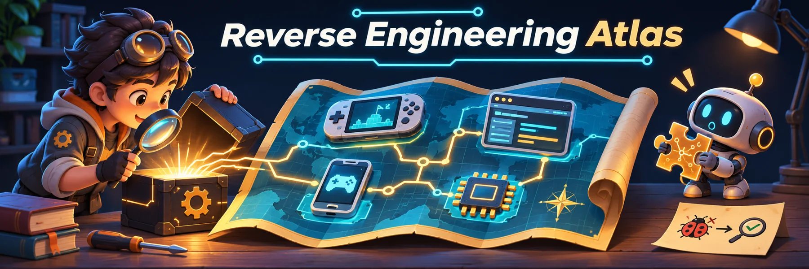

[English](README.md) · [简体中文](README.zh-CN.md) · [繁體中文](README.zh-TW.md) · [日本語](README.ja.md) · [한국어](README.ko.md)

# Reverse Engineering Atlas · 逆向工程项目地图

按目标、平台和技术整理逆向项目、工具与 Agent 工作流。开始自己动手前，先看看已有成果：游戏反编译与重编译、应用重实现、Android 与 JavaScript 分析、协议、固件及配套工具。

**387 条目录记录 · 381 个 GitHub 仓库 · 10 类 skill 工作流 · 5 种 README 语言**

Switch 2 按编辑优先级置顶，不代表实测热度。分类内沿用累计 Star 快照排序，不是实时趋势；原快照未记录采集时间，缺失计数排在最后。所有条目均保留。

> 独立整理，不绑定某一工具，也不是 REA 或其他上游项目的官方目录。收录不代表背书，不保证项目已完成、安全或适合你的许可用途。

## 目录

- [从这里开始](#atlas-start)
- [Skill 技术索引](#atlas-skills)
- [收录范围、证据与许可](#atlas-policy)
- [游戏](#atlas-games)
  - [Nintendo Switch 2](#nintendo-switch-2)
  - [Nintendo Switch](#nintendo-switch)
  - [NES / FC](#nes--fc)
  - [SFC / SNES](#sfc--snes)
  - [MD / Genesis](#md--genesis)
  - [世嘉土星](#世嘉土星)
  - [Game Boy](#game-boy)
  - [GBA](#gba)
  - [任天堂 64](#任天堂-64)
  - [GameCube](#gamecube)
  - [Wii](#wii)
  - [NDS](#nds)
  - [3DS](#3ds)
  - [PS1](#ps1)
  - [PS2](#ps2)
  - [Xbox / Xbox 360](#xbox--xbox-360)
  - [PC / DOS / PC-98](#pc--dos--pc-98)
- [应用 / Electron / 桌面](#atlas-app)
- [协议 / 硬件](#atlas-protocol)
- [固件 / 驱动](#atlas-firmware)
- [安全 / 评测](#atlas-security)
- [逆向工具](#atlas-tooling)
- [REA 官方 Showcase](#atlas-official)
- [可选视图：使用 REA 的项目](#atlas-rea)
- [数据与贡献](#atlas-data)

## 从这里开始

- **找已有成果:** 按 [游戏平台](#atlas-games)、[桌面应用 / Electron](#atlas-app)、[协议 / 硬件](#atlas-protocol) 或 [固件 / 驱动](#atlas-firmware) 浏览。
- **选分析路线:** 用 [十类 skill 技术地图](#atlas-skills) 查 Android、JavaScript、原生二进制、CTF 与净室重实现工作流。
- **选工具:** 查看 [逆向工具](#atlas-tooling) 和 [安全 / 评测](#atlas-security)。工具、skill 和重建后的应用承担不同角色。
- **核查依据与局限:** 打开 [详细技术地图](SKILL_MAP.zh-CN.md)，查看官方来源、许可提醒、维护状态与能力边界。

用 Ctrl+F / Cmd+F 搜索目标名、作者/仓库、平台或文件格式，例如 APK、DEX、Electron、WASM、PS2、firmware。找到条目后，再读上游 README 核对依赖与当前进展。目录没有收录，不代表不存在相关项目。

## Skill 技术索引

按技术整理十个 skill 入口及相关项目。技术相关不代表上游依赖，也不代表使用了 REA。

[证据、许可与局限](SKILL_MAP.zh-CN.md) · [JSON](skill-map.json)

| Skill / 来源 | 技术方向 | 相关项目 |
| --- | --- | --- |
| [REA](https://github.com/morluto/rea) | CLI / MCP、反编译、交叉引用、证据 | [7](SKILL_MAP.zh-CN.md#rea) |
| [reverse-skill](https://github.com/zhaoxuya520/reverse-skill) | 目标分类路由、工具发现、证据工作流 | [6](SKILL_MAP.zh-CN.md#reverse-skill) |
| [android-reverse-engineering-skill](https://github.com/SimoneAvogadro/android-reverse-engineering-skill) | APK / DEX、Kotlin 元数据、HTTP 接口分析 | [7](SKILL_MAP.zh-CN.md#android-reverse-engineering-skill) |
| [replica-skill](https://github.com/Jakeschincariol/replica-skill) | 黑盒观察、净室规格、行为测试 | [5](SKILL_MAP.zh-CN.md#replica-skill) |
| [leanrea](https://github.com/aicodeking/leanrea) | 命令行编排、目标初筛、证据 | [6](SKILL_MAP.zh-CN.md#leanrea) |
| [ctf-skills](https://github.com/ljagiello/ctf-skills) | CTF 逆向、符号执行、模拟执行 | [6](SKILL_MAP.zh-CN.md#ctf-skills) |
| [reverse-skills](https://github.com/P4nda0s/reverse-skills) | 反编译结果导出、类型重建、插桩 | [6](SKILL_MAP.zh-CN.md#reverse-skills) |
| [hello_js_reverse_skill](https://github.com/WhiteNightShadow/hello_js_reverse_skill) | JavaScript 抽象语法树、反混淆、运行时分析 | [5](SKILL_MAP.zh-CN.md#hello-js-reverse-skill) |
| [Open-ReverseLab](https://github.com/LING71671/open-reverselab) | MCP 工作台、原生程序 / Android、案例报告 | [7](SKILL_MAP.zh-CN.md#open-reverselab) |
| [js-reverse-automation--skill](https://github.com/Fausto-404/js-reverse-automation--skill) | CDP、抽象语法树、浏览器运行时、WASM | [7](SKILL_MAP.zh-CN.md#js-reverse-automation-skill) |

## 收录范围、证据与许可

**收录什么：** 公开项目与资料，覆盖静态/动态分析、反编译、重编译、净室重实现及软件保存。Skill 负责组织方法，不一定是分析引擎；解包工具不等于源码恢复，也不授予素材复用权。

**核验到哪里：** 技术地图记录了 2026-11-07 对 45 个项目的定向文档核查，并非重新审计全部旧条目。本次未安装或运行这些项目，也未独立复现性能与安全声明。

**REA 只是可选关系标记：** Yes 需要公开使用证据；No 表示记录为非 REA 工作流或独立替代方案；Unverified 表示尚未确立这种关系。标记不评价质量或许可。单纯在基准中对比 REA，不等于运行时使用 REA。[REA 子集](#atlas-rea) 只是可选视图，不是本目录的范围。

**授权与许可：** 仅分析自有或明确获授权的目标与数据。不收录破解、DRM 绕过、盗版程序或未经许可分发的游戏素材。公开可见不等于具有开源许可；不明确、仅覆盖子目录或商业依赖的许可须到上游核对。部分项目需要自行提供合法取得的原版资源。

**目录与项目权利分开：** 本目录原创贡献采用 [CC0-1.0](LICENSE)。上游代码、截图、商标与其他第三方内容仍受各自权利约束。归档或早期 Alpha 项目仅作为历史/实验参考，不等于默认推荐。

## 游戏

### Nintendo Switch 2

#### 反编译 / 重编译

<table>
<tr><th width="220">项目 / 图片</th><th width="500">简介</th></tr>
<tr><td width="220"> <b>Pokémon Pokopia</b> <a href="https://github.com/Dittobyte/Recompia"><b>Recompia</b></a> Dittobyte &#160;Nintendo Switch 2</td><td width="500">《Pokémon Pokopia》（Switch 2）重编译项目。上游以 Windows 为目标，Linux 启动器通过 Proton 运行；需自备 2.0.1a 文件。仓库截图 SVG 是占位图，并非已验证的运行画面。  使用 rea: 否 图片来源: <a href="images/editorial/README.md">官方游戏主视觉 · 非项目运行截图</a></td></tr>
<tr><td width="220">— <b>The Legend of Zelda: Ocarina of Time</b> <a href="https://github.com/RealZotto/oot2-native"><b>oot2-native</b></a> RealZotto &#160;Nintendo Switch 2</td><td width="500">面向上游所称 Switch 2《时之笛》重制版的开发预览研究。尚不可玩、无发行版，图形后端为空；不是可用的 PC 移植。  使用 rea: 否 图片来源: —</td></tr>
</table>

#### 重制 / 移植

<table>
<tr><th width="220">项目 / 图片</th><th width="500">简介</th></tr>
<tr><td width="220"> <b>The Legend of Zelda: Ocarina of Time</b> <a href="https://github.com/NotRexed/Hookshot"><b>Hookshot</b></a> NotRexed &#160;Nintendo Switch 2</td><td width="500">实验性《时之笛》Switch 2 重编译，面向 Windows/Linux。上游报告起始区域可玩，其他区域与部分显卡仍有问题。需自备游戏转储；本目录未独立实测。  使用 rea: 否 图片来源: 仓库卡片</td></tr>
<tr><td width="220"><a href="https://github.com/sostenesfreitas/ocarina-recomp">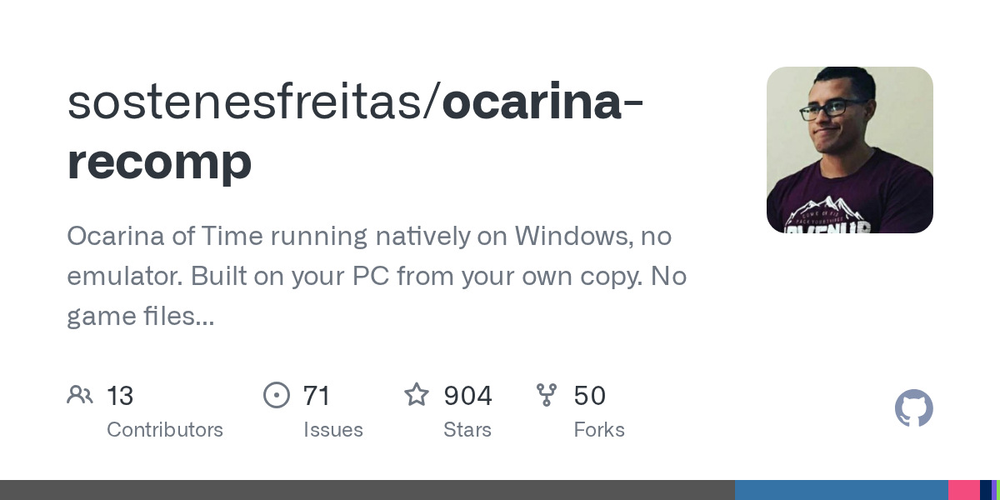</a> <b>The Legend of Zelda: Ocarina of Time</b> <a href="https://github.com/sostenesfreitas/ocarina-recomp"><b>ocarina-recomp</b></a> sostenesfreitas &#160;Nintendo Switch 2</td><td width="500">《时之笛》Switch 2 重编译研究；现将实现贡献转向 Hookshot，并保留葡语支持与指南。作者仅报告 RTX 5090 起始区域测试，并非全流程验证；需自备游戏文件。  使用 rea: 否 图片来源: 仓库卡片</td></tr>
<tr><td width="220"> <b>Donkey Kong Bananza</b> <a href="https://github.com/Lucas-blip-png/dkb-pc-recomp"><b>dkb-pc-recomp</b></a> Lucas-blip-png &#160;Nintendo Switch 2</td><td width="500">《咚奇刚 蕉力全开》（Switch 2）实验性重编译。上游明确尚不可玩：教学洞穴可移动与攻击，但仍会崩溃、缺失特效。面向 Windows，Linux/macOS 为预览；需自备游戏转储。  使用 rea: 否 图片来源: 仓库卡片</td></tr>
<tr><td width="220"> <b>Star Fox</b> <a href="https://github.com/SerenityG4K/SpaceAnimalsRecomp"><b>SpaceAnimalsRecomp</b></a> SerenityG4K &#160;Nintendo Switch 2</td><td width="500">《Star Fox》（Switch 2 2.0.0）Windows 重编译。作者报告仅在 Ryzen 9700X + RTX 5070 Ti 上以 60 fps 通关；尚未优化，部分着色器未转换。本目录未独立验证，需自备游戏文件。  使用 rea: 否 图片来源: 仓库卡片</td></tr>
<tr><td width="220"><a href="https://github.com/drakolordx7/switch2-recomp">预览暂不可用 · 查看原项目</a> <b>Pokémon Pokopia</b> <a href="https://github.com/drakolordx7/switch2-recomp"><b>switch2-recomp</b></a> drakolordx7 &#160;Nintendo Switch 2</td><td width="500">把任天堂 Switch 2 上的《宝可梦 波克皮亚》变成可以在 Windows 上原生运行的程序，不需要模拟器，用你自己的游戏转储。  使用 rea: 否 图片来源: <a href="https://github.com/drakolordx7/switch2-recomp">仓库卡片</a></td></tr>
</table>

### Nintendo Switch

#### 反编译 / 重编译

<table>
<tr><th width="220">项目 / 图片</th><th width="500">简介</th></tr>
<tr><td width="220">— <b>Xenoblade Chronicles X: Definitive Edition</b> <a href="https://github.com/jmars125/xcx-recomp"><b>xcx-recomp</b></a> jmars125 &#160;Nintendo Switch</td><td width="500">把闭源的《异度神剑 X 终极版》（Switch）通过静态重编译做成了能在 Windows 上原生运行的程序。需要自己提供合法转储的游戏文件。  使用 rea: 否 图片来源: —</td></tr>
<tr><td width="220"> <b>Xenoblade Chronicles 2</b> <a href="https://github.com/KevinBonnoron/xc2-decomp"><b>xc2-decomp</b></a> KevinBonnoron &#160;Nintendo Switch</td><td width="500">任天堂Switch版《异度神剑2》的匹配反编译：能重建原版游戏二进制的源码项目。  使用 rea: 否 图片来源: 仓库卡片</td></tr>
</table>

#### 重制 / 移植

<table>
<tr><th width="220">项目 / 图片</th><th width="500">简介</th></tr>
<tr><td width="220"> <b>The Legend of Zelda: Tears of the Kingdom</b> <a href="https://github.com/valentderah/totk-pc-recomp"><b>totk-pc-recomp</b></a> valentderah &#160;Nintendo Switch</td><td width="500">把任天堂 Switch 上的《塞尔达传说：王国之泪》静态重编译成原生 Windows 程序，不用模拟器就能玩。需要自己提供游戏文件。  使用 rea: 否 图片来源: 仓库卡片</td></tr>
<tr><td width="220"> <b>The Legend of Zelda: Link’s Awakening</b> <a href="https://github.com/peiikai/LASRecomp"><b>LASRecomp</b></a> peiikai &#160;Nintendo Switch</td><td width="500">把 2019 年任天堂 Switch 版《塞尔达传说：织梦岛》变成可以在 Windows、macOS 或 Linux 上原生运行的程序，用你自己的游戏转储。  使用 rea: 否 图片来源: 仓库卡片</td></tr>
<tr><td width="220">— <b>Super Mario Maker 2</b> <a href="https://github.com/smm2recomp/smm2recomp"><b>smm2recomp</b></a> smm2recomp &#160;Nintendo Switch</td><td width="500">用静态重编译把闭源的 Switch《超级马里奥制造2》做成能在电脑、Mac、Linux 等平台原生运行的程序；需要你自己提供游戏转储。  使用 rea: 否 图片来源: —</td></tr>
<tr><td width="220">— <b>Metroid Prime 4: Beyond</b> <a href="https://github.com/linuxopt/mp4-recomp"><b>mp4-recomp</b></a> linuxopt &#160;Nintendo Switch</td><td width="500">从零重写的任天堂Switch游戏《密特罗德 究极4：超越》的免费开源Linux原生版。用你自己的游戏dump就能玩，不用模拟器。  使用 rea: 否 图片来源: —</td></tr>
<tr><td width="220">— <b>Tomodachi Life: Living the Dream</b> <a href="https://github.com/RussoPhone/tomodachi-ltd-recomp"><b>tomodachi-ltd-recomp</b></a> RussoPhone &#160;Nintendo Switch</td><td width="500">把任天堂 Switch 游戏《朋友收集：梦想生活》静态重编译成可在 PC 上原生运行的早期免费开源移植（需要自备 dump）。  使用 rea: 否 图片来源: —</td></tr>
<tr><td width="220">— <a href="https://github.com/Zexyen/Witch-Time"><b>Witch-Time</b></a> Zexyen &#160;Nintendo Switch</td><td width="500">把闭源的《猎天使魔女3》（Switch）变成你能在电脑上跑的原生程序（需自备游戏文件）  使用 rea: 否 图片来源: —</td></tr>
<tr><td width="220"><a href="https://github.com/Revivedx/SavageWindRecomp">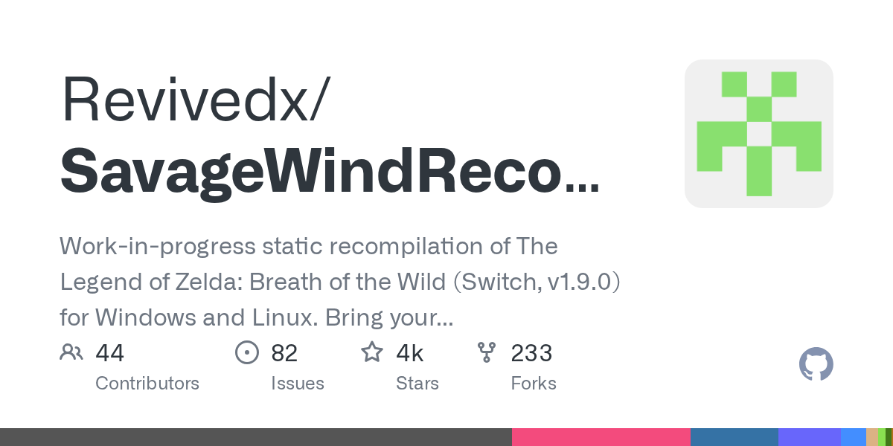</a> <a href="https://github.com/Revivedx/SavageWindRecomp"><b>SavageWindRecomp</b></a> Revivedx &#160;Nintendo Switch</td><td width="500">把闭源的《塞尔达传说：旷野之息》（Switch）变成你能在 Windows/Linux 上跑的原生程序（需自备文件）  使用 rea: 否 图片来源: 本仓库截图</td></tr>
<tr><td width="220"><a href="https://github.com/captainj-sparrow/astral-chain-pc-recomp">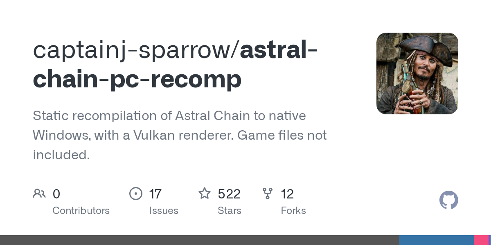</a> <a href="https://github.com/captainj-sparrow/astral-chain-pc-recomp"><b>astral-chain-pc-recomp</b></a> captainj-sparrow &#160;Nintendo Switch</td><td width="500">把闭源的《异界锁链》（Switch）变成你能在 Windows 上跑的原生程序（需自备游戏文件）  使用 rea: 否 图片来源: 本仓库截图</td></tr>
<tr><td width="220">— <a href="https://github.com/yozander2009-stack/Metroid-Dread-Recomp"><b>Metroid-Dread-Recomp</b></a> yozander2009-stack &#160;Nintendo Switch</td><td width="500">把闭源的《银河战士：生存恐惧》（Switch）变成你能在电脑上跑的原生程序（需自备文件）  使用 rea: 否 图片来源: —</td></tr>
</table>

### NES / FC

#### 反编译 / 重编译

<table>
<tr><th width="220">项目 / 图片</th><th width="500">简介</th></tr>
<tr><td width="220"> <a href="https://github.com/aldonunez/zelda1-disassembly"><b>zelda1-disassembly</b></a> aldonunez &#160;NES / FC</td><td width="500">初代塞尔达传说（FC）完整反汇编  使用 rea: 否 图片来源: <a href="https://upload.wikimedia.org/wikipedia/en/4/41/Legend_of_zelda_cover_%28with_cartridge%29_gold.png">维基百科（© 版权方）</a></td></tr>
</table>

#### 资源提取与工具

<table>
<tr><th width="220">项目 / 图片</th><th width="500">简介</th></tr>
<tr><td width="220"> <a href="https://github.com/SourMesen/Mesen2"><b>Mesen2</b></a> SourMesen &#160;NES / FC</td><td width="500">带强大调试工具的多机种模拟器  使用 rea: 否 图片来源: 仓库卡片</td></tr>
</table>

### SFC / SNES

#### 反编译 / 重编译

<table>
<tr><th width="220">项目 / 图片</th><th width="500">简介</th></tr>
<tr><td width="220"> <a href="https://github.com/snesrev/zelda3"><b>zelda3</b></a> snesrev &#160;SFC / SNES</td><td width="500">用 C 重写的众神的三角力量，支持宽屏（ROM 自备）  使用 rea: 否 图片来源: <a href="https://upload.wikimedia.org/wikipedia/en/2/21/The_Legend_of_Zelda_A_Link_to_the_Past_SNES_Game_Cover.jpg">维基百科（© 版权方）</a></td></tr>
<tr><td width="220"> <a href="https://github.com/snesrev/sm"><b>sm</b></a> snesrev &#160;SFC / SNES</td><td width="500">用 C 重写的超级银河战士（ROM 自备）  使用 rea: 否 图片来源: <a href="https://upload.wikimedia.org/wikipedia/en/e/e4/Smetroidbox.jpg">维基百科（© 版权方）</a></td></tr>
</table>

#### 重制 / 移植

<table>
<tr><th width="220">项目 / 图片</th><th width="500">简介</th></tr>
<tr><td width="220"> <a href="https://github.com/snesrev/smw"><b>smw</b></a> snesrev &#160;SFC / SNES</td><td width="500">用 C 重写的超级马里奥世界（ROM 自备）  使用 rea: 否 图片来源: <a href="https://upload.wikimedia.org/wikipedia/en/3/32/Super_Mario_World_Coverart.png">维基百科（© 版权方）</a></td></tr>
<tr><td width="220"> <a href="https://github.com/MrJackSpade/SuperMetroidDecomp"><b>SuperMetroidDecomp</b></a> MrJackSpade &#160;SFC / SNES</td><td width="500">把闭源的 SNES 游戏《超级银河战士》用 C# 重实现成源码移植，从你自己的 ROM 提取资源，支持现代 Windows 和 Android。  使用 rea: 否 图片来源: 仓库卡片</td></tr>
</table>

### MD / Genesis

#### 反编译 / 重编译

<table>
<tr><th width="220">项目 / 图片</th><th width="500">简介</th></tr>
<tr><td width="220"> <a href="https://github.com/sonicretro/s1disasm"><b>s1disasm</b></a> sonicretro &#160;MD / Genesis</td><td width="500">刺猬索尼克（MD）完整反汇编  使用 rea: 否 图片来源: <a href="https://upload.wikimedia.org/wikipedia/en/b/ba/Sonic_the_Hedgehog_1_Genesis_box_art.jpg">维基百科（© 版权方）</a></td></tr>
<tr><td width="220"> <a href="https://github.com/sonicretro/s2disasm"><b>s2disasm</b></a> sonicretro &#160;MD / Genesis</td><td width="500">索尼克 2（MD）完整反汇编  使用 rea: 否 图片来源: <a href="https://upload.wikimedia.org/wikipedia/en/0/0c/Sonic_2_US_Cover.jpg">维基百科（© 版权方）</a></td></tr>
<tr><td width="220"> <a href="https://github.com/sonicretro/skdisasm"><b>skdisasm</b></a> sonicretro &#160;MD / Genesis</td><td width="500">索尼克 3 &amp; 纳克鲁斯完整反汇编  使用 rea: 否 图片来源: <a href="https://upload.wikimedia.org/wikipedia/en/d/d3/Sonic_%26_Knuckles_cover.jpg">维基百科（© 版权方）</a></td></tr>
<tr><td width="220">— <a href="https://github.com/crabsmack/xmen2-pc"><b>xmen2-pc</b></a> crabsmack &#160;MD / Genesis</td><td width="500">把 1995 年 Genesis 游戏《X-Men 2: Clone Wars》从完整反编译重建成原生 PC 游戏，支持宽屏、高帧率和最多 4 人本地或在线合作。需要自己的 ROM。  使用 rea: 否 图片来源: —</td></tr>
</table>

#### 重制 / 移植

<table>
<tr><th width="220">项目 / 图片</th><th width="500">简介</th></tr>
<tr><td width="220"> <a href="https://github.com/RSDKModding/RSDKv4-Decompilation"><b>RSDKv4-Decompilation</b></a> RSDKModding &#160;MD / Genesis</td><td width="500">索尼克 1、2（2013）引擎的反编译  使用 rea: 否 图片来源: 项目 README</td></tr>
<tr><td width="220"> <a href="https://github.com/RSDKModding/RSDKv5-Decompilation"><b>RSDKv5-Decompilation</b></a> RSDKModding &#160;MD / Genesis</td><td width="500">索尼克狂热的引擎反编译（读取你自己的数据文件）  使用 rea: 否 图片来源: 项目 README</td></tr>
<tr><td width="220">— <a href="https://github.com/YuutaTsubasa/ChaotixRecompiled"><b>ChaotixRecompiled</b></a> YuutaTsubasa &#160;MD / Genesis</td><td width="500">把 1995 年 Sega 32X 游戏《Knuckles&#x27; Chaotix》静态重编译成原生多平台程序（Windows/Linux/macOS/Android），支持真正宽屏。需要自己的 ROM。  使用 rea: 否 图片来源: —</td></tr>
<tr><td width="220">— <a href="https://github.com/RuiNelson/StreetsOfRageProject"><b>StreetsOfRageProject</b></a> RuiNelson &#160;MD / Genesis</td><td width="500">从零重写并重编译了世嘉Mega Drive经典游戏《怒之铁拳》（Streets of Rage），让你可以在现代电脑上用自己合法拥有的ROM玩和研究它。  使用 rea: 否 图片来源: —</td></tr>
</table>

### 世嘉土星

#### 反编译 / 重编译

<table>
<tr><th width="220">项目 / 图片</th><th width="500">简介</th></tr>
<tr><td width="220"> <a href="https://github.com/yaz0r/Azel"><b>Azel</b></a> yaz0r &#160;世嘉土星</td><td width="500">逆向并重新实现的铁甲飞龙 Saga  使用 rea: 否 图片来源: 项目 README</td></tr>
<tr><td width="220">— <a href="https://github.com/indieindie7/congo-decomp"><b>congo-decomp</b></a> indieindie7 &#160;世嘉土星</td><td width="500">对闭源的世嘉土星游戏《刚果：失落的津吉城》做的仅命名反编译，提供 Ghidra 函数名，不含任何游戏数据。  使用 rea: 否 图片来源: —</td></tr>
</table>

#### 重制 / 移植

<table>
<tr><th width="220">项目 / 图片</th><th width="500">简介</th></tr>
<tr><td width="220">— <a href="https://github.com/mattkuhnQAAI/sfiii-native"><b>sfiii-native</b></a> mattkuhnQAAI &#160;世嘉土星</td><td width="500">世嘉土星《Shining Force III》（情景 1–3）的实验性原生 PC 静态重编译移植，支持宽屏预览  使用 rea: 否 图片来源: —</td></tr>
</table>

### Game Boy

#### 反编译 / 重编译

<table>
<tr><th width="220">项目 / 图片</th><th width="500">简介</th></tr>
<tr><td width="220"> <b>Pokémon Red / Blue</b> <a href="https://github.com/pret/pokered"><b>pokered</b></a> pret &#160;Game Boy</td><td width="500">宝可梦红/蓝完整反汇编  使用 rea: 否 图片来源: <a href="https://upload.wikimedia.org/wikipedia/en/a/af/Pok%C3%A9mon_Red_and_Blue_cover_art.webp">维基百科（© 版权方）</a></td></tr>
<tr><td width="220"> <b>Pokémon Crystal</b> <a href="https://github.com/pret/pokecrystal"><b>pokecrystal</b></a> pret &#160;Game Boy</td><td width="500">宝可梦水晶完整反汇编  使用 rea: 否 图片来源: 维护者发布</td></tr>
<tr><td width="220"> <a href="https://github.com/zladx/LADX-Disassembly"><b>LADX-Disassembly</b></a> zladx &#160;Game Boy</td><td width="500">塞尔达：织梦岛 DX 完整反汇编  使用 rea: 否 图片来源: 项目 README</td></tr>
<tr><td width="220"> <b>Pokémon Yellow</b> <a href="https://github.com/pret/pokeyellow"><b>pokeyellow</b></a> pret &#160;Game Boy</td><td width="500">宝可梦皮卡丘版完整反汇编  使用 rea: 否 图片来源: <a href="https://upload.wikimedia.org/wikipedia/en/a/af/Pok%C3%A9mon_Red_and_Blue_cover_art.webp">维基百科（© 版权方）</a></td></tr>
<tr><td width="220"> <b>Pokémon Gold / Silver</b> <a href="https://github.com/pret/pokegold"><b>pokegold</b></a> pret &#160;Game Boy</td><td width="500">宝可梦金/银完整反汇编  使用 rea: 否 图片来源: <a href="https://upload.wikimedia.org/wikipedia/en/4/4c/Pok%C3%A9mon_box_art_-_Gold_Version.png">维基百科（© 版权方）</a></td></tr>
</table>

### GBA

#### 反编译 / 重编译

<table>
<tr><th width="220">项目 / 图片</th><th width="500">简介</th></tr>
<tr><td width="220"> <a href="https://github.com/pret/pokeemerald"><b>pokeemerald</b></a> pret &#160;GBA</td><td width="500">宝可梦绿宝石的 C 源码，无数改版的起点  使用 rea: 否 图片来源: 维护者发布</td></tr>
<tr><td width="220"> <a href="https://github.com/pret/pokefirered"><b>pokefirered</b></a> pret &#160;GBA</td><td width="500">宝可梦火红/叶绿的 C 源码  使用 rea: 否 图片来源: <a href="https://upload.wikimedia.org/wikipedia/en/a/a7/Pokemon_LeafGreen_box.jpg">维基百科（© 版权方）</a></td></tr>
<tr><td width="220"> <a href="https://github.com/pret/pokeruby"><b>pokeruby</b></a> pret &#160;GBA</td><td width="500">宝可梦红宝石/蓝宝石的 C 源码  使用 rea: 否 图片来源: <a href="https://upload.wikimedia.org/wikipedia/en/b/be/PokemonRubySapphireBox.jpg">维基百科（© 版权方）</a></td></tr>
<tr><td width="220"> <a href="https://github.com/zeldaret/tmc"><b>tmc</b></a> zeldaret &#160;GBA</td><td width="500">塞尔达：缩小帽，反编译为 C  使用 rea: 否 图片来源: <a href="https://upload.wikimedia.org/wikipedia/en/0/0a/TLOZ-_Minish_Cap_NA_Box_art.png">维基百科（© 版权方）</a></td></tr>
<tr><td width="220"> <a href="https://github.com/pret/pmd-red"><b>pmd-red</b></a> pret &#160;GBA</td><td width="500">宝可梦不可思议的迷宫 赤之救助队，反编译为 C  使用 rea: 否 图片来源: <a href="https://upload.wikimedia.org/wikipedia/en/d/d3/Pok%C3%A9mon_Mystery_Dungeon_Blue_and_Red_Rescue_Team_cover_arts.jpg">维基百科（© 版权方）</a></td></tr>
<tr><td width="220"> <a href="https://github.com/jiangzhengwenjz/katam"><b>katam</b></a> jiangzhengwenjz &#160;GBA</td><td width="500">星之卡比：镜之大迷宫，反编译为 C  使用 rea: 否 图片来源: <a href="https://upload.wikimedia.org/wikipedia/en/0/0b/Kirby_%26_the_Amazing_Mirror.jpg">维基百科（© 版权方）</a></td></tr>
</table>

### 任天堂 64

#### 反编译 / 重编译

<table>
<tr><th width="220">项目 / 图片</th><th width="500">简介</th></tr>
<tr><td width="220"> <b>Super Mario 64</b> <a href="https://github.com/n64decomp/sm64"><b>sm64</b></a> n64decomp &#160;任天堂 64</td><td width="500">可构建的超级马里奥 64 C 源码（不含 ROM）  使用 rea: 否 图片来源: <a href="https://upload.wikimedia.org/wikipedia/en/e/e9/Super_Mario_64.png">维基百科（© 版权方）</a></td></tr>
<tr><td width="220"> <a href="https://github.com/N64Recomp/N64Recomp"><b>N64Recomp</b></a> N64Recomp &#160;任天堂 64</td><td width="500">把 N64 游戏直接重编译成原生代码  使用 rea: 否 图片来源: 仓库卡片</td></tr>
<tr><td width="220"> <b>The Legend of Zelda: Ocarina of Time</b> <a href="https://github.com/zeldaret/oot"><b>oot</b></a> zeldaret &#160;任天堂 64</td><td width="500">时之笛完整反编译为 C（不含 ROM）  使用 rea: 否 图片来源: 维护者发布</td></tr>
<tr><td width="220"> <a href="https://github.com/HarbourMasters/Starship"><b>Starship</b></a> HarbourMasters &#160;任天堂 64</td><td width="500">在 PC 上原生运行星际火狐 64（ROM 自备）  使用 rea: 否 图片来源: <a href="https://upload.wikimedia.org/wikipedia/en/6/63/StarFox64_N64_Game_Box.jpg">维基百科（© 版权方）</a></td></tr>
<tr><td width="220"> <a href="https://github.com/zeldaret/mm"><b>mm</b></a> zeldaret &#160;任天堂 64</td><td width="500">塞尔达：姆吉拉的假面，反编译为 C  使用 rea: 否 图片来源: 维护者发布</td></tr>
<tr><td width="220"> <a href="https://github.com/pmret/papermario"><b>papermario</b></a> pmret &#160;任天堂 64</td><td width="500">纸片马里奥（N64），反编译为 C  使用 rea: 否 图片来源: <a href="https://upload.wikimedia.org/wikipedia/en/6/61/Papermario.jpg">维基百科（© 版权方）</a></td></tr>
<tr><td width="220"> <a href="https://github.com/n64decomp/mk64"><b>mk64</b></a> n64decomp &#160;任天堂 64</td><td width="500">马里奥赛车 64，反编译为 C  使用 rea: 否 图片来源: <a href="https://upload.wikimedia.org/wikipedia/en/a/a1/Mario_Kart_64.jpg">维基百科（© 版权方）</a></td></tr>
<tr><td width="220"> <a href="https://github.com/n64decomp/perfect_dark"><b>perfect_dark</b></a> n64decomp &#160;任天堂 64</td><td width="500">完美黑暗（N64），反编译为 C  使用 rea: 否 图片来源: <a href="https://upload.wikimedia.org/wikipedia/en/3/32/Perfect_dark_box.jpg">维基百科（© 版权方）</a></td></tr>
<tr><td width="220"> <a href="https://github.com/DinosaurPlanetRecomp/dino-recomp"><b>dino-recomp</b></a> DinosaurPlanetRecomp &#160;任天堂 64</td><td width="500">把 N64 原型游戏 Dinosaur Planet 静态重编译成原生 PC 移植，带图形增强。  使用 rea: 否 图片来源: 仓库卡片</td></tr>
<tr><td width="220">— <a href="https://github.com/fliperama86/cvlod_recomp"><b>cvlod_recomp</b></a> fliperama86 &#160;任天堂 64</td><td width="500">用 N64Recomp 把任天堂 64 上的《恶魔城：暗夜之光》变成可以在电脑上直接运行的原生程序。需要自己准备 ROM。  使用 rea: 否 图片来源: —</td></tr>
<tr><td width="220"> <a href="https://github.com/bryantmh/rush2recompiled"><b>rush2recompiled</b></a> bryantmh &#160;任天堂 64</td><td width="500">把 N64 上的 Rush 2 赛车游戏静态重编译成原生 PC 版本，支持宽屏和高帧率。  使用 rea: 否 图片来源: 仓库卡片</td></tr>
<tr><td width="220">— <a href="https://github.com/RetroReversing/v-rally-decomp"><b>v-rally-decomp</b></a> RetroReversing &#160;任天堂 64</td><td width="500">任天堂64游戏《V-Rally 99欧洲版》的匹配反编译项目，用AI辅助从ROM还原，并逐字节验证与原版一致。  使用 rea: 否 图片来源: —</td></tr>
<tr><td width="220"> <a href="https://github.com/alemigav/re2-64-decomp"><b>re2-64-decomp</b></a> alemigav &#160;任天堂 64</td><td width="500">用 AI 工具（REA + Ghidra）拆解任天堂64版《生化危机2》。有数千个反编译函数和验证套件，不含游戏ROM。  使用 rea: ✅ 是 图片来源: 仓库卡片</td></tr>
<tr><td width="220">— <a href="https://github.com/RetroReversing/turok-decomp"><b>turok-decomp</b></a> RetroReversing &#160;任天堂 64</td><td width="500">任天堂64游戏《恐龙猎人》（Turok: Dinosaur Hunter，欧洲版）的部分匹配反编译，用AI辅助从ROM还原。需要你自己拥有的ROM。  使用 rea: 否 图片来源: —</td></tr>
<tr><td width="220"><a href="https://github.com/RetroReversing/penny-racers-decomp">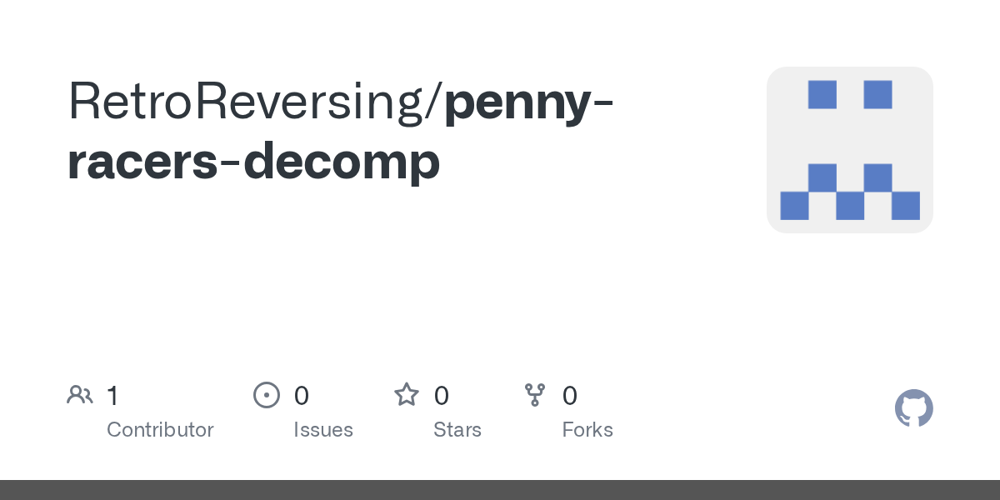</a> <a href="https://github.com/RetroReversing/penny-racers-decomp"><b>penny-racers-decomp</b></a> RetroReversing &#160;任天堂 64</td><td width="500">任天堂 64 游戏《Penny Racers》的匹配反编译公开进度，AI 助手只保留能逐字节重建原版的 C 代码。  使用 rea: 否 图片来源: 仓库卡片</td></tr>
</table>

#### 重制 / 移植

<table>
<tr><th width="220">项目 / 图片</th><th width="500">简介</th></tr>
<tr><td width="220"> <b>The Legend of Zelda: Majora’s Mask</b> <a href="https://github.com/Zelda64Recomp/Zelda64Recomp"><b>Zelda64Recomp</b></a> Zelda64Recomp &#160;任天堂 64</td><td width="500">重编译到 PC 的姆吉拉的假面，支持现代操作（ROM 自备）  使用 rea: 否 图片来源: 项目 README</td></tr>
<tr><td width="220"> <b>The Legend of Zelda: Ocarina of Time</b> <a href="https://github.com/HarbourMasters/Shipwright"><b>Shipwright</b></a> HarbourMasters &#160;任天堂 64</td><td width="500">在 PC 上原生运行塞尔达：时之笛（ROM 自备）  使用 rea: 否 图片来源: <a href="https://upload.wikimedia.org/wikipedia/en/5/57/The_Legend_of_Zelda_Ocarina_of_Time.jpg">维基百科（© 版权方）</a></td></tr>
<tr><td width="220"> <a href="https://github.com/2ship2harkinian/2ship2harkinian"><b>2ship2harkinian</b></a> 2ship2harkinian &#160;任天堂 64</td><td width="500">在 PC 上原生运行塞尔达：姆吉拉的假面（ROM 自备）  使用 rea: 否 图片来源: <a href="https://upload.wikimedia.org/wikipedia/en/6/60/The_Legend_of_Zelda_-_Majora%27s_Mask_Box_Art.jpg">维基百科（© 版权方）</a></td></tr>
<tr><td width="220"> <a href="https://github.com/HarvestMoon64Recomp/HarvestMoon64Recomp"><b>HarvestMoon64Recomp</b></a> HarvestMoon64Recomp &#160;任天堂 64</td><td width="500">用现代电脑玩《牧场物语64》：把原版 N64 游戏静态重编译成原生程序，画质更好，还能装模组。  使用 rea: 否 图片来源: 仓库卡片</td></tr>
<tr><td width="220"><a href="https://github.com/TK22-26/JetForceGemini-Recomp">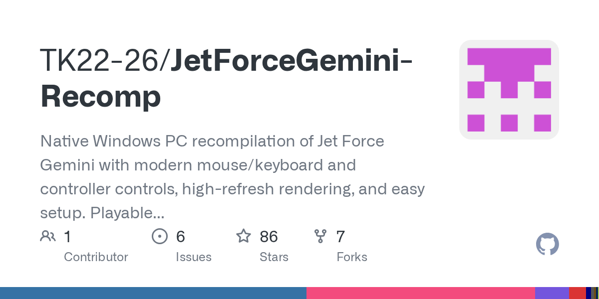</a> <a href="https://github.com/TK22-26/JetForceGemini-Recomp"><b>JetForceGemini-Recomp</b></a> TK22-26 &#160;任天堂 64</td><td width="500">把 1999 年的 N64 游戏《双子星英雄》的代码转成能在 Windows 上原生运行的程序。需要自己的 ROM。  使用 rea: 否 图片来源: 仓库卡片</td></tr>
<tr><td width="220"> <a href="https://github.com/RetroPulse03/WinBackRecomp"><b>WinBackRecomp</b></a> RetroPulse03 &#160;任天堂 64</td><td width="500">N64游戏《WinBack：秘密行动》的原生PC移植版，通过静态重编译实现。不含ROM。  使用 rea: 否 图片来源: 仓库卡片</td></tr>
</table>

#### 资源提取与工具

<table>
<tr><th width="220">项目 / 图片</th><th width="500">简介</th></tr>
<tr><td width="220"><a href="https://github.com/ethteck/splat">预览暂不可用 · 查看原项目</a> <a href="https://github.com/ethteck/splat"><b>splat</b></a> ethteck &#160;任天堂 64</td><td width="500">把 N64、PS1 二进制切分成可反编译的工程  使用 rea: 否 图片来源: <a href="https://github.com/ethteck/splat">仓库卡片</a></td></tr>
<tr><td width="220"> <a href="https://github.com/NEstelami/ZAPD"><b>ZAPD</b></a> NEstelami &#160;任天堂 64</td><td width="500">把 Zelda 64 的资源转成可编辑的源文件  使用 rea: 否 图片来源: 项目 README</td></tr>
</table>

### GameCube

#### 反编译 / 重编译

<table>
<tr><th width="220">项目 / 图片</th><th width="500">简介</th></tr>
<tr><td width="220"> <b>Super Smash Bros. Melee</b> <a href="https://github.com/doldecomp/melee"><b>melee</b></a> doldecomp &#160;GameCube</td><td width="500">任天堂明星大乱斗 DX，反编译为 C  使用 rea: 否 图片来源: <a href="https://upload.wikimedia.org/wikipedia/en/7/75/Super_Smash_Bros_Melee_box_art.png">维基百科（© 版权方）</a></td></tr>
<tr><td width="220"> <b>The Legend of Zelda: Twilight Princess</b> <a href="https://github.com/zeldaret/tp"><b>tp</b></a> zeldaret &#160;GameCube</td><td width="500">塞尔达：黄昏公主，反编译为 C++  使用 rea: 否 图片来源: <a href="https://upload.wikimedia.org/wikipedia/en/0/0e/The_Legend_of_Zelda_Twilight_Princess_Game_Cover.jpg">维基百科（© 版权方）</a></td></tr>
<tr><td width="220"> <b>The Legend of Zelda: The Wind Waker</b> <a href="https://github.com/zeldaret/tww"><b>tww</b></a> zeldaret &#160;GameCube</td><td width="500">塞尔达：风之杖，反编译为 C  使用 rea: 否 图片来源: <a href="https://upload.wikimedia.org/wikipedia/en/7/79/The_Legend_of_Zelda_The_Wind_Waker.jpg">维基百科（© 版权方）</a></td></tr>
<tr><td width="220"> <a href="https://github.com/projectPiki/pikmin2"><b>pikmin2</b></a> projectPiki &#160;GameCube</td><td width="500">皮克敏 2，反编译为 C++  使用 rea: 否 图片来源: <a href="https://upload.wikimedia.org/wikipedia/en/3/38/Pikmin_2_Case.jpg">维基百科（© 版权方）</a></td></tr>
<tr><td width="220"> <a href="https://github.com/doldecomp/sms"><b>sms</b></a> doldecomp &#160;GameCube</td><td width="500">超级马里奥阳光，反编译为 C++  使用 rea: 否 图片来源: <a href="https://upload.wikimedia.org/wikipedia/en/0/05/Super_Mario_Sunshine_Box_Art.png">维基百科（© 版权方）</a></td></tr>
<tr><td width="220">— <a href="https://github.com/karamzov123/fzero-gx-decomp"><b>fzero-gx-decomp</b></a> karamzov123 &#160;GameCube</td><td width="500">GameCube 赛车《F-Zero GX》（美版）的匹配反编译，能逐字节还原原版二进制  使用 rea: 否 图片来源: —</td></tr>
<tr><td width="220"> <a href="https://github.com/octavioCuatrochio/nfsu2-gcpc"><b>nfsu2-gcpc</b></a> octavioCuatrochio &#160;GameCube</td><td width="500">对《极品飞车：地下狂飙2》进行函数级重写，行为与原版 PC 游戏一致，借助 GameCube 版的调试符号获得原始名称和类型。通过代理 DLL 在原版游戏内运行。  使用 rea: 否 图片来源: 仓库卡片</td></tr>
<tr><td width="220"> <a href="https://github.com/dev-camo/shadow-decomp"><b>shadow-decomp</b></a> dev-camo &#160;GameCube</td><td width="500">对闭源的 GameCube 游戏《刺猬夏特》进行的匹配反编译进行中项目。需要自己的游戏副本。  使用 rea: 否 图片来源: 仓库卡片</td></tr>
</table>

#### 重制 / 移植

<table>
<tr><th width="220">项目 / 图片</th><th width="500">简介</th></tr>
<tr><td width="220">— <a href="https://github.com/Odrannnn/MetroidPrimePort"><b>MetroidPrimePort</b></a> Odrannnn &#160;GameCube</td><td width="500">基于匹配反编译重建的《银河战士Prime》原生多平台移植（原闭源GameCube游戏），无需模拟器，还能导入重制版模型。  使用 rea: 否 图片来源: —</td></tr>
<tr><td width="220">— <a href="https://github.com/Odrannnn/MetroidPrime2Port"><b>MetroidPrime2Port</b></a> Odrannnn &#160;GameCube</td><td width="500">从零基于反编译重建的《银河战士Prime 2：回声》原生多平台移植（原闭源GameCube游戏），无需模拟器即可在PC、Linux、安卓等设备上玩。  使用 rea: 否 图片来源: —</td></tr>
<tr><td width="220"> <a href="https://github.com/Hero88go/melee-unlocked"><b>melee-unlocked</b></a> Hero88go &#160;GameCube</td><td width="500">把 Super Smash Bros. Melee 的反编译源码编译成原生 Windows 版本，解锁帧率并支持 Slippi 联机。  使用 rea: 否 图片来源: 仓库卡片</td></tr>
<tr><td width="220">— <a href="https://github.com/Trick230/DualizeRecomp"><b>DualizeRecomp</b></a> Trick230 &#160;GameCube</td><td width="500">把 Wii 游戏《NiGHTS: Journey of Dreams》静态重编译成原生 PC 程序  使用 rea: 否 图片来源: —</td></tr>
</table>

#### 资源提取与工具

<table>
<tr><th width="220">项目 / 图片</th><th width="500">简介</th></tr>
<tr><td width="220"> <a href="https://github.com/encounter/objdiff"><b>objdiff</b></a> encounter &#160;GameCube</td><td width="500">一眼看出你的反编译函数还差在哪  使用 rea: 否 图片来源: 项目 README</td></tr>
<tr><td width="220"> <a href="https://github.com/encounter/decomp-toolkit"><b>decomp-toolkit</b></a> encounter &#160;GameCube</td><td width="500">众多 GameCube、Wii 反编译项目背后的工具链  使用 rea: 否 图片来源: 仓库卡片</td></tr>
</table>

### Wii

#### 反编译 / 重编译

<table>
<tr><th width="220">项目 / 图片</th><th width="500">简介</th></tr>
<tr><td width="220"> <a href="https://github.com/zeldaret/ss"><b>ss</b></a> zeldaret &#160;Wii</td><td width="500">塞尔达：天空之剑，反编译为 C  使用 rea: 否 图片来源: <a href="https://upload.wikimedia.org/wikipedia/en/9/99/Legend_of_Zelda_Skyward_Sword_boxart.png">维基百科（© 版权方）</a></td></tr>
<tr><td width="220"> <a href="https://github.com/DarkRTA/rb3"><b>rb3</b></a> DarkRTA &#160;Wii</td><td width="500">摇滚乐队 3（Wii），反编译为 C++  使用 rea: 否 图片来源: <a href="https://upload.wikimedia.org/wikipedia/en/3/3b/Rock_Band_3_Game_Cover.jpg">维基百科（© 版权方）</a></td></tr>
<tr><td width="220">— <a href="https://github.com/frootloops-1/SlopSportsResort"><b>SlopSportsResort</b></a> frootloops-1 &#160;Wii</td><td width="500">用 AI 辅助对闭源的《Wii 运动 度假胜地》进行反编译，试图还原它的代码。  使用 rea: 否 图片来源: —</td></tr>
</table>

#### 重制 / 移植

<table>
<tr><th width="220">项目 / 图片</th><th width="500">简介</th></tr>
<tr><td width="220">— <a href="https://github.com/josiahg2502-glitch/BrawlRecompiled"><b>BrawlRecompiled</b></a> josiahg2502-glitch &#160;Wii</td><td width="500">把 2008 年 Wii 游戏《大乱斗 特别版》（Super Smash Bros. Brawl）的 PowerPC 代码静态重编译成原生 PC 程序，支持 4K、高帧率和模组。需要自己的光盘。  使用 rea: 否 图片来源: —</td></tr>
</table>

### NDS

#### 反编译 / 重编译

<table>
<tr><th width="220">项目 / 图片</th><th width="500">简介</th></tr>
<tr><td width="220"> <a href="https://github.com/pret/pokeheartgold"><b>pokeheartgold</b></a> pret &#160;NDS</td><td width="500">宝可梦心金/魂银，反编译为 C  使用 rea: 否 图片来源: <a href="https://upload.wikimedia.org/wikipedia/en/c/cb/PokemonHGSSBox.jpg">维基百科（© 版权方）</a></td></tr>
<tr><td width="220"> <a href="https://github.com/pret/pokeplatinum"><b>pokeplatinum</b></a> pret &#160;NDS</td><td width="500">宝可梦白金的 C 源码  使用 rea: 否 图片来源: 维护者发布</td></tr>
<tr><td width="220"> <a href="https://github.com/tangosdev/sm64ds-decomp"><b>sm64ds-decomp</b></a> tangosdev &#160;NDS</td><td width="500">从零开始、逐字节匹配的《超级马力欧64 DS》反编译项目，把原版 DS 游戏还原成可读的 C/C++ 源码。  使用 rea: 否 图片来源: 仓库卡片</td></tr>
<tr><td width="220"> <a href="https://github.com/zeldaret/ph"><b>ph</b></a> zeldaret &#160;NDS</td><td width="500">塞尔达：幻影沙漏，反编译为 C  使用 rea: 否 图片来源: <a href="https://upload.wikimedia.org/wikipedia/en/5/5e/The_Legend_of_Zelda_Phantom_Hourglass_Game_Cover.jpg">维基百科（© 版权方）</a></td></tr>
<tr><td width="220">— <a href="https://github.com/fuddlesworth/pokebw2"><b>pokebw2</b></a> fuddlesworth &#160;NDS</td><td width="500">反编译闭源的任天堂 DS 游戏《宝可梦 黑2 / 白2》，恢复源码以便更好理解和保存。  使用 rea: 否 图片来源: —</td></tr>
</table>

### 3DS

#### 资源提取与工具

<table>
<tr><th width="220">项目 / 图片</th><th width="500">简介</th></tr>
<tr><td width="220"> <a href="https://github.com/3DSGuy/Project_CTR"><b>Project_CTR</b></a> 3DSGuy &#160;3DS</td><td width="500">构建和查看 3DS 文件格式（ctrtool / makerom）  使用 rea: 否 图片来源: 仓库卡片</td></tr>
</table>

### PS1

#### 反编译 / 重编译

<table>
<tr><th width="220">项目 / 图片</th><th width="500">简介</th></tr>
<tr><td width="220"> <a href="https://github.com/Xeeynamo/sotn-decomp"><b>sotn-decomp</b></a> Xeeynamo &#160;PS1</td><td width="500">恶魔城：月下夜想曲，反编译为 C  使用 rea: 否 图片来源: 维护者发布</td></tr>
<tr><td width="220"> <a href="https://github.com/shdecompilations/silent-hill-decomp"><b>silent-hill-decomp</b></a> shdecompilations &#160;PS1</td><td width="500">寂静岭（PS1）反编译进行中  使用 rea: 否 图片来源: <a href="https://upload.wikimedia.org/wikipedia/en/9/96/Silent_Hill_video_game_cover.png">维基百科（© 版权方）</a></td></tr>
<tr><td width="220"> <a href="https://github.com/SlickAmogus/silent-hill-decomp"><b>silent-hill-decomp</b></a> SlickAmogus &#160;PS1</td><td width="500">基于对原版《寂静岭1》PS1 版本的反编译，做成了可以在多平台玩的开源移植版。  使用 rea: 否 图片来源: 仓库卡片</td></tr>
<tr><td width="220">— <a href="https://github.com/TekRantGaming/muppet-racemania-recompiled"><b>muppet-racemania-recompiled</b></a> TekRantGaming &#160;PS1</td><td width="500">把闭源的《布偶赛车》（PlayStation）通过静态重编译做成了 PC 原生版。支持 16:9 和 60 帧。  使用 rea: 否 图片来源: —</td></tr>
<tr><td width="220"> <a href="https://github.com/raulcorreia7/bof3-decomp"><b>bof3-decomp</b></a> raulcorreia7 &#160;PS1</td><td width="500">对闭源的 PlayStation 游戏《龙战士 III》（美版）进行的匹配反编译。  使用 rea: 否 图片来源: 仓库卡片</td></tr>
<tr><td width="220"><a href="https://github.com/cdlewis/snowboardkidsplus-decomp">预览暂不可用 · 查看原项目</a> <a href="https://github.com/cdlewis/snowboardkidsplus-decomp"><b>snowboardkidsplus-decomp</b></a> cdlewis &#160;PS1</td><td width="500">对闭源的 PlayStation 游戏《滑雪板小子 Plus》进行的匹配反编译。  使用 rea: 否 图片来源: <a href="https://github.com/cdlewis/snowboardkidsplus-decomp">仓库卡片</a></td></tr>
</table>

#### 重制 / 移植

<table>
<tr><th width="220">项目 / 图片</th><th width="500">简介</th></tr>
<tr><td width="220">— <a href="https://github.com/AndrewAltimit/legend-of-legaia-re"><b>legend-of-legaia-re</b></a> AndrewAltimit &#160;PS1</td><td width="500">用 Rust 从零重写 1999 年闭源 PS1 游戏《雷盖亚传说》（Legend of Legaia），基于 Ghidra 逆向出的格式和逻辑文档。需要自备光盘镜像。  使用 rea: 否 图片来源: —</td></tr>
</table>

### PS2

#### 反编译 / 重编译

<table>
<tr><th width="220">项目 / 图片</th><th width="500">简介</th></tr>
<tr><td width="220"> <a href="https://github.com/ran-j/PS2Recomp"><b>PS2Recomp</b></a> ran-j &#160;PS2</td><td width="500">把 PS2 游戏重编译成原生 PC 程序  使用 rea: 否 图片来源: 仓库卡片</td></tr>
<tr><td width="220"> <b>Jak and Daxter / Jak II</b> <a href="https://github.com/open-goal/jak-project"><b>jak-project</b></a> open-goal &#160;PS2</td><td width="500">在 PC 上原生运行杰克与达斯特（光盘自备）  使用 rea: 否 图片来源: 项目 README</td></tr>
<tr><td width="220"> <a href="https://github.com/OpenRAC/rac1-decomp"><b>rac1-decomp</b></a> OpenRAC &#160;PS2</td><td width="500">PS2原版《瑞奇与叮当》的匹配反编译：能逐字节重建原版可执行文件的C/C++源码。  使用 rea: 否 图片来源: 仓库卡片</td></tr>
<tr><td width="220">— <a href="https://github.com/Yaz-Myst/ZOE-Recompiled"><b>ZOE-Recompiled</b></a> Yaz-Myst &#160;PS2</td><td width="500">把闭源的《终极地带》（PS2）通过静态重编译做成了能在 Windows 上原生跑的版本。需要自己带原版光盘。  使用 rea: 否 图片来源: —</td></tr>
<tr><td width="220"> <a href="https://github.com/TheRealestNwah/sotc-decomp"><b>sotc-decomp</b></a> TheRealestNwah &#160;PS2</td><td width="500">《旺达与巨像》（PS2）的匹配反编译项目，目标是还原原版游戏代码，最终做成原生 PC 移植。  使用 rea: 否 图片来源: 仓库卡片</td></tr>
<tr><td width="220">— <a href="https://github.com/OpenRAC/rac2-decomp"><b>rac2-decomp</b></a> OpenRAC &#160;PS2</td><td width="500">针对闭源 PlayStation 2 游戏《Ratchet &amp; Clank: Going Commando》（USA v1.01）的字节级精确重建工具和匹配反编译研究。不含游戏资源。  使用 rea: 否 图片来源: —</td></tr>
<tr><td width="220"><a href="https://github.com/Destinity13/TimeSplitters-2-Native-Linux-Recomp">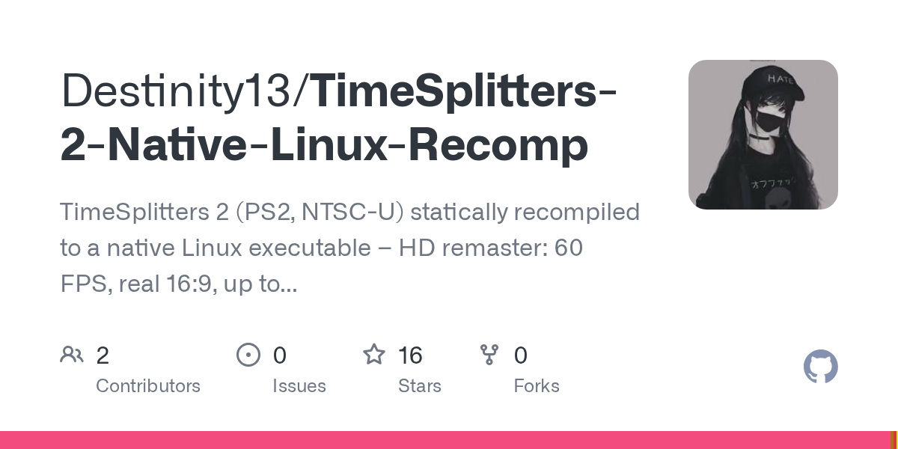</a> <a href="https://github.com/Destinity13/TimeSplitters-2-Native-Linux-Recomp"><b>TimeSplitters-2-Native-Linux-Recomp</b></a> Destinity13 &#160;PS2</td><td width="500">把原版 PlayStation 2《时空分裂者2》变成能在 Linux 和 Steam Deck 上以 60 帧、真正宽屏运行的原生游戏，用你自己的光盘。  使用 rea: 否 图片来源: 仓库卡片</td></tr>
<tr><td width="220"><a href="https://github.com/C-GBL/P3FES-Decompilation">预览暂不可用 · 查看原项目</a> <a href="https://github.com/C-GBL/P3FES-Decompilation"><b>P3FES-Decompilation</b></a> C-GBL &#160;PS2</td><td width="500">把闭源的《女神异闻录3 FES》（PS2）通过静态重编译成 C++，做成能在 Windows 上原生运行的版本。需要自己带游戏。  使用 rea: 否 图片来源: <a href="https://github.com/C-GBL/P3FES-Decompilation">项目 README</a></td></tr>
<tr><td width="220"> <a href="https://github.com/TekRantGaming/cartoon-network-racing-recompiled"><b>cartoon-network-racing-recompiled</b></a> TekRantGaming &#160;PS2</td><td width="500">把闭源的《卡通频道赛车》（PS2）通过静态重编译做成了 PC 原生版。支持宽屏和高帧率。需要自己带光盘。  使用 rea: 否 图片来源: 项目 README</td></tr>
<tr><td width="220">— <a href="https://github.com/OpenRAC/rac5-sm-decomp"><b>rac5-sm-decomp</b></a> OpenRAC &#160;PS2</td><td width="500">对 PS2 游戏《瑞奇与叮当：大小战争》进行匹配式反编译，目标是还原出能编译出原始二进制的可读 C 代码。  使用 rea: 否 图片来源: —</td></tr>
<tr><td width="220">— <a href="https://github.com/Megami-Decomps/smt3-decomp"><b>smt3-decomp</b></a> Megami-Decomps &#160;PS2</td><td width="500">对 PS2 RPG《真·女神转生 III：夜曲》进行匹配式反编译，还原出接近原始的 C 代码。  使用 rea: 否 图片来源: —</td></tr>
<tr><td width="220">— <a href="https://github.com/andrewnakas/thug-decomp"><b>thug-decomp</b></a> andrewnakas &#160;PS2</td><td width="500">PlayStation 2游戏《托尼·霍克地下世界》的匹配反编译。把原始C++源码逐函数还原，编译后和零售版光盘字节完全一致。  使用 rea: 否 图片来源: —</td></tr>
<tr><td width="220"> <a href="https://github.com/WeAreTommyBruh/Legaia2-Decomp"><b>Legaia2-Decomp</b></a> WeAreTommyBruh &#160;PS2</td><td width="500">把闭源的 PlayStation 2 游戏《Legaia 2: Duel Saga》反编译成可读的 C 代码，目标是字节级一致地重建原版可执行文件。  使用 rea: 否 图片来源: 项目 README</td></tr>
<tr><td width="220"> <a href="https://github.com/Megami-Decomps/raidou-decomp"><b>raidou-decomp</b></a> Megami-Decomps &#160;PS2</td><td width="500">把《真·女神转生 恶魔召唤师 晓月》1和2（PS2）的闭源代码从零还原成能编译出一模一样原版程序的 C 代码。  使用 rea: 否 图片来源: 仓库卡片</td></tr>
</table>

#### 重制 / 移植

<table>
<tr><th width="220">项目 / 图片</th><th width="500">简介</th></tr>
<tr><td width="220">— <a href="https://github.com/gothamor/gta-vcs-recomp"><b>gta-vcs-recomp</b></a> gothamor &#160;PS2</td><td width="500">把原版 PS2 游戏《GTA：罪恶都市传奇》的可执行文件重编译成原生 Windows 和 Linux 程序。需要自己提供光盘镜像。  使用 rea: 否 图片来源: —</td></tr>
<tr><td width="220">— <a href="https://github.com/AsobiCodes/rac-rs"><b>rac-rs</b></a> AsobiCodes &#160;PS2</td><td width="500">把 2002 年的 PS2 游戏《Ratchet &amp; Clank》（拉切特与克拉克）静态重编译成原生 PC 程序，无需模拟器即可运行。需要自己的光盘。  使用 rea: 否 图片来源: —</td></tr>
<tr><td width="220"> <a href="https://github.com/thiagordsfx/urban-reign-recomp"><b>urban-reign-recomp</b></a> thiagordsfx &#160;PS2</td><td width="500">把 PS2 格斗游戏《都市统治》通过静态重编译做成原生 PC 移植版，支持 60 帧、高分辨率和 HD 贴图。  使用 rea: 否 图片来源: 仓库卡片</td></tr>
<tr><td width="220"> <a href="https://github.com/TheBozos/VP2S_Recomp"><b>VP2S_Recomp</b></a> TheBozos &#160;PS2</td><td width="500">把闭源的 PlayStation 2 游戏《女神侧写 2：希尔梅莉娅》通过静态重编译做成原生 PC 移植。需要自己的光盘，仓库不含游戏文件。  使用 rea: 否 图片来源: 仓库卡片</td></tr>
<tr><td width="220">— <a href="https://github.com/Renzo-MGRR/Tenkaichi3Decomp"><b>Tenkaichi3Decomp</b></a> Renzo-MGRR &#160;PS2</td><td width="500">基于已有的反编译成果，把闭源的《龙珠 Z 武道会 3》移植到了 PS3。  使用 rea: 否 图片来源: —</td></tr>
<tr><td width="220">— <a href="https://github.com/TheBozos/ChampionsOfNorrath_Recomp"><b>ChampionsOfNorrath_Recomp</b></a> TheBozos &#160;PS2</td><td width="500">把 PS2 动作 RPG《诺拉斯的勇士》静态重编译成可在 PC 上原生运行的代码（需要自备光盘）。  使用 rea: 否 图片来源: —</td></tr>
<tr><td width="220">— <a href="https://github.com/Ptraaah/godhand-recompiled-android"><b>godhand-recompiled-android</b></a> Ptraaah &#160;PS2</td><td width="500">把 PS2 格斗游戏《神之手》静态重编译，使其能在 Android 手机上原生运行的免费项目（需要自备游戏拷贝）。  使用 rea: 否 图片来源: —</td></tr>
</table>

### Xbox / Xbox 360

#### 反编译 / 重编译

<table>
<tr><th width="220">项目 / 图片</th><th width="500">简介</th></tr>
<tr><td width="220"> <a href="https://github.com/hedge-dev/XenonRecomp"><b>XenonRecomp</b></a> hedge-dev &#160;Xbox / Xbox 360</td><td width="500">把 Xbox 360 游戏重编译为原生 C++  使用 rea: 否 图片来源: 仓库卡片</td></tr>
<tr><td width="220">— <a href="https://github.com/RenanQueiroz/mcla-recomp"><b>mcla-recomp</b></a> RenanQueiroz &#160;Xbox / Xbox 360</td><td width="500">通过静态重编译，把 Xbox 360 上的《午夜俱乐部：洛杉矶》完整版变成可以在电脑（和 PS5）上直接运行的原生程序。用自己的光盘镜像来构建。  使用 rea: 否 图片来源: —</td></tr>
<tr><td width="220"><a href="https://github.com/phobos665/split2-recomp">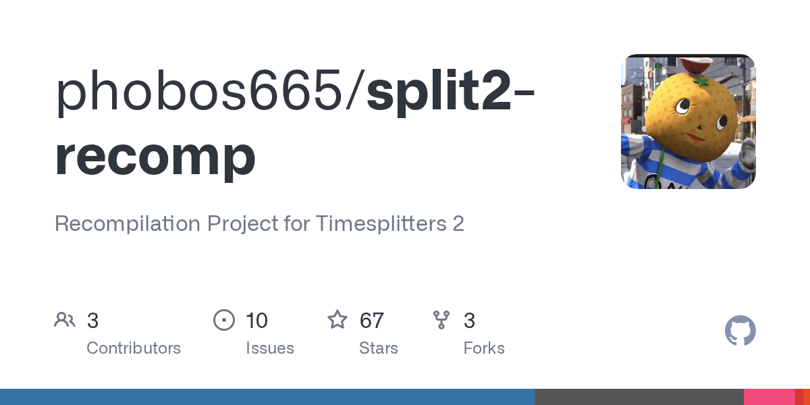</a> <a href="https://github.com/phobos665/split2-recomp"><b>split2-recomp</b></a> phobos665 &#160;Xbox / Xbox 360</td><td width="500">把原版 Xbox《时空分裂者2》重新编译成可在 Windows、Mac 和 Linux 上运行的原生程序，用你自己的光盘构建。  使用 rea: 否 图片来源: 仓库卡片</td></tr>
<tr><td width="220"> <a href="https://github.com/cdetv/conker-live-recompiled"><b>conker-live-recompiled</b></a> cdetv &#160;Xbox / Xbox 360</td><td width="500">把闭源的《康克：复活》（原版 Xbox）通过静态重编译做成了能在 Windows 上原生运行的版本。  使用 rea: 否 图片来源: 项目 README</td></tr>
<tr><td width="220">— <a href="https://github.com/comoria08/defjam_recomp"><b>defjam_recomp</b></a> comoria08 &#160;Xbox / Xbox 360</td><td width="500">通过静态重编译，把初代 Xbox 上的《Def Jam：纽约之战》变成可以在 Windows 上直接运行的原生程序。用自己的光盘来构建。  使用 rea: 否 图片来源: —</td></tr>
<tr><td width="220">— <a href="https://github.com/jkoehler11/stargate-alliance-decomp"><b>stargate-alliance-decomp</b></a> jkoehler11 &#160;Xbox / Xbox 360</td><td width="500">反编译闭源的 2005 年 Xbox 原型游戏《星际之门 SG-1：联盟》，包含 UnrealScript、原生符号映射和可启动重建。不含游戏数据。  使用 rea: 否 图片来源: —</td></tr>
<tr><td width="220">— <a href="https://github.com/NextrixVFX/Hydro-Recomp"><b>Hydro-Recomp</b></a> NextrixVFX &#160;Xbox / Xbox 360</td><td width="500">对 Xbox 360 赛艇游戏《Hydro Thunder Hurricane》进行进行中的匹配式反编译（用 C++ 编写）。  使用 rea: 否 图片来源: —</td></tr>
</table>

#### 重制 / 移植

<table>
<tr><th width="220">项目 / 图片</th><th width="500">简介</th></tr>
<tr><td width="220"> <a href="https://github.com/hedge-dev/UnleashedRecomp"><b>UnleashedRecomp</b></a> hedge-dev &#160;Xbox / Xbox 360</td><td width="500">在 PC 上原生运行索尼克：释放（游戏自备）  使用 rea: 否 图片来源: <a href="https://upload.wikimedia.org/wikipedia/en/a/a0/Sonic_unleashed_boxart.jpg">维基百科（© 版权方）</a></td></tr>
<tr><td width="220">— <a href="https://github.com/Shagg88/COGBox"><b>COGBox</b></a> Shagg88 &#160;Xbox / Xbox 360</td><td width="500">把 Xbox 360 上的《战争机器 2》《战争机器 3》和《战争机器：审判》静态重编译成可在 Windows PC 上原生运行的免费开源项目（需要自备合法拷贝）。  使用 rea: 否 图片来源: —</td></tr>
<tr><td width="220">— <a href="https://github.com/NoRain211/doaxvb-re"><b>doaxvb-re</b></a> NoRain211 &#160;Xbox / Xbox 360</td><td width="500">用静态重编译把 Xbox 游戏《Dead or Alive Xtreme Beach Volleyball》做成原生 PC 版（需要自备光盘）。  使用 rea: 否 图片来源: —</td></tr>
<tr><td width="220">— <a href="https://github.com/i2kiselev/fm4-static-recomp"><b>fm4-static-recomp</b></a> i2kiselev &#160;Xbox / Xbox 360</td><td width="500">把 Xbox 360 竞速游戏《极限竞速 4》（Forza Motorsport 4）静态重编译成原生 Windows 程序，支持高帧率、DLSS/FSR 和最高 4K。需要自己的光盘。  使用 rea: 否 图片来源: —</td></tr>
<tr><td width="220"> <a href="https://github.com/YuutaTsubasa/Free-Riders-Recompiled"><b>Free-Riders-Recompiled</b></a> YuutaTsubasa &#160;Xbox / Xbox 360</td><td width="500">把 Xbox 360 上的《索尼克自由滑板》通过静态再编译做成能在电脑和安卓上直接跑的版本，需要你自己的正版光盘。  使用 rea: 否 图片来源: 仓库卡片</td></tr>
<tr><td width="220"> <a href="https://github.com/hk21x/pgr2-recomp"><b>pgr2-recomp</b></a> hk21x &#160;Xbox / Xbox 360</td><td width="500">把原版Xbox游戏《哥谭赛车2》通过静态重编译做成的免费原生PC版。需要自备游戏光盘。  使用 rea: 否 图片来源: 项目 README</td></tr>
<tr><td width="220">— <a href="https://github.com/MysteriousAeon/rayman3-hd-recompiled"><b>rayman3-hd-recompiled</b></a> MysteriousAeon &#160;Xbox / Xbox 360</td><td width="500">把闭源的 Xbox 360《雷曼3 HD》通过静态重编译做成能在 Windows 上原生运行的程序；需要你自己提供游戏包。  使用 rea: 否 图片来源: —</td></tr>
<tr><td width="220">— <a href="https://github.com/ElKev118/ghostrecon2-recomp"><b>ghostrecon2-recomp</b></a> ElKev118 &#160;Xbox / Xbox 360</td><td width="500">通过静态重编译把原闭源Xbox游戏《幽灵行动2》做成原生Windows版，用现代Vulkan渲染器运行。  使用 rea: 否 图片来源: —</td></tr>
<tr><td width="220">— <a href="https://github.com/itsbybanshee/wwe2k14-pc"><b>wwe2k14-pc</b></a> itsbybanshee &#160;Xbox / Xbox 360</td><td width="500">把 Xbox 360 的摔跤游戏《WWE 2K14》做成原生 PC 版，带启动器、模组支持、更高分辨率和现代操控。需要自己的游戏文件。  使用 rea: 否 图片来源: —</td></tr>
<tr><td width="220">— <a href="https://github.com/MrPowerUp82/superman_returns_recomp"><b>superman_returns_recomp</b></a> MrPowerUp82 &#160;Xbox / Xbox 360</td><td width="500">用 ReXGlue 把闭源的 Xbox 360 游戏《Superman Returns》实验性静态重编译到原生 PC。需要自备游戏副本，不含游戏文件。  使用 rea: 否 图片来源: —</td></tr>
<tr><td width="220">— <a href="https://github.com/sp00nznet/saintsrow"><b>saintsrow</b></a> sp00nznet &#160;Xbox / Xbox 360</td><td width="500">把 2006 年闭源 Xbox 360 游戏《黑道圣徒》（Saints Row）的 PowerPC 代码静态重编译成原生 x86-64 C++，在现代 Windows 上直接运行，不需要模拟器。需要自备游戏文件。  使用 rea: 否 图片来源: —</td></tr>
<tr><td width="220">— <a href="https://github.com/ElKev118/summitstrike-recomp"><b>summitstrike-recomp</b></a> ElKev118 &#160;Xbox / Xbox 360</td><td width="500">通过静态重编译把原闭源Xbox扩展包《幽灵行动2：巅峰行动》做成原生Windows版。  使用 rea: 否 图片来源: —</td></tr>
<tr><td width="220">— <a href="https://github.com/Minuteworld94/Dawn-of-the-dragon-recomp"><b>Dawn-of-the-dragon-recomp</b></a> Minuteworld94 &#160;Xbox / Xbox 360</td><td width="500">把闭源的《小龙斯派罗：黎明之龙》（Xbox 360）变成你能在 Windows 上跑的原生程序（需自备光盘）  使用 rea: 否 图片来源: —</td></tr>
</table>

#### 资源提取与工具

<table>
<tr><th width="220">项目 / 图片</th><th width="500">简介</th></tr>
<tr><td width="220"> <a href="https://github.com/xemu-project/xemu"><b>xemu</b></a> xemu-project &#160;Xbox / Xbox 360</td><td width="500">在 Windows、macOS、Linux 上玩初代 Xbox 游戏  使用 rea: 否 图片来源: 维护者发布</td></tr>
</table>

### PC / DOS / PC-98

#### 反编译 / 重编译

<table>
<tr><th width="220">项目 / 图片</th><th width="500">简介</th></tr>
<tr><td width="220"> <b>Diablo</b> <a href="https://github.com/diasurgical/DevilutionX"><b>DevilutionX</b></a> diasurgical &#160;PC / DOS / PC-98</td><td width="500">在现代系统上玩暗黑破坏神（需你自己的 DIABDAT.MPQ）  使用 rea: 否 图片来源: 项目 README</td></tr>
<tr><td width="220"> <a href="https://github.com/isledecomp/isle"><b>isle</b></a> isledecomp &#160;PC / DOS / PC-98</td><td width="500">乐高岛（1997），反编译为 C++  使用 rea: 否 图片来源: <a href="https://upload.wikimedia.org/wikipedia/en/a/a1/Lego-island.jpg">维基百科（© 版权方）</a></td></tr>
<tr><td width="220">— <a href="https://github.com/timboat/demons-souls-recomp"><b>demons-souls-recomp</b></a> timboat &#160;PC / DOS / PC-98</td><td width="500">用 ps3recomp 静态重编译把闭源的《恶魔之魂》（PS3）做成了能在 Windows 上原生运行的版本。需要自己带光盘镜像。  使用 rea: 否 图片来源: —</td></tr>
<tr><td width="220"> <a href="https://github.com/Open-BFME/Open-BFME-1"><b>Open-BFME-1</b></a> Open-BFME &#160;PC / DOS / PC-98</td><td width="500">从零用 C++ 重写了《指环王：中土大战》第一部，让代码能逐字节还原原版游戏可执行文件  使用 rea: 否 图片来源: 项目 README</td></tr>
<tr><td width="220"> <a href="https://github.com/openblack/bw1-decomp"><b>bw1-decomp</b></a> openblack &#160;PC / DOS / PC-98</td><td width="500">经典 PC 神游戏《黑与白1》的反编译项目，把原版闭源代码重建成开源。  使用 rea: 否 图片来源: 仓库卡片</td></tr>
<tr><td width="220">— <a href="https://github.com/isledecomp/racers"><b>racers</b></a> isledecomp &#160;PC / DOS / PC-98</td><td width="500">把 1999 年的闭源 PC 游戏《乐高赛车》（LEGO Racers）反编译成可读的 C++ 源码，尽量与原版机器码逐字节匹配，重编译后已经可以玩。  使用 rea: 否 图片来源: —</td></tr>
<tr><td width="220"> <a href="https://github.com/N0zoM1z0/dx-ball"><b>dx-ball</b></a> N0zoM1z0 &#160;PC / DOS / PC-98</td><td width="500">用 C/C++ 重建 DX-Ball 1.07，并对照原版 x86 测试  使用 rea: ✅ 是 图片来源: 项目 README</td></tr>
<tr><td width="220"> <a href="https://github.com/N0zoM1z0/th08"><b>th08</b></a> N0zoM1z0 &#160;PC / DOS / PC-98</td><td width="500">东方永夜抄，重建为源码  使用 rea: ❔ 待验证 图片来源: 项目 README</td></tr>
<tr><td width="220"> <a href="https://github.com/LemonHaze420/shenmue"><b>shenmue</b></a> LemonHaze420 &#160;PC / DOS / PC-98</td><td width="500">基于已完成的反编译，从零用 C/C++ 重写了原本闭源的《莎木 I &amp; II》（Dreamcast、Xbox 和 PC 版）。  使用 rea: 否 图片来源: 仓库卡片</td></tr>
<tr><td width="220"> <a href="https://github.com/N0zoM1z0/th04"><b>th04</b></a> N0zoM1z0 &#160;PC / DOS / PC-98</td><td width="500">东方幻想乡（PC-98）的可读源码，对照原编译器校验  使用 rea: ✅ 是 图片来源: 项目 README</td></tr>
<tr><td width="220"> <a href="https://github.com/N0zoM1z0/th105"><b>th105</b></a> N0zoM1z0 &#160;PC / DOS / PC-98</td><td width="500">东方绯想天，重建为源码  使用 rea: ❔ 待验证 图片来源: 项目 README</td></tr>
<tr><td width="220">— <a href="https://github.com/0xd34db8/LF2-decomp"><b>LF2-decomp</b></a> 0xd34db8 &#160;PC / DOS / PC-98</td><td width="500">把闭源的《小小大乱斗2》完整反编译成了现代 C++20 源码，能和原版 x86 机器码逐字节对应。  使用 rea: 否 图片来源: —</td></tr>
<tr><td width="220">— <a href="https://github.com/phys-winner/pc_decomp_ut3"><b>pc_decomp_ut3</b></a> phys-winner &#160;PC / DOS / PC-98</td><td width="500">把闭源的《虚幻竞技场3》（PC 版）静态重编译成了能在 Android ARM64 上原生运行的代码，还做了原版 Win32/Direct3D 9 的兼容层。  使用 rea: 否 图片来源: —</td></tr>
<tr><td width="220">— <a href="https://github.com/kazuyette/senjin-recomped"><b>senjin-recomped</b></a> kazuyette &#160;PC / DOS / PC-98</td><td width="500">把闭源的街机游戏《战刃》/Senjin Aleste（APM3）静态重编译成了能在 Linux x86-64 上原生运行的程序，还附带 Windows 用的 DLL 替换。  使用 rea: 否 图片来源: —</td></tr>
<tr><td width="220"> <a href="https://github.com/N0zoM1z0/th095"><b>th095</b></a> N0zoM1z0 &#160;PC / DOS / PC-98</td><td width="500">东方文花帖，重建为源码  使用 rea: ❔ 待验证 图片来源: 项目 README</td></tr>
</table>

查看该分类全部项目 (+9)

<table>
<tr><th width="220">项目 / 图片</th><th width="500">简介</th></tr>
<tr><td width="220"> <a href="https://github.com/N0zoM1z0/th10"><b>th10</b></a> N0zoM1z0 &#160;PC / DOS / PC-98</td><td width="500">东方风神录，重建为源码  使用 rea: ❔ 待验证 图片来源: 项目 README</td></tr>
<tr><td width="220"> <a href="https://github.com/N0zoM1z0/touhou-reverse-engineering"><b>touhou-reverse-engineering</b></a> N0zoM1z0 &#160;PC / DOS / PC-98</td><td width="500">以证据为先的东方 IDA 笔记，附运行时补丁实验  使用 rea: 否 图片来源: 仓库卡片</td></tr>
<tr><td width="220"> <a href="https://github.com/N0zoM1z0/th09"><b>th09</b></a> N0zoM1z0 &#160;PC / DOS / PC-98</td><td width="500">东方花映冢，重建为源码  使用 rea: ❔ 待验证 图片来源: 项目 README</td></tr>
<tr><td width="220">— <a href="https://github.com/yamahuser/mhfz-decomp"><b>mhfz-decomp</b></a> yamahuser &#160;PC / DOS / PC-98</td><td width="500">针对《怪物猎人边境Z》在线客户端的逆向工程：整理函数名、规格和辅助工具。不包含卡普空的原始代码。  使用 rea: 否 图片来源: —</td></tr>
<tr><td width="220"> <a href="https://github.com/LuckyLuke00/sadx-decomp"><b>sadx-decomp</b></a> LuckyLuke00 &#160;PC / DOS / PC-98</td><td width="500">对闭源的 2014 年 Steam 版《索尼克大冒险 DX》进行的匹配反编译，目标是机器码逐字节一致。  使用 rea: 否 图片来源: 仓库卡片</td></tr>
<tr><td width="220"> <a href="https://github.com/bmbelo87/decomp-it-up-Perfect-Collection"><b>decomp-it-up-Perfect-Collection</b></a> bmbelo87 &#160;PC / DOS / PC-98</td><td width="500">从零用 C 重写了闭源的 DOS 版《Pump It Up Perfect Collection》（2000 年 PIU.EXE），玩起来和原版一样。  使用 rea: 否 图片来源: 项目 README</td></tr>
<tr><td width="220">— <a href="https://github.com/awkto/deadly-tide-decomp"><b>deadly-tide-decomp</b></a> awkto &#160;PC / DOS / PC-98</td><td width="500">对 1996 年闭源游戏《致命潮汐》做的逆向工程，以及用现代 WebAssembly 重写的实现。不包含任何原版游戏数据。  使用 rea: 否 图片来源: —</td></tr>
<tr><td width="220">— <a href="https://github.com/albovsky/nd-blackmoor-decomp"><b>nd-blackmoor-decomp</b></a> albovsky &#160;PC / DOS / PC-98</td><td width="500">把 PC 冒险游戏《南希·德鲁：布莱克摩尔庄园的诅咒》的可执行文件反编译重建成匹配的原生 C 代码，并提供 macOS ARM64 移植。  使用 rea: 否 图片来源: —</td></tr>
<tr><td width="220"> <a href="https://github.com/LostArtefacts/tr01"><b>tr01</b></a> LostArtefacts &#160;PC / DOS / PC-98</td><td width="500">对 1996 年 DOS 版《古墓丽影》做匹配反编译，让 C 和汇编能编译回原版 TOMB.EXE 的精确字节  使用 rea: 否 图片来源: 项目 README</td></tr>
</table>

#### 重制 / 移植

<table>
<tr><th width="220">项目 / 图片</th><th width="500">简介</th></tr>
<tr><td width="220"> <a href="https://github.com/OpenRA/OpenRA"><b>OpenRA</b></a> OpenRA &#160;PC / DOS / PC-98</td><td width="500">为现代联机重建的经典命令与征服  使用 rea: 否 图片来源: 项目 README</td></tr>
<tr><td width="220"> <b>RollerCoaster Tycoon 2</b> <a href="https://github.com/OpenRCT2/OpenRCT2"><b>OpenRCT2</b></a> OpenRCT2 &#160;PC / DOS / PC-98</td><td width="500">开源版过山车大亨 2，在现代系统上继续运行  使用 rea: 否 图片来源: 项目 README</td></tr>
<tr><td width="220"> <a href="https://github.com/OpenTTD/OpenTTD"><b>OpenTTD</b></a> OpenTTD &#160;PC / DOS / PC-98</td><td width="500">开源的运输大亨，至今仍在更新  使用 rea: 否 图片来源: <a href="https://upload.wikimedia.org/wikipedia/commons/b/ba/OpenTTD-15.3-en.png">维基百科（© 版权方）</a></td></tr>
<tr><td width="220"> <a href="https://github.com/OpenMW/openmw"><b>openmw</b></a> OpenMW &#160;PC / DOS / PC-98</td><td width="500">在现代开源引擎上玩晨风  使用 rea: 否 图片来源: <a href="https://upload.wikimedia.org/wikipedia/commons/9/9e/OpenMW_with_example_suit_2.png">维基百科（© 版权方）</a></td></tr>
<tr><td width="220"> <a href="https://github.com/Interkarma/daggerfall-unity"><b>daggerfall-unity</b></a> Interkarma &#160;PC / DOS / PC-98</td><td width="500">用 Unity 重现的匕首雨（读取你自己的游戏数据）  使用 rea: 否 图片来源: 项目 README</td></tr>
<tr><td width="220"> <a href="https://github.com/scummvm/scummvm"><b>scummvm</b></a> scummvm &#160;PC / DOS / PC-98</td><td width="500">在几乎任何设备上玩经典点击冒险游戏  使用 rea: 否 图片来源: 项目 README</td></tr>
<tr><td width="220"> <a href="https://github.com/OpenXcom/OpenXcom"><b>OpenXcom</b></a> OpenXcom &#160;PC / DOS / PC-98</td><td width="500">在现代开源引擎上玩初代 UFO / X-COM  使用 rea: 否 图片来源: 仓库卡片</td></tr>
<tr><td width="220"> <a href="https://github.com/perfect-dark-pc-port/perfect_dark"><b>perfect_dark</b></a> perfect-dark-pc-port &#160;PC / DOS / PC-98</td><td width="500">在 PC 上原生运行完美黑暗（ROM 自备）  使用 rea: 否 图片来源: <a href="https://upload.wikimedia.org/wikipedia/en/3/32/Perfect_dark_box.jpg">维基百科（© 版权方）</a></td></tr>
<tr><td width="220"> <a href="https://github.com/julianxhokaxhiu/FFNx"><b>FFNx</b></a> julianxhokaxhiu &#160;PC / DOS / PC-98</td><td width="500">PC 版 FF7/FF8 的现代驱动与 Mod 平台  使用 rea: 否 图片来源: 项目 README</td></tr>
<tr><td width="220">— <a href="https://github.com/AksharDP/xc2-recomp"><b>xc2-recomp</b></a> AksharDP &#160;PC / DOS / PC-98</td><td width="500">从零重写的任天堂Switch游戏《异度神剑2》的免费开源Windows原生版。用你自己的游戏dump静态重编译成原生程序，配Vulkan渲染器。  使用 rea: 否 图片来源: —</td></tr>
<tr><td width="220">— <a href="https://github.com/BLSNCVS/Castlevania-Grimoire-of-Souls-Recomp"><b>Castlevania-Grimoire-of-Souls-Recomp</b></a> BLSNCVS &#160;PC / DOS / PC-98</td><td width="500">把 Apple Arcade / macOS 版的《恶魔城：灵魂魔典》做成原生 Windows 程序，不用模拟器就能玩，需要自己的游戏文件。  使用 rea: 否 图片来源: —</td></tr>
<tr><td width="220"> <a href="https://github.com/tmcleroy/cps2recomp"><b>cps2recomp</b></a> tmcleroy &#160;PC / DOS / PC-98</td><td width="500">通过静态重编译做成的卡普空 CPS-2 街机游戏（街头霸王 Alpha 2 等）非官方原生 PC 移植版。需自备 ROM。  使用 rea: 否 图片来源: 仓库卡片</td></tr>
<tr><td width="220"> <a href="https://github.com/fallout2-ce/fallout2-ce"><b>fallout2-ce</b></a> fallout2-ce &#160;PC / DOS / PC-98</td><td width="500">在现代系统上玩辐射 2（读取你自己的游戏数据）  使用 rea: 否 图片来源: 项目 README</td></tr>
<tr><td width="220">— <a href="https://github.com/pablocpas/OpenCMR2"><b>OpenCMR2</b></a> pablocpas &#160;PC / DOS / PC-98</td><td width="500">基于匹配反编译，把 2000 年闭源 PC 游戏《柯林麦克雷拉力赛 2.0》（Colin McRae Rally 2.0）做成现代多平台原生移植，用 SDL3 替换了老的 DirectX。需要自备游戏文件。  使用 rea: 否 图片来源: —</td></tr>
<tr><td width="220">— <a href="https://github.com/cheviman/outrunners-port"><b>outrunners-port</b></a> cheviman &#160;PC / DOS / PC-98</td><td width="500">基于逐字节匹配的 C 反编译，把 1992 年世嘉街机游戏《OutRunners》移植成原生 PC 和主机版本。需要自己提供 ROM。  使用 rea: 否 图片来源: —</td></tr>
</table>

查看该分类全部项目 (+22)

<table>
<tr><th width="220">项目 / 图片</th><th width="500">简介</th></tr>
<tr><td width="220">— <a href="https://github.com/mr-finster/vf3-recomp"><b>vf3-recomp</b></a> mr-finster &#160;PC / DOS / PC-98</td><td width="500">把 1996 年闭源的世嘉 Model 3 街机游戏《VR战士 3》（Virtua Fighter 3）的 PowerPC 程序静态重编译成原生 PC 代码，支持最高 6 倍分辨率和 120 帧。需要自备 ROM。  使用 rea: 否 图片来源: —</td></tr>
<tr><td width="220"> <a href="https://github.com/Moxnatiy/OpenBattlefield2"><b>OpenBattlefield2</b></a> Moxnatiy &#160;PC / DOS / PC-98</td><td width="500">战地 2 引擎的 C++20 净室重写（读取你自己的游戏）  使用 rea: ✅ 是 图片来源: 项目 README</td></tr>
<tr><td width="220">— <a href="https://github.com/Mava-b/folklore-decomp"><b>folklore-decomp</b></a> Mava-b &#160;PC / DOS / PC-98</td><td width="500">把 2007 年 PS3 游戏《Folklore》静态重编译成可在 Windows 上原生运行的版本（支持 60 帧、超宽屏）  使用 rea: 否 图片来源: —</td></tr>
<tr><td width="220">— <a href="https://github.com/Karlos-fr/fun-tracks-recomp-releases"><b>fun-tracks-recomp-releases</b></a> Karlos-fr &#160;PC / DOS / PC-98</td><td width="500">闭源 1997 年游戏《Fun Tracks》的反编译与重编译多平台（Windows、Android）发布。需要原版游戏文件。  使用 rea: 否 图片来源: —</td></tr>
<tr><td width="220">— <a href="https://github.com/vahokif/I26"><b>I26</b></a> vahokif &#160;PC / DOS / PC-98</td><td width="500">用 Godot 从零重写的 1997 年汽车战斗游戏 Interstate &#x27;76，支持现代画面和多人联机。  使用 rea: 否 图片来源: —</td></tr>
<tr><td width="220"> <a href="https://github.com/OpenReliant/openreliant"><b>openreliant</b></a> OpenReliant &#160;PC / DOS / PC-98</td><td width="500">用现代电脑玩 2000 年的太空战斗游戏《星际航线》：从零重写的引擎，使用你自己的游戏文件，支持高分辨率和模组。  使用 rea: 否 图片来源: 仓库卡片</td></tr>
<tr><td width="220"> <a href="https://github.com/gminustwo/RondoRecomp"><b>RondoRecomp</b></a> gminustwo &#160;PC / DOS / PC-98</td><td width="500">把经典的 PC Engine 游戏《恶魔城：血之轮回》静态重编译成原生 Windows 或 Linux 程序，你提供自己的光盘镜像即可。支持倒带、存档和 RetroAchievements。  使用 rea: 否 图片来源: 仓库卡片</td></tr>
<tr><td width="220">— <a href="https://github.com/ccbury/MGSPOStaticRecomp"><b>MGSPOStaticRecomp</b></a> ccbury &#160;PC / DOS / PC-98</td><td width="500">把 PSP 游戏《合金装备：掌上行动》静态重编译成原生 Windows 程序，不用模拟器就能跑。目前已经能进游戏。  使用 rea: 否 图片来源: —</td></tr>
<tr><td width="220"> <a href="https://github.com/AsyncFinn/rook"><b>rook</b></a> AsyncFinn &#160;PC / DOS / PC-98</td><td width="500">Rust 写的 Roblox 兼容引擎，对照 Studio 测试  使用 rea: 否 图片来源: 仓库卡片</td></tr>
<tr><td width="220"> <a href="https://github.com/N0zoM1z0/th08-web"><b>th08-web</b></a> N0zoM1z0 &#160;PC / DOS / PC-98</td><td width="500">在浏览器里玩永夜抄，基于 th08 重建  使用 rea: ❔ 待验证 图片来源: 项目 README</td></tr>
<tr><td width="220"> <a href="https://github.com/tallowmere/free-heroes4"><b>free-heroes4</b></a> tallowmere &#160;PC / DOS / PC-98</td><td width="500">英雄无敌 IV 的 C++23 新引擎（读取你的 GOG 文件）  使用 rea: 否 图片来源: <a href="https://upload.wikimedia.org/wikipedia/en/c/cc/Heroes_of_Might_and_Magic_IV_box.jpg">维基百科（© 版权方）</a></td></tr>
<tr><td width="220">— <a href="https://github.com/ectrc/dishonoredrecompiled"><b>dishonoredrecompiled</b></a> ectrc &#160;PC / DOS / PC-98</td><td width="500">用Claude AI代理从原版Win32可执行文件重建了2012年PC游戏《耻辱》（Dishonored），能进主菜单并玩开头任务；需要你自己拥有的游戏文件。  使用 rea: 否 图片来源: —</td></tr>
<tr><td width="220"> <a href="https://github.com/ucodia/desktop-games-nostalgia"><b>desktop-games-nostalgia</b></a> ucodia &#160;PC / DOS / PC-98</td><td width="500">再砸一次桌面：Gemtree 2000 年的小玩具登上 macOS 和网页  使用 rea: ✅ 是 图片来源: 项目 README</td></tr>
<tr><td width="220"><a href="https://github.com/a-barzanti/ai-rebuilds">预览暂不可用 · 查看原项目</a> <a href="https://github.com/a-barzanti/ai-rebuilds"><b>ai-rebuilds</b></a> a-barzanti &#160;PC / DOS / PC-98</td><td width="500">被遗弃的老游戏重回浏览器，不含任何原版文件  使用 rea: ✅ 是 图片来源: <a href="https://github.com/a-barzanti/ai-rebuilds">仓库卡片</a></td></tr>
<tr><td width="220"> <a href="https://github.com/OpenRsG/GunZRs"><b>GunZRs</b></a> OpenRsG &#160;PC / DOS / PC-98</td><td width="500">GunZ：The Duel 用 Rust + Bevy 重生  使用 rea: ✅ 是 图片来源: 项目 README</td></tr>
<tr><td width="220"> <a href="https://github.com/tuunanet/rea-ski-or-die-reconstruction"><b>rea-ski-or-die-reconstruction</b></a> tuunanet &#160;PC / DOS / PC-98</td><td width="500">Ski or Die 的雪球大战，用 Rust + SDL2 重做（素材自备）  使用 rea: ✅ 是 图片来源: 项目 README</td></tr>
<tr><td width="220">— <a href="https://github.com/NostalgiaRealm/A2-Racer-4"><b>A2-Racer-4</b></a> NostalgiaRealm &#160;PC / DOS / PC-98</td><td width="500">闭源游戏《A2 赛车 4》（Davilex，2000）的浏览器和桌面移植版。游戏的 x86 代码被重编译成了 WebAssembly，菜单是手写重做的。  使用 rea: 否 图片来源: —</td></tr>
<tr><td width="220">— <a href="https://github.com/YuutaTsubasa/MarbleKnightsRecompiled"><b>MarbleKnightsRecompiled</b></a> YuutaTsubasa &#160;PC / DOS / PC-98</td><td width="500">把闭源的 Apple Arcade 游戏《Marble Knights》（Unity IL2CPP，iOS ARM64）静态重编译成原生 Windows 版本。需要自备游戏文件，不含任何游戏数据。  使用 rea: 否 图片来源: —</td></tr>
<tr><td width="220">— <a href="https://github.com/carlhako/keen-clone"><b>keen-clone</b></a> carlhako &#160;PC / DOS / PC-98</td><td width="500">用 REA + Ghidra 函数级还原的 Commander Keen 1 原生 Linux/SDL2 重实现  使用 rea: ✅ 是 图片来源: —</td></tr>
<tr><td width="220">— <a href="https://github.com/NathanKanaeru/samp-client-re"><b>samp-client-re</b></a> NathanKanaeru &#160;PC / DOS / PC-98</td><td width="500">用 REA/Ghidra 恢复架构的 SA-MP 0.3.DL-R1 clean-room 客户端重实现  使用 rea: ✅ 是 图片来源: —</td></tr>
<tr><td width="220">— <a href="https://github.com/openage/openage"><b>openage</b></a> openage &#160;PC / DOS / PC-98</td><td width="500">帝国时代 2 及其他 RTS 的开源引擎重实现  使用 rea: 否 图片来源: —</td></tr>
<tr><td width="220">— <a href="https://github.com/thepoprock/mudbrick"><b>mudbrick</b></a> thepoprock &#160;PC / DOS / PC-98</td><td width="500">从零开始、清洁室方式重写的免费开源浏览器版《文明2》（1996 年闭源经典）。用 TypeScript 写，MIT 协议。  使用 rea: 否 图片来源: —</td></tr>
</table>

#### 资源提取与工具

<table>
<tr><th width="220">项目 / 图片</th><th width="500">简介</th></tr>
<tr><td width="220"> <a href="https://github.com/Perfare/AssetStudio"><b>AssetStudio</b></a> Perfare &#160;PC / DOS / PC-98</td><td width="500">浏览并导出 Unity 游戏资源  使用 rea: 否 图片来源: 仓库卡片</td></tr>
<tr><td width="220"> <a href="https://github.com/AssetRipper/AssetRipper"><b>AssetRipper</b></a> AssetRipper &#160;PC / DOS / PC-98</td><td width="500">把 Unity 构建产物还原成可编辑的工程  使用 rea: 否 图片来源: 项目 README</td></tr>
<tr><td width="220"> <a href="https://github.com/ata4/disunity"><b>disunity</b></a> ata4 &#160;PC / DOS / PC-98</td><td width="500">早期的 Unity 资源文件探查工具  使用 rea: 否 图片来源: 仓库卡片</td></tr>
<tr><td width="220"> <a href="https://github.com/ladislav-zezula/CascLib"><b>CascLib</b></a> ladislav-zezula &#160;PC / DOS / PC-98</td><td width="500">读取暴雪 CASC 游戏存档格式  使用 rea: 否 图片来源: 仓库卡片</td></tr>
<tr><td width="220">— <a href="https://github.com/rodneypantonial/sims3-modernization"><b>sims3-modernization</b></a> rodneypantonial &#160;PC / DOS / PC-98</td><td width="500">让模拟人生 3 在新电脑上少卡顿、少崩溃  使用 rea: ✅ 是 图片来源: —</td></tr>
<tr><td width="220"> <a href="https://github.com/N0zoM1z0/touhou-reconstruction-factory"><b>touhou-reconstruction-factory</b></a> N0zoM1z0 &#160;PC / DOS / PC-98</td><td width="500">东方系列重建背后的智能体流水线  使用 rea: ❔ 待验证 图片来源: 仓库卡片</td></tr>
</table>

## 应用 / Electron / 桌面

<table>
<tr><th width="220">项目 / 图片</th><th width="500">简介</th></tr>
<tr><td width="220"> <a href="https://github.com/storytold/photocraft"><b>photocraft</b></a> storytold</td><td width="500">有人从零重写了一个类似 Adobe Photoshop 的免费开源修图软件。用 Rust 写的，支持图层、蒙版、PSD 文件，但完全没用 Adobe 的代码。  使用 rea: 否 图片来源: 项目 README</td></tr>
<tr><td width="220">— <a href="https://github.com/storytold/pdfcraft"><b>pdfcraft</b></a> storytold</td><td width="500">纯 Rust 洁净室 PDF 阅读与编辑器  使用 rea: 否 图片来源: —</td></tr>
<tr><td width="220">— <a href="https://github.com/storytold/filmcraft"><b>filmcraft</b></a> storytold</td><td width="500">有人从零做了一个类似 Adobe Premiere Pro 的免费视频剪辑软件。用 Rust 写的，可以剪片子、加特效、调色，完全没用 Adobe 的代码。  使用 rea: 否 图片来源: —</td></tr>
<tr><td width="220">— <a href="https://github.com/storytold/wordcraft"><b>wordcraft</b></a> storytold</td><td width="500">纯 Rust 洁净室文字处理器  使用 rea: 否 图片来源: —</td></tr>
<tr><td width="220"> <a href="https://github.com/storytold/lightcraft"><b>lightcraft</b></a> storytold</td><td width="500">从零重写的类似 Adobe Lightroom 的照片管理和 RAW 冲印工具。纯 Rust 实现，用来整理和编辑照片，完全没用 Adobe 的代码。  使用 rea: 否 图片来源: 仓库卡片</td></tr>
<tr><td width="220"> <a href="https://github.com/storytold/vectorcraft"><b>vectorcraft</b></a> storytold</td><td width="500">从零重写的类似 Adobe Illustrator 的矢量绘图工具。纯 Rust 实现，可以画海报、Logo、插画，完全没用 Adobe 的代码。  使用 rea: 否 图片来源: 仓库卡片</td></tr>
<tr><td width="220">— <a href="https://github.com/storytold/effectcraft"><b>effectcraft</b></a> storytold</td><td width="500">从零重写的类似 Adobe After Effects 的动效和视觉特效软件。用 Rust 写的，可以做动画标题和合成，完全没用 Adobe 的代码。  使用 rea: 否 图片来源: —</td></tr>
<tr><td width="220">— <a href="https://github.com/storytold/cadcraft"><b>cadcraft</b></a> storytold</td><td width="500">从零重写的类似 AutoCAD 的 CAD 制图软件。纯 Rust 实现。  使用 rea: 否 图片来源: —</td></tr>
<tr><td width="220">— <a href="https://github.com/storytold/gridcraft"><b>gridcraft</b></a> storytold</td><td width="500">有人从零做了一个类似 Excel 的免费电子表格软件。用 Rust 写的。  使用 rea: 否 图片来源: —</td></tr>
<tr><td width="220">— <a href="https://github.com/storytold/designcraft"><b>designcraft</b></a> storytold</td><td width="500">从零重写的类似 Adobe InDesign 的排版出版工具。纯 Rust 实现。  使用 rea: 否 图片来源: —</td></tr>
<tr><td width="220">— <a href="https://github.com/storytold/figcraft"><b>figcraft</b></a> storytold</td><td width="500">有人从零做了一个类似 Figma 的免费界面设计和原型工具。用 Rust 写的。  使用 rea: 否 图片来源: —</td></tr>
<tr><td width="220">— <a href="https://github.com/storytold/deckcraft"><b>deckcraft</b></a> storytold</td><td width="500">从零重写的类似 PowerPoint 的演示文稿软件。用 Rust 写的，做幻灯片不用微软的代码。  使用 rea: 否 图片来源: —</td></tr>
<tr><td width="220">— <a href="https://github.com/storytold/soundcraft"><b>soundcraft</b></a> storytold</td><td width="500">从零重写的类似 Pro Tools 的数字音频工作站。纯 Rust 实现。  使用 rea: 否 图片来源: —</td></tr>
<tr><td width="220"> <a href="https://github.com/electron/asar"><b>asar</b></a> electron</td><td width="500">打包、解包 Electron 应用里的归档  使用 rea: 否 图片来源: 本仓库截图</td></tr>
<tr><td width="220">— <a href="https://github.com/Caho1/open-claude-ui"><b>open-claude-ui</b></a> Caho1</td><td width="500">用 REA 深度拆解并高保真还原 Claude 桌面端 UI 组件与交互物理  使用 rea: ✅ 是 图片来源: —</td></tr>
</table>

查看该分类全部项目 (+20)

<table>
<tr><th width="220">项目 / 图片</th><th width="500">简介</th></tr>
<tr><td width="220"> <a href="https://github.com/GLinnik21/plx-native"><b>plx-native</b></a> GLinnik21</td><td width="500">LG 电视上更快的原生 Plex 客户端  使用 rea: 否 图片来源: 项目 README</td></tr>
<tr><td width="220"> <a href="https://github.com/michaelshimeles/terminal-rs"><b>terminal-rs</b></a> michaelshimeles</td><td width="500">Rust 写的彭博风格交易终端  使用 rea: ✅ 是 图片来源: 项目 README</td></tr>
<tr><td width="220">— <a href="https://github.com/pingw33n/openrb-338"><b>openrb-338</b></a> pingw33n</td><td width="500">从零重写的 1997 年 ReBirth RB-338 软件合成器，声音与原版逐字节一致。  使用 rea: 否 图片来源: —</td></tr>
<tr><td width="220">— <a href="https://github.com/fabox-os/Pro-Wave"><b>Pro-Wave</b></a> fabox-os</td><td width="500">从零用纯 Rust 重写了一个类似 Apple Logic Pro 的免费开源音乐制作软件（DAW）。  使用 rea: 否 图片来源: —</td></tr>
<tr><td width="220">— <a href="https://github.com/Xiangyu-CAS/rea-capcut"><b>rea-capcut</b></a> Xiangyu-CAS</td><td width="500">用 REA 研究剪映后重做的开源离线剪辑软件  使用 rea: ✅ 是 图片来源: —</td></tr>
<tr><td width="220"> <a href="https://github.com/michaelshimeles/rec-rs"><b>rec-rs</b></a> michaelshimeles</td><td width="500">Rust 写的 macOS 快速录屏工具，参照 OBS 设计  使用 rea: ✅ 是 图片来源: 项目 README</td></tr>
<tr><td width="220"> <a href="https://github.com/michaelshimeles/sketch"><b>sketch</b></a> michaelshimeles</td><td width="500">Rust 写的无限设计画布，研究 Paper 后重建  使用 rea: ✅ 是 图片来源: 项目 README</td></tr>
<tr><td width="220">— <a href="https://github.com/glauberlima/open-scrantic"><b>open-scrantic</b></a> glauberlima</td><td width="500">用 REA 逆向并重写的 1992 年 Johnny Castaway 屏保（Rust）  使用 rea: ✅ 是 图片来源: —</td></tr>
<tr><td width="220"> <a href="https://github.com/lxistired/ledger-reborn"><b>ledger-reborn</b></a> lxistired</td><td width="500">本地优先的记账应用，参照 QuickBooks Mac 版  使用 rea: ✅ 是 图片来源: 项目 README</td></tr>
<tr><td width="220"> <a href="https://github.com/LilZeeCN/zee-rp"><b>zee-rp</b></a> LilZeeCN</td><td width="500">用命令行或 MCP 读写 Axure RP 原型文件  使用 rea: ❔ 待验证 图片来源: 项目 README</td></tr>
<tr><td width="220"> <a href="https://github.com/cudanexus/vd-streamer-linux"><b>vd-streamer-linux</b></a> cudanexus</td><td width="500">把 Linux 桌面串流到 Quest、Pico 头显  使用 rea: ✅ 是 图片来源: 仓库卡片</td></tr>
<tr><td width="220"> <a href="https://github.com/laaielichter/Reverseport"><b>Reverseport</b></a> laaielichter</td><td width="500">把逆向成果移植到 Godot、Unity、Unreal 或 three.js  使用 rea: ❔ 待验证 图片来源: 项目 README</td></tr>
<tr><td width="220">— <a href="https://github.com/Dicklesworthstone/frankentorch"><b>frankentorch</b></a> Dicklesworthstone</td><td width="500">从零用安全的 Rust 重写了一个和 PyTorch 行为完全一样的机器学习库，包括梯度计算，还加了确定性与耐久性功能。  使用 rea: 否 图片来源: —</td></tr>
<tr><td width="220"> <a href="https://github.com/sickpyramid/ReaFuse"><b>ReaFuse</b></a> sickpyramid</td><td width="500">借助 REA 把两个 JS/TS 项目融合成一个  使用 rea: ✅ 是 图片来源: 仓库卡片</td></tr>
<tr><td width="220"> <a href="https://github.com/iammukeshm/hexgrab"><b>hexgrab</b></a> iammukeshm</td><td width="500">迷你 Windows 取色器，从 PowerToys 二进制研究而来  使用 rea: ✅ 是 图片来源: 仓库卡片</td></tr>
<tr><td width="220"> <a href="https://github.com/monatis/okur"><b>okur</b></a> monatis</td><td width="500">从零重写的开源屏幕阅读器，行为像 JAWS，通过观察 JAWS 的语音输出来实现。  使用 rea: 否 图片来源: 仓库卡片</td></tr>
<tr><td width="220"> <a href="https://github.com/az9713/wispr-flow-rea-teardown"><b>wispr-flow-rea-teardown</b></a> az9713</td><td width="500">拆解 Wispr Flow 语音管线，附 64 行重写版  使用 rea: ✅ 是 图片来源: <a href="https://img.youtube.com/vi/FnB9tHKBJXQ/maxresdefault.jpg">视频封面</a></td></tr>
<tr><td width="220"> <a href="https://github.com/KarlssonChristoffer/DiskLens"><b>DiskLens</b></a> KarlssonChristoffer</td><td width="500">像 WinDirStat 一样看清 Windows 11 磁盘被什么占满  使用 rea: ✅ 是 图片来源: 仓库卡片</td></tr>
<tr><td width="220"> <a href="https://github.com/AdamLinCodes/AdamTerm"><b>AdamTerm</b></a> AdamLinCodes</td><td width="500">研究 Ghostty 后做出的极简 macOS 终端  使用 rea: ✅ 是 图片来源: 项目 README</td></tr>
<tr><td width="220">— <a href="https://github.com/chilliesdev/fmseasonhub-re"><b>fmseasonhub-re</b></a> chilliesdev</td><td width="500">用 REA 拆解 FM Season Hub 应用的分析笔记  使用 rea: ✅ 是 图片来源: —</td></tr>
</table>

## 协议 / 硬件

<table>
<tr><th width="220">项目 / 图片</th><th width="500">简介</th></tr>
<tr><td width="220"> <a href="https://github.com/mitmproxy/mitmproxy"><b>mitmproxy</b></a> mitmproxy</td><td width="500">实时查看和修改 HTTPS 流量  使用 rea: 否 图片来源: 项目 README</td></tr>
<tr><td width="220"> <a href="https://github.com/wireshark/wireshark"><b>wireshark</b></a> wireshark</td><td width="500">看清网络上的每一个数据包  使用 rea: 否 图片来源: 本仓库截图</td></tr>
<tr><td width="220"> <a href="https://github.com/postlund/pyatv"><b>pyatv</b></a> postlund</td><td width="500">用 Python 控制 Apple TV 和 AirPlay 设备  使用 rea: 否 图片来源: 仓库卡片</td></tr>
<tr><td width="220"> <a href="https://github.com/a-funk/open-appleremote"><b>open-appleremote</b></a> a-funk</td><td width="500">在 Linux 上用第一代 Siri 遥控器，连手势也支持  使用 rea: ❔ 待验证 图片来源: 仓库卡片</td></tr>
<tr><td width="220"> <a href="https://github.com/Slyvan25/OpenGHub"><b>OpenGHub</b></a> Slyvan25</td><td width="500">在 Linux 上不用 G HUB 也能控制罗技外设  使用 rea: 否 图片来源: 项目 README</td></tr>
<tr><td width="220">— <a href="https://github.com/EndLess728/MiTV-Remote"><b>MiTV-Remote</b></a> EndLess728</td><td width="500">在 Mac、安卓、iPhone 上用 Wi-Fi 遥控小米电视  使用 rea: ✅ 是 图片来源: —</td></tr>
<tr><td width="220">— <a href="https://github.com/B-Howell/soundconnect-desktop"><b>soundconnect-desktop</b></a> B-Howell</td><td width="500">在 Windows 桌面上控制索尼蓝牙耳机  使用 rea: ✅ 是 图片来源: —</td></tr>
<tr><td width="220">— <a href="https://github.com/ethanntann/massage-chair-mcp"><b>massage-chair-mcp</b></a> ethanntann</td><td width="500">逆向了闭源的 OSIM uDiva3 按摩椅蓝牙协议，做成 MCP 服务器，让 AI 智能体可以控制这把椅子。  使用 rea: 否 图片来源: —</td></tr>
</table>

## 固件 / 驱动

<table>
<tr><th width="220">项目 / 图片</th><th width="500">简介</th></tr>
<tr><td width="220"> <a href="https://github.com/ReFirmLabs/binwalk"><b>binwalk</b></a> ReFirmLabs</td><td width="500">找出并提取固件镜像里藏着的东西  使用 rea: 否 图片来源: 项目 README</td></tr>
<tr><td width="220"> <a href="https://github.com/qilingframework/qiling"><b>qiling</b></a> qilingframework</td><td width="500">跨系统、跨 CPU 模拟并插桩二进制  使用 rea: 否 图片来源: 项目 README</td></tr>
<tr><td width="220"> <a href="https://github.com/onekey-sec/unblob"><b>unblob</b></a> onekey-sec</td><td width="500">递归解包几乎所有固件和容器格式  使用 rea: 否 图片来源: 本仓库截图</td></tr>
<tr><td width="220"><a href="https://github.com/attify/firmware-analysis-toolkit">预览暂不可用 · 查看原项目</a> <a href="https://github.com/attify/firmware-analysis-toolkit"><b>firmware-analysis-toolkit</b></a> attify</td><td width="500">模拟运行物联网固件，安全地研究它  使用 rea: 否 图片来源: <a href="https://github.com/attify/firmware-analysis-toolkit">仓库卡片</a></td></tr>
<tr><td width="220"><a href="https://github.com/travisgoodspeed/md380tools">预览暂不可用 · 查看原项目</a> <a href="https://github.com/travisgoodspeed/md380tools"><b>md380tools</b></a> travisgoodspeed</td><td width="500">TYT MD-380 对讲机的自制固件补丁  使用 rea: 否 图片来源: <a href="https://github.com/travisgoodspeed/md380tools">仓库卡片</a></td></tr>
<tr><td width="220"> <a href="https://github.com/ghidraninja/game-and-watch-backup"><b>game-and-watch-backup</b></a> ghidraninja</td><td width="500">备份并恢复你自己的 Game &amp; Watch 固件  使用 rea: 否 图片来源: <a href="https://img.youtube.com/vi/-MzmoEFs0bQ/maxresdefault.jpg">视频封面</a></td></tr>
<tr><td width="220">— <a href="https://github.com/nicolvus/a6000-fw-decomp"><b>a6000-fw-decomp</b></a> nicolvus</td><td width="500">用 REA 和 Ghidra 拆索尼 A6000 相机固件  使用 rea: ✅ 是 图片来源: —</td></tr>
<tr><td width="220"> <a href="https://github.com/mwdmwd/sc26re"><b>sc26re</b></a> mwdmwd</td><td width="500">尝试从零重写 2026 年 Steam 手柄官方固件的实验性开源固件，附带逆向工具。  使用 rea: 否 图片来源: 仓库卡片</td></tr>
<tr><td width="220"> <a href="https://github.com/grisuno/VSL-DSP"><b>VSL-DSP</b></a> grisuno</td><td width="500">PreSonus AudioBox VSL 声卡的 Linux 内核模块  使用 rea: ✅ 是 图片来源: 仓库卡片</td></tr>
</table>

## 安全 / 评测

<table>
<tr><th width="220">项目 / 图片</th><th width="500">简介</th></tr>
<tr><td width="220"> <a href="https://github.com/morluto/rea/discussions/2254"><b>REA discussion #2254</b></a></td><td width="500">分析去符号的 bzip2，并对照真实构建验证  使用 rea: ✅ 是 图片来源: 本仓库截图</td></tr>
<tr><td width="220">— <a href="https://github.com/MobSF/Mobile-Security-Framework-MobSF"><b>Mobile-Security-Framework-MobSF</b></a> MobSF</td><td width="500">Automated mobile application security assessment workbench with static and dynamic analysis; not a source-reconstruction engine.  使用 rea: ❔ 待验证 图片来源: —</td></tr>
<tr><td width="220">— <a href="https://github.com/ljagiello/ctf-skills"><b>ctf-skills</b></a> ljagiello</td><td width="500">CTF agent skills for reversing and related challenge categories, with challenge routing and reproducible writeups.  使用 rea: ❔ 待验证 图片来源: —</td></tr>
<tr><td width="220">— <a href="https://github.com/RyanDFIR/hindsight"><b>hindsight</b></a> RyanDFIR</td><td width="500">Browser-forensics parser that correlates Chromium and Firefox profile artifacts into timelines and exportable reports.  使用 rea: ❔ 待验证 图片来源: —</td></tr>
<tr><td width="220">— <a href="https://github.com/doyensec/electronegativity"><b>electronegativity</b></a> doyensec</td><td width="500">Archived Electron static-analysis scanner for security misconfigurations and anti-patterns.  使用 rea: ❔ 待验证 图片来源: —</td></tr>
<tr><td width="220"> <a href="https://github.com/pablodiazjorge/rea-lab"><b>rea-lab</b></a> pablodiazjorge</td><td width="500">Windows + Ghidra 练习题和预注册的 REA 评测  使用 rea: ✅ 是 图片来源: 仓库卡片</td></tr>
<tr><td width="220">— <a href="https://github.com/doyensec/ElectroNG"><b>ElectroNG</b></a> doyensec</td><td width="500">Open-source successor to Electronegativity for auditing Electron security configurations and implementation patterns.  使用 rea: ❔ 待验证 图片来源: —</td></tr>
<tr><td width="220"> <a href="https://github.com/NullLabTests/OpenBSD_netcat_REA"><b>OpenBSD_netcat_REA</b></a> NullLabTests</td><td width="500">用 REA + Ghidra 静态分析 netcat-openbsd  使用 rea: ✅ 是 图片来源: 项目 README</td></tr>
<tr><td width="220"> <a href="https://github.com/az9713/REA-demo"><b>REA-demo</b></a> az9713</td><td width="500">让 REA 分析它自己，附可证伪的预测  使用 rea: ✅ 是 图片来源: 仓库卡片</td></tr>
<tr><td width="220"> <a href="https://github.com/UnknownHacker1/rea-groundtruth"><b>rea-groundtruth</b></a> UnknownHacker1</td><td width="500">拿真实源码检验 REA 的分析报告  使用 rea: ✅ 是 图片来源: 仓库卡片</td></tr>
</table>

## 逆向工具

<table>
<tr><th width="220">项目 / 图片</th><th width="500">简介</th></tr>
<tr><td width="220">— <a href="https://github.com/morluto/rea"><b>rea</b></a> morluto</td><td width="500">Evidence-oriented CLI and MCP toolkit for native, Android, JavaScript/Electron and firmware analysis; third-party engines are separate.  使用 rea: ❔ 待验证 图片来源: —</td></tr>
<tr><td width="220"> <a href="https://github.com/NationalSecurityAgency/ghidra"><b>ghidra</b></a> NationalSecurityAgency</td><td width="500">NSA 开源的免费反编译/反汇编套件  使用 rea: 否 图片来源: 本仓库截图</td></tr>
<tr><td width="220"> <a href="https://github.com/WerWolv/ImHex"><b>ImHex</b></a> WerWolv</td><td width="500">带模式语言、能帮你解析结构的十六进制编辑器  使用 rea: 否 图片来源: 本仓库截图</td></tr>
<tr><td width="220">— <a href="https://github.com/ChromeDevTools/chrome-devtools-mcp"><b>chrome-devtools-mcp</b></a> ChromeDevTools</td><td width="500">Official Chrome DevTools integration for agent-driven browser inspection, network debugging, performance traces and automation.  使用 rea: ❔ 待验证 图片来源: —</td></tr>
<tr><td width="220"> <a href="https://github.com/skylot/jadx"><b>jadx</b></a> skylot</td><td width="500">把安卓 APK 还原成可读的 Java  使用 rea: 否 图片来源: 项目 README</td></tr>
<tr><td width="220"> <a href="https://github.com/x64dbg/x64dbg"><b>x64dbg</b></a> x64dbg</td><td width="500">Windows 程序首选的开源调试器  使用 rea: 否 图片来源: 项目 README</td></tr>
<tr><td width="220">— <a href="https://github.com/zhaoxuya520/reverse-skill"><b>reverse-skill</b></a> zhaoxuya520</td><td width="500">Agent skill router and playbooks for Android, native binaries, JavaScript, CTF and firmware, with evidence and reporting workflows.  使用 rea: ❔ 待验证 图片来源: —</td></tr>
<tr><td width="220">— <a href="https://github.com/microsoft/playwright-mcp"><b>playwright-mcp</b></a> microsoft</td><td width="500">Official Playwright MCP server for structured accessibility-based browser interaction and exploratory testing.  使用 rea: ❔ 待验证 图片来源: —</td></tr>
<tr><td width="220">— <a href="https://github.com/storytold/craft-anything"><b>craft-anything</b></a> storytold</td><td width="500">面向网站、应用与游戏的 Rust 逆向分析和 AI 重建工作台，提供 CLI/MCP；处于早期 Alpha，部分动态分析与代理集成尚未充分验证。  使用 rea: 否 图片来源: —</td></tr>
<tr><td width="220"> <a href="https://github.com/iBotPeaches/Apktool"><b>Apktool</b></a> iBotPeaches</td><td width="500">解包、阅读并重新打包安卓 APK  使用 rea: 否 图片来源: 本仓库截图</td></tr>
<tr><td width="220"> <a href="https://github.com/icsharpcode/ILSpy"><b>ILSpy</b></a> icsharpcode</td><td width="500">把任意 .NET 程序集还原成 C#  使用 rea: 否 图片来源: 仓库卡片</td></tr>
<tr><td width="220"> <a href="https://github.com/radareorg/radare2"><b>radare2</b></a> radareorg</td><td width="500">可脚本化的命令行逆向框架  使用 rea: 否 图片来源: 项目 README</td></tr>
<tr><td width="220"> <a href="https://github.com/frida/frida"><b>frida</b></a> frida</td><td width="500">注入任意平台上运行中的程序，实时改写行为  使用 rea: 否 图片来源: 本仓库截图</td></tr>
<tr><td width="220"> <a href="https://github.com/rizinorg/cutter"><b>cutter</b></a> rizinorg</td><td width="500">基于 Rizin 的友好逆向图形界面  使用 rea: 否 图片来源: 项目 README</td></tr>
<tr><td width="220">— <a href="https://github.com/microsoft/playwright-cli"><b>playwright-cli</b></a> microsoft</td><td width="500">Playwright command-line browser actions and reusable agent skills for screenshots, selectors, recordings and testing.  使用 rea: ❔ 待验证 图片来源: —</td></tr>
</table>

查看该分类全部项目 (+96)

<table>
<tr><th width="220">项目 / 图片</th><th width="500">简介</th></tr>
<tr><td width="220">— <a href="https://github.com/Gallopsled/pwntools"><b>pwntools</b></a> Gallopsled</td><td width="500">Python framework for CTF experiments and binary-analysis automation; component licenses vary.  使用 rea: ❔ 待验证 图片来源: —</td></tr>
<tr><td width="220"> <a href="https://github.com/mrexodia/ida-pro-mcp"><b>ida-pro-mcp</b></a> mrexodia</td><td width="500">IDA Pro MCP 桥接；上游现推荐使用 Hex-Rays 官方 HexRaysSA/ida-mcp。  使用 rea: 否 图片来源: 项目 README</td></tr>
<tr><td width="220"> <a href="https://github.com/LaurieWired/GhidraMCP"><b>GhidraMCP</b></a> LaurieWired</td><td width="500">一个桥接工具，让 AI 助手（比如 Claude）能直接控制免费的逆向工具 Ghidra。AI 可以帮你反编译程序、给函数改名、分析二进制文件。  使用 rea: 否 图片来源: 项目 README</td></tr>
<tr><td width="220"> <a href="https://github.com/dnSpyEx/dnSpy"><b>dnSpy</b></a> dnSpyEx</td><td width="500">无需源码即可调试和修改 .NET 程序集  使用 rea: 否 图片来源: 项目 README</td></tr>
<tr><td width="220">— <a href="https://github.com/pwndbg/pwndbg"><b>pwndbg</b></a> pwndbg</td><td width="500">GDB and LLDB extension for low-level debugging and reverse engineering; LLDB support is still early-stage.  使用 rea: ❔ 待验证 图片来源: —</td></tr>
<tr><td width="220">— <a href="https://github.com/wtsxdev/reverse-engineering"><b>reverse-engineering</b></a> wtsxDev</td><td width="500">经典的逆向工程资源、工具与学习资料精选列表  使用 rea: 否 图片来源: —</td></tr>
<tr><td width="220">— <a href="https://github.com/unicorn-engine/unicorn"><b>unicorn</b></a> unicorn-engine</td><td width="500">Multi-architecture CPU emulation framework for isolated code execution, instrumentation and reverse-engineering experiments.  使用 rea: ❔ 待验证 图片来源: —</td></tr>
<tr><td width="220">— <a href="https://github.com/sensepost/objection"><b>objection</b></a> sensepost</td><td width="500">Frida-based runtime exploration and security assessment toolkit for authorized Android and iOS applications.  使用 rea: ❔ 待验证 图片来源: —</td></tr>
<tr><td width="220"><a href="https://github.com/angr/angr">预览暂不可用 · 查看原项目</a> <a href="https://github.com/angr/angr"><b>angr</b></a> angr</td><td width="500">在 Python 里做符号执行和二进制分析  使用 rea: 否 图片来源: <a href="https://github.com/angr/angr">仓库卡片</a></td></tr>
<tr><td width="220">— <a href="https://github.com/Jakeschincariol/replica-skill"><b>replica-skill</b></a> Jakeschincariol</td><td width="500">A clean-room product-reconstruction skill suite for researching public interfaces, planning original implementations and checking functional and visual parity.  使用 rea: ❔ 待验证 图片来源: —</td></tr>
<tr><td width="220">— <a href="https://github.com/SimoneAvogadro/android-reverse-engineering-skill"><b>android-reverse-engineering-skill</b></a> SimoneAvogadro</td><td width="500">Android static-analysis skill for APK/XAPK/JAR/AAR inspection, Kotlin metadata recovery and HTTP API documentation.  使用 rea: ❔ 待验证 图片来源: —</td></tr>
<tr><td width="220"> <a href="https://github.com/avast/retdec"><b>retdec</b></a> avast</td><td width="500">把多种架构的机器码反编译成 C  使用 rea: 否 图片来源: 维护者发布</td></tr>
<tr><td width="220">— <a href="https://github.com/WebAssembly/wabt"><b>wabt</b></a> WebAssembly</td><td width="500">WebAssembly toolkit for binary/text conversion, validation, disassembly, interpretation and C translation.  使用 rea: ❔ 待验证 图片来源: —</td></tr>
<tr><td width="220">— <a href="https://github.com/albertan017/LLM4Decompile"><b>LLM4Decompile</b></a> albertan017</td><td width="500">基于 LLM 的二进制反编译研究模型与工具（开源权重）。  使用 rea: 否 图片来源: —</td></tr>
<tr><td width="220">— <a href="https://github.com/androguard/androguard"><b>androguard</b></a> androguard</td><td width="500">Python framework for APK/DEX structure and cross-reference analysis; development-branch capabilities may differ from PyPI releases.  使用 rea: ❔ 待验证 图片来源: —</td></tr>
<tr><td width="220"> <a href="https://github.com/mandiant/capa"><b>capa</b></a> mandiant</td><td width="500">问一个程序“你能干什么”，得到映射到 ATT&amp;CK 的答案  使用 rea: 否 图片来源: 项目 README</td></tr>
<tr><td width="220"><a href="https://github.com/qybaihe/bla">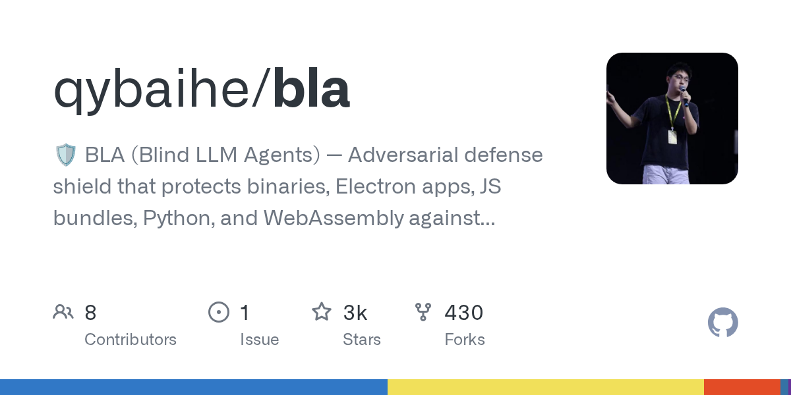</a> <a href="https://github.com/qybaihe/bla"><b>bla</b></a> qybaihe</td><td width="500">给软件构建产物加上诱饵和噪声，让 AI 逆向工具浪费大量 token，程序本身运行完全一样。  使用 rea: 否 图片来源: 仓库卡片</td></tr>
<tr><td width="220">— <a href="https://github.com/alphaSeclab/awesome-reverse-engineering"><b>awesome-reverse-engineering</b></a> alphaSeclab</td><td width="500">覆盖主流平台与领域的大型逆向工程工具与资源精选列表。  使用 rea: 否 图片来源: —</td></tr>
<tr><td width="220">— <a href="https://github.com/aicodeking/leanrea"><b>leanrea</b></a> aicodeking</td><td width="500">轻量 skill，替代 REA 的 MCP 层，让 agent 直接调用 CLI 工具  使用 rea: 否 图片来源: —</td></tr>
<tr><td width="220"> <a href="https://github.com/mandiant/flare-floss"><b>flare-floss</b></a> mandiant</td><td width="500">把恶意软件里隐藏、混淆的字符串挖出来  使用 rea: 否 图片来源: 本仓库截图</td></tr>
<tr><td width="220"> <a href="https://github.com/rizinorg/rizin"><b>rizin</b></a> rizinorg</td><td width="500">源自 radare2 的 UNIX 风格逆向框架  使用 rea: 否 图片来源: 项目 README</td></tr>
<tr><td width="220">— <a href="https://github.com/JusticeRage/Gepetto"><b>Gepetto</b></a> JusticeRage</td><td width="500">IDA Pro 插件，用语言模型在逆向过程中解释、重命名和注释函数。  使用 rea: 否 图片来源: —</td></tr>
<tr><td width="220"> <a href="https://github.com/google/bindiff"><b>bindiff</b></a> google</td><td width="500">找出两个版本二进制之间改了什么  使用 rea: 否 图片来源: 项目 README</td></tr>
<tr><td width="220">— <a href="https://github.com/j4k0xb/webcrack"><b>webcrack</b></a> j4k0xb</td><td width="500">JavaScript deobfuscation and bundle-unpacking tool for supported obfuscator.io, webpack and Browserify patterns.  使用 rea: ❔ 待验证 图片来源: —</td></tr>
<tr><td width="220">— <a href="https://github.com/SubmitGame/awesome-decomp-games"><b>awesome-decomp-games</b></a> SubmitGame</td><td width="500">评级并自动刷新的游戏反编译、静态重编译、源码移植与引擎重制列表  使用 rea: 否 图片来源: —</td></tr>
<tr><td width="220">— <a href="https://github.com/zinja-coder/jadx-ai-mcp"><b>jadx-ai-mcp</b></a> zinja-coder</td><td width="500">JADX 的 MCP 插件，让 AI Agent 反编译并浏览 Android APK / DEX。  使用 rea: 否 图片来源: —</td></tr>
<tr><td width="220">— <a href="https://github.com/P4nda0s/reverse-skills"><b>reverse-skills</b></a> P4nda0s</td><td width="500">Skills for interpreting IDA exports, recovering symbols and structures, and Frida/Unicorn-assisted analysis; MIT is claimed only in the README.  使用 rea: ❔ 待验证 图片来源: —</td></tr>
<tr><td width="220">— <a href="https://github.com/cranebeaker/coop-anything"><b>coop-anything</b></a> cranebeaker</td><td width="500">用 REA 调查入口，为单机游戏添加合作模式的 MCP 服务器与技能  使用 rea: ✅ 是 图片来源: —</td></tr>
<tr><td width="220">— <a href="https://github.com/morluto/awesome-reverse-engineering"><b>awesome-reverse-engineering</b></a> morluto</td><td width="500">逆向工具与学习资源的精选入门列表（二进制、应用、固件、格式、协议）。由 REA 作者维护。  使用 rea: 否 图片来源: —</td></tr>
<tr><td width="220">— <a href="https://github.com/P4nda0s/IDA-NO-MCP"><b>IDA-NO-MCP</b></a> P4nda0s</td><td width="500">Exports IDA decompilation and call relationships into agent-readable files; no explicit root license file was found.  使用 rea: ❔ 待验证 图片来源: —</td></tr>
<tr><td width="220"> <a href="https://github.com/HexRaysSA/ida-mcp"><b>ida-mcp</b></a> HexRaysSA</td><td width="500">Hex-Rays 官方的 IDA MCP 服务  使用 rea: 否 图片来源: 仓库卡片</td></tr>
<tr><td width="220">— <a href="https://github.com/WhiteNightShadow/hello_js_reverse_skill"><b>hello_js_reverse_skill</b></a> WhiteNightShadow</td><td width="500">A JavaScript-analysis skill that routes signature, obfuscation, cookie and WASM investigations through controlled experiments and browser evidence.  使用 rea: ❔ 待验证 图片来源: —</td></tr>
<tr><td width="220">— <a href="https://github.com/LING71671/open-reverselab"><b>open-reverselab</b></a> LING71671</td><td width="500">Agent-oriented reverse-engineering workbench combining MCP tools, a knowledge base and evidence workspaces; review the license and disclaimer.  使用 rea: ❔ 待验证 图片来源: —</td></tr>
<tr><td width="220">— <a href="https://github.com/alexgaoth/awesome-reverse-engineered"><b>awesome-reverse-engineered</b></a> alexgaoth</td><td width="500">一个很大的可搜索目录，收录了超过 1.7 万个开源项目。这些项目存在是因为有人把闭源的应用、游戏、API 或设备逆向了。它还有自己的搜索网站和 MCP，方便 AI 查询。  使用 rea: 否 图片来源: —</td></tr>
<tr><td width="220">— <a href="https://github.com/webrecorder/browsertrix-crawler"><b>browsertrix-crawler</b></a> webrecorder</td><td width="500">High-fidelity browser-based crawler that captures web content through CDP inside a standalone container.  使用 rea: ❔ 待验证 图片来源: —</td></tr>
<tr><td width="220"> <a href="https://github.com/ghidraninja/ghidra_scripts"><b>ghidra_scripts</b></a> ghidraninja</td><td width="500">实用 Ghidra 脚本合集，从 binwalk 到 YARA  使用 rea: 否 图片来源: 项目 README</td></tr>
<tr><td width="220">— <a href="https://github.com/pionxzh/wakaru"><b>wakaru</b></a> pionxzh</td><td width="500">JavaScript decompiler and bundle unpacker that recovers readable modules and modern syntax from minified or transpiled production builds.  使用 rea: ❔ 待验证 图片来源: —</td></tr>
<tr><td width="220"> <a href="https://github.com/cyberkaida/reverse-engineering-assistant"><b>reverse-engineering-assistant</b></a> cyberkaida</td><td width="500">另一种让 AI 控制 Ghidra（NSA 出的免费逆向工具）的方法。它给 AI 很多小而专注的工具，这样分析大程序时不容易晕。  使用 rea: 否 图片来源: 仓库卡片</td></tr>
<tr><td width="220">— <a href="https://github.com/MiaAI-Lab/sparkDash"><b>sparkDash</b></a> MiaAI-Lab</td><td width="500">集成 REA 长时分析任务、按需加载结果的多设备仪表盘  使用 rea: ✅ 是 图片来源: —</td></tr>
<tr><td width="220">— <a href="https://github.com/zinja-coder/jadx-mcp-server"><b>jadx-mcp-server</b></a> zinja-coder</td><td width="500">MCP server that exposes Android decompilation context through the companion JADX-AI-MCP plugin.  使用 rea: ❔ 待验证 图片来源: —</td></tr>
<tr><td width="220">— <a href="https://github.com/symgraph/GhidrAssist"><b>GhidrAssist</b></a> symgraph</td><td width="500">Ghidra 的 LLM 扩展，辅助重命名、解释和分析反编译代码。  使用 rea: 否 图片来源: —</td></tr>
<tr><td width="220">— <a href="https://github.com/nforest/awesome-decompilation"><b>awesome-decompilation</b></a> nforest</td><td width="500">反编译相关资源、论文、中间表示与项目的精选列表。  使用 rea: 否 图片来源: —</td></tr>
<tr><td width="220"> <a href="https://github.com/decompme/decomp.me"><b>decomp.me</b></a> decompme</td><td width="500">在浏览器里协作反编译，一起冲击完全匹配  使用 rea: 否 图片来源: 仓库卡片</td></tr>
<tr><td width="220">— <a href="https://github.com/Fausto-404/js-reverse-automation--skill"><b>js-reverse-automation--skill</b></a> Fausto-404</td><td width="500">An evidence-driven JavaScript workflow that combines Chrome DevTools MCP with runtime probes and JSRPC, Flask and Burp artifact generation.  使用 rea: ❔ 待验证 图片来源: —</td></tr>
<tr><td width="220">— <a href="https://github.com/1llu50ry/mcp-reverse"><b>mcp-reverse</b></a> 1llu50ry</td><td width="500">一个 MCP 服务器，把多种逆向工具和大量技能库打包起来，让 AI 代理能分析二进制和游戏  使用 rea: 否 图片来源: —</td></tr>
<tr><td width="220">— <a href="https://github.com/WhiteNightShadow/camoufox-reverse-mcp"><b>camoufox-reverse-mcp</b></a> WhiteNightShadow</td><td width="500">Camoufox-based MCP server for JavaScript runtime inspection, script search, network capture, hooks and offline signer verification.  使用 rea: ❔ 待验证 图片来源: —</td></tr>
<tr><td width="220">— <a href="https://github.com/radareorg/r2ai"><b>r2ai</b></a> radareorg</td><td width="500">radare2 的基于 LLM 的逆向工具与插件  使用 rea: 否 图片来源: —</td></tr>
<tr><td width="220">— <a href="https://github.com/dnakov/frida-mcp"><b>frida-mcp</b></a> dnakov</td><td width="500">Community MCP bridge for Frida devices, processes and JavaScript sessions; check maintenance and version compatibility.  使用 rea: ❔ 待验证 图片来源: —</td></tr>
<tr><td width="220">— <a href="https://github.com/fosdickio/binary_ninja_mcp"><b>binary_ninja_mcp</b></a> fosdickio</td><td width="500">让 LLM Agent 驱动 Binary Ninja 的 MCP 服务器（反编译、交叉引用、重命名、注释）。  使用 rea: 否 图片来源: —</td></tr>
<tr><td width="220">— <a href="https://github.com/radareorg/radare2-mcp"><b>radare2-mcp</b></a> radareorg</td><td width="500">radare2 官方 MCP stdio 服务器  使用 rea: 否 图片来源: —</td></tr>
<tr><td width="220">— <a href="https://github.com/lemonadesaltbagel/crab"><b>crab</b></a> lemonadesaltbagel</td><td width="500">一个 MCP 工具，让 AI 把任何软件当成纯黑盒来观察（只看它做什么，不看代码），然后做一个行为完全一样的干净室版本。  使用 rea: 否 图片来源: —</td></tr>
<tr><td width="220">— <a href="https://github.com/n-delic/decompdecomp"><b>decompdecomp</b></a> n-delic</td><td width="500">让 AI 代理把你拥有的游戏反编译成能逐字节重建原版的 C/C++ 的桌面工具。  使用 rea: 否 图片来源: —</td></tr>
<tr><td width="220">— <a href="https://github.com/exoteric33/ps2-native-recomp"><b>ps2-native-recomp</b></a> exoteric33</td><td width="500">把你自己的 PS2 游戏光盘静态重编译成原生 Windows/Linux 程序  使用 rea: 否 图片来源: —</td></tr>
<tr><td width="220">— <a href="https://github.com/crowdere/Awesome-RE-MCP"><b>Awesome-RE-MCP</b></a> crowdere</td><td width="500">精选带 MCP 服务器的逆向工程工具列表，方便 AI 助手驱动 Ghidra、IDA 等工具进行分析。  使用 rea: 否 图片来源: —</td></tr>
<tr><td width="220">— <a href="https://github.com/sp00nznet/pcrecomp"><b>pcrecomp</b></a> sp00nznet</td><td width="500">一套统一工具箱，用来拆解老旧PC软件（DOS、Windows 16/32/64位等），然后重新编译成现代原生代码，在Windows、Linux等系统上直接运行，不需要模拟器。  使用 rea: 否 图片来源: —</td></tr>
<tr><td width="220"> <a href="https://github.com/ShadowSwaps/REA-Reconstruction-Companion"><b>REA-Reconstruction-Companion</b></a> ShadowSwaps</td><td width="500">让重建过程始终有证据可查的智能体技能  使用 rea: ✅ 是 图片来源: 仓库卡片</td></tr>
<tr><td width="220"><a href="https://github.com/seifhassine/REasy">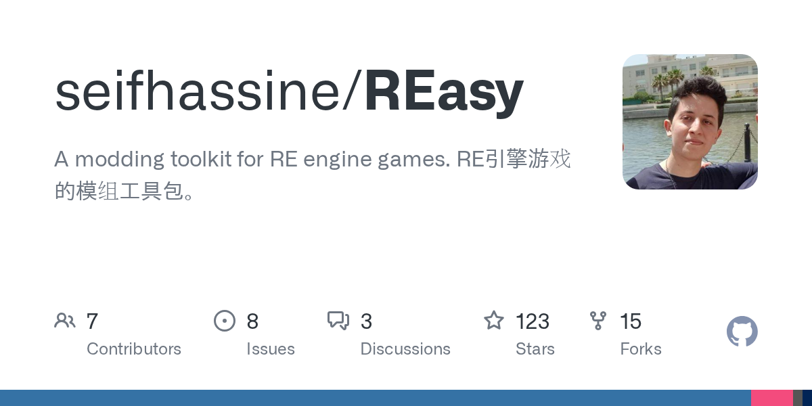</a> <a href="https://github.com/seifhassine/REasy"><b>REasy</b></a> seifhassine</td><td width="500">一个免费工具包，可以打开、编辑并重新打包卡普空 RE 引擎游戏（如生化危机、怪物猎人）用的文件。  使用 rea: 否 图片来源: 仓库卡片</td></tr>
<tr><td width="220"> <a href="https://github.com/SwitchRECOMP-Dev/Switch2RECOMP"><b>Switch2RECOMP</b></a> SwitchRECOMP-Dev</td><td width="500">一个免费开源工具，能把任天堂 Switch 和 Switch 2 游戏的机器码一次性翻译成原生 Windows 或 Linux 程序，让你用自己的游戏副本在电脑上直接玩，不用模拟器。  使用 rea: 否 图片来源: 仓库卡片</td></tr>
<tr><td width="220">— <a href="https://github.com/giveen/decomp.anything"><b>decomp.anything</b></a> giveen</td><td width="500">停更的匹配式反编译器 decomp.wtf 的活跃分支；增加了 Windows/Linux 二进制支持，并接入 REA，让 AI 也能逆向非游戏程序。  使用 rea: ✅ 是 图片来源: —</td></tr>
<tr><td width="220">— <a href="https://github.com/FurkanAnc/totk-launcher"><b>totk-launcher</b></a> FurkanAnc</td><td width="500">给现有的《塞尔达传说 王国之泪》PC 重编译版做的启动器：改设置、改按键、成就、存档备份和作弊。  使用 rea: 否 图片来源: —</td></tr>
<tr><td width="220"> <a href="https://github.com/czcdr/dsh-plugin-rea"><b>dsh-plugin-rea</b></a> czcdr</td><td width="500">在 DeepSeek Harness 里用 REA，自动装好 Ghidra  使用 rea: ✅ 是 图片来源: 项目 README</td></tr>
<tr><td width="220"> <a href="https://github.com/rizinorg/jsdec"><b>jsdec</b></a> rizinorg</td><td width="500">为 Rizin 生成可读伪 C，手写汇编也行  使用 rea: 否 图片来源: 仓库卡片</td></tr>
<tr><td width="220"> <a href="https://github.com/0xshlomil/ida-free-mcp"><b>ida-free-mcp</b></a> 0xshlomil</td><td width="500">通过 MCP 让 AI 智能体使用免费版 IDA  使用 rea: ✅ 是 图片来源: 仓库卡片</td></tr>
<tr><td width="220"> <a href="https://github.com/dav1dngy/era-agent"><b>era-agent</b></a> dav1dngy</td><td width="500">以证据驱动、会尝试自我改进的逆向智能体  使用 rea: ❔ 待验证 图片来源: 项目 README</td></tr>
<tr><td width="220">— <a href="https://github.com/tanepiper/game-frame"><b>game-frame</b></a> tanepiper</td><td width="500">让 AI agent 从发行文件逆向游戏的框架  使用 rea: ✅ 是 图片来源: —</td></tr>
<tr><td width="220">— <a href="https://github.com/gryszzz/reverse-engineer-everything"><b>reverse-engineer-everything</b></a> gryszzz</td><td width="500">基于 REA 引擎的本地工作台和调查工作室，用于有证据支持的软件分析，文件不上云。  使用 rea: ✅ 是 图片来源: —</td></tr>
<tr><td width="220"> <a href="https://github.com/BurnoutDecomp/BP-Decomp_Workflow"><b>BP-Decomp_Workflow</b></a> BurnoutDecomp</td><td width="500">帮助逆向和反编译《横冲直撞：天堂》的工具与工作流仓库。包含脚本、IDA数据库和代理编排。  使用 rea: 否 图片来源: 仓库卡片</td></tr>
<tr><td width="220">— <a href="https://github.com/veritr1x/recomp-kit"><b>recomp-kit</b></a> veritr1x</td><td width="500">一套静态重编译工具包，把老的32位x86 Windows游戏变成macOS、iOS、Android、Linux和Windows上的原生程序，完全不需要模拟器或JIT。  使用 rea: 否 图片来源: —</td></tr>
<tr><td width="220"> <a href="https://github.com/alexmi256/rea-agent-docker"><b>rea-agent-docker</b></a> alexmi256</td><td width="500">REA 的 Docker 镜像，含 Ghidra/Hopper/IDA 版本  使用 rea: ✅ 是 图片来源: 仓库卡片</td></tr>
<tr><td width="220"> <a href="https://github.com/sp00nznet/snesrecomp"><b>snesrecomp</b></a> sp00nznet</td><td width="500">一套现成的 SNES 硬件库，让你把重编译出来的 SNES 游戏代码直接做成带正常画面和声音的原生移植。  使用 rea: 否 图片来源: 仓库卡片</td></tr>
<tr><td width="220">— <a href="https://github.com/yefan911/automated-recompilers"><b>automated-recompilers</b></a> yefan911</td><td width="500">一个自动化框架，能把主机 ROM 可执行文件通过静态重编译翻译成能在 PC 上原生运行的程序。  使用 rea: 否 图片来源: —</td></tr>
<tr><td width="220"> <a href="https://github.com/DatanoiseTV/revenant"><b>revenant</b></a> DatanoiseTV</td><td width="500">用大模型自动逆向被厂商抛弃的固件和二进制程序，生成引脚图、设备树或开源重实现。  使用 rea: 否 图片来源: 仓库卡片</td></tr>
<tr><td width="220"> <a href="https://github.com/Nowng/rea-mcp"><b>rea-mcp</b></a> Nowng</td><td width="500">在 LM Studio 里配合本地模型用 REA  使用 rea: ✅ 是 图片来源: 仓库卡片</td></tr>
<tr><td width="220">— <a href="https://github.com/ValveResourceFormat/Source2Mcp"><b>Source2Mcp</b></a> ValveResourceFormat</td><td width="500">一个 MCP 服务器，让 AI 能启动并控制 CS2、Dota 2 或 Deadlock 这类 Source 2 游戏：跑控制台命令、移动镜头、截图。  使用 rea: 否 图片来源: —</td></tr>
<tr><td width="220"> <a href="https://github.com/jaenster/ghidra-reconstruct"><b>ghidra-reconstruct</b></a> jaenster</td><td width="500">把 Ghidra 反编译出来的乱糟糟代码整理成干净、有命名空间的 C++ 源码，让你可以真正编译构建。  使用 rea: 否 图片来源: 仓库卡片</td></tr>
<tr><td width="220"> <a href="https://github.com/zhaofeng130/dsh-rea"><b>dsh-rea</b></a> zhaofeng130</td><td width="500">给 DeepSeek Harness 加上 REA 技能和工具  使用 rea: ✅ 是 图片来源: 仓库卡片</td></tr>
<tr><td width="220"><a href="https://github.com/andrewnakas/recompsoftware">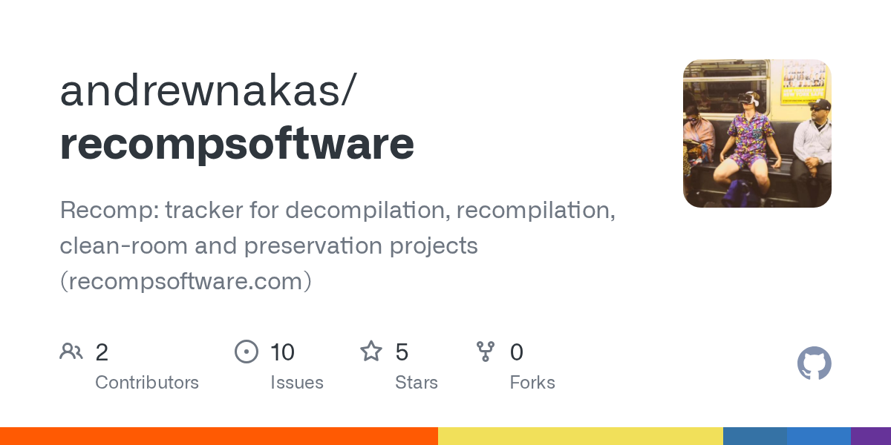</a> <a href="https://github.com/andrewnakas/recompsoftware"><b>recompsoftware</b></a> andrewnakas</td><td width="500">一个实时网站，追踪数千个从机器码重建老游戏和软件的项目，附带进度图和发布记录。  使用 rea: 否 图片来源: 仓库卡片</td></tr>
<tr><td width="220"> <a href="https://github.com/pablodiazjorge/rea-casebook"><b>rea-casebook</b></a> pablodiazjorge</td><td width="500">让 Claude Code 的每条结论都引用真实 REA 证据  使用 rea: ✅ 是 图片来源: 项目 README</td></tr>
<tr><td width="220"> <a href="https://github.com/sheilacraig/dsh-rea-mcp"><b>dsh-rea-mcp</b></a> sheilacraig</td><td width="500">只靠配置就把 REA 挂进 DeepSeek Harness  使用 rea: ✅ 是 图片来源: 仓库卡片</td></tr>
<tr><td width="220">— <a href="https://github.com/agioracle/rea-unity-game"><b>rea-unity-game</b></a> agioracle</td><td width="500">用 agent 逆向 Unity 游戏的工作流  使用 rea: ❔ 待验证 图片来源: —</td></tr>
<tr><td width="220"> <a href="https://github.com/itsgrimetime/decomp-me-mcp"><b>decomp-me-mcp</b></a> itsgrimetime</td><td width="500">让 AI 编程助手能直接在 decomp.me 上查看、编译并改进游戏反编译草稿的 MCP 服务器。  使用 rea: 否 图片来源: 仓库卡片</td></tr>
<tr><td width="220"> <a href="https://github.com/ya123-4/rea-dsh-plugin"><b>rea-dsh-plugin</b></a> ya123-4</td><td width="500">在 DeepSeek Harness 中注册 REA 的 MCP 工具  使用 rea: ✅ 是 图片来源: 仓库卡片</td></tr>
<tr><td width="220"> <a href="https://github.com/Sage-is/CleanRoom"><b>CleanRoom</b></a> Sage-is</td><td width="500">用 Python 从零重写的本地 REA（逆向任何东西）MCP 服务器和命令行工具。  使用 rea: 否 图片来源: 仓库卡片</td></tr>
<tr><td width="220">— <a href="https://github.com/jaenster/setup-msvc"><b>setup-msvc</b></a> jaenster</td><td width="500">一个 CI 助手，能安装精确的历史版本微软 Visual C++ 工具链（6.0 到 2010），方便反编译和重编译项目做到和原版编译器逐字节匹配。  使用 rea: 否 图片来源: —</td></tr>
<tr><td width="220"><a href="https://github.com/cognixws/picode-rea">预览暂不可用 · 查看原项目</a> <a href="https://github.com/cognixws/picode-rea"><b>picode-rea</b></a> cognixws</td><td width="500">在 PiCode 里使用 REA 的静态分析工具  使用 rea: ✅ 是 图片来源: <a href="https://github.com/cognixws/picode-rea">仓库卡片</a></td></tr>
<tr><td width="220"> <a href="https://github.com/jinshi666888/rea-playbook"><b>rea-playbook</b></a> jinshi666888</td><td width="500">带迷你 Electron 靶子的 REA 动手实验  使用 rea: ✅ 是 图片来源: 项目 README</td></tr>
<tr><td width="220">— <a href="https://github.com/Stijnus/dsh-rev-eng"><b>dsh-rev-eng</b></a> Stijnus</td><td width="500">将 REA 技能与可选 MCP 打包为 DSH 插件，用于逆向工程与 Mac 应用构建。  使用 rea: ✅ 是 图片来源: —</td></tr>
<tr><td width="220">— <a href="https://github.com/MarkMcCaskey/dolphin-decomp-mcp"><b>dolphin-decomp-mcp</b></a> MarkMcCaskey</td><td width="500">一个MCP服务器和命令行工具，让AI代理可以实时调试在海豚模拟器里跑的GameCube和Wii游戏。适合做逆向工程和匹配反编译。  使用 rea: 否 图片来源: —</td></tr>
<tr><td width="220"> <a href="https://github.com/orikami048/gea"><b>gea</b></a> orikami048</td><td width="500">游戏逆向、资源提取与 Cocos/Three.js 重现的 MCP 与 CLI；受 morluto/rea 启发。  使用 rea: 否 图片来源: 仓库卡片</td></tr>
<tr><td width="220">— <a href="https://github.com/CurLeaf/dsh-command-rea"><b>dsh-command-rea</b></a> CurLeaf</td><td width="500">DSH /rea 斜杠命令，将逆向分析请求路由到 REA 技能与 MCP 工具。  使用 rea: ✅ 是 图片来源: —</td></tr>
<tr><td width="220">— <a href="https://github.com/LostArtefacts/decomp-tools"><b>decomp-tools</b></a> LostArtefacts</td><td width="500">帮助对 Windows 版《古墓丽影2》到《古墓丽影5》做逐字节匹配反编译的工具，使用 Wine 下的原版 MSVC 5/6 编译器。  使用 rea: 否 图片来源: —</td></tr>
<tr><td width="220">— <a href="https://github.com/MistblastClear/UEBulkExport-rpocket"><b>UEBulkExport-rpocket</b></a> MistblastClear</td><td width="500">一个命令行工具，能把整个虚幻引擎游戏包（.pak / .utoc / .ucas）一次性导出成纹理、模型、动画、音频和关卡文件夹。  使用 rea: 否 图片来源: —</td></tr>
<tr><td width="220">— <a href="https://github.com/zarvox32/vb-native-decompiler"><b>vb-native-decompiler</b></a> zarvox32</td><td width="500">一个工具，能把闭源的 Visual Basic 5/6 原生代码程序反编译回可读的 VB 源码，并且逐个过程对照原版机器码做验证。  使用 rea: 否 图片来源: —</td></tr>
<tr><td width="220">— <a href="https://github.com/austinkregel/corpus_mcp"><b>corpus_mcp</b></a> austinkregel</td><td width="500">一个 MCP 服务器，让 AI 智能体能搜索 Ghidra 反编译结果、Lua 代码和项目文档，加快对闭源程序的逆向。  使用 rea: 否 图片来源: —</td></tr>
<tr><td width="220">— <a href="https://github.com/romangalaxys10-spec/zcode-rea"><b>zcode-rea</b></a> romangalaxys10-spec</td><td width="500">ZCode 插件，封装了官方 REA 工具包，让 AI 智能体能带证据地对闭源二进制、应用和网站做逆向。  使用 rea: ✅ 是 图片来源: —</td></tr>
<tr><td width="220">— <a href="https://github.com/sosiman/re-code-mode"><b>re-code-mode</b></a> sosiman</td><td width="500">给 AI 智能体提供 radare2、binwalk 等逆向工具的工具箱，专门分析闭源程序，并在本地过滤大输出以免撑爆模型上下文。  使用 rea: 否 图片来源: —</td></tr>
</table>

## REA 官方 Showcase

<table>
<tr><th width="220">项目 / 图片</th><th width="500">简介</th></tr>
<tr><td width="220"> <a href="https://rea.tools/showcase/dx-ball/"><b>DX-Ball: sound-pan function</b></a></td><td width="500">看 REA 把 DX-Ball 的一个音效函数还原成逐字节一致的 C  使用 rea: ✅ 是 图片来源: 本仓库截图</td></tr>
<tr><td width="220"> <a href="https://rea.tools/showcase/notion/"><b>Notion: Electron clipboard bridge</b></a></td><td width="500">跟着一次 Notion 复制操作，从页面一路追到 IPC 和主进程  使用 rea: ✅ 是 图片来源: 本仓库截图</td></tr>
<tr><td width="220"> <a href="https://rea.tools/showcase/th04/"><b>TH04: PC-98 bullet-ring maths</b></a></td><td width="500">从 16 位 DOS 代码里找回东方幻想乡的弹幕角度算法  使用 rea: ✅ 是 图片来源: 本仓库截图</td></tr>
<tr><td width="220"> <a href="https://rea.tools/showcase/aegis/"><b>Aegis: TOTP code generation</b></a></td><td width="500">看清 Aegis 安卓应用是怎样生成两步验证码的  使用 rea: ✅ 是 图片来源: 本仓库截图</td></tr>
<tr><td width="220"> <a href="https://rea.tools/showcase/ctf/"><b>CTF: flag checker</b></a></td><td width="500">一步步解开 DownUnderCTF 2023 的逆向题  使用 rea: ✅ 是 图片来源: 本仓库截图</td></tr>
</table>

## 可选视图：使用 REA 的项目

这个证据标记子集复用上方平台与主题目录中的条目。本地图同样收录不依赖 REA 的独立工具与项目。

展开 58 条 REA 标记记录

<table>
<tr><th width="220">项目 / 图片</th><th width="500">简介</th></tr>
<tr><td width="220"> <a href="https://github.com/morluto/rea/discussions/2254"><b>REA discussion #2254</b></a></td><td width="500">分析去符号的 bzip2，并对照真实构建验证  使用 rea: ✅ 是 图片来源: 本仓库截图</td></tr>
<tr><td width="220">— <a href="https://github.com/cranebeaker/coop-anything"><b>coop-anything</b></a> cranebeaker</td><td width="500">用 REA 调查入口，为单机游戏添加合作模式的 MCP 服务器与技能  使用 rea: ✅ 是 图片来源: —</td></tr>
<tr><td width="220">— <a href="https://github.com/Caho1/open-claude-ui"><b>open-claude-ui</b></a> Caho1</td><td width="500">用 REA 深度拆解并高保真还原 Claude 桌面端 UI 组件与交互物理  使用 rea: ✅ 是 图片来源: —</td></tr>
<tr><td width="220">— <a href="https://github.com/MiaAI-Lab/sparkDash"><b>sparkDash</b></a> MiaAI-Lab</td><td width="500">集成 REA 长时分析任务、按需加载结果的多设备仪表盘  使用 rea: ✅ 是 图片来源: —</td></tr>
<tr><td width="220"> <a href="https://github.com/michaelshimeles/terminal-rs"><b>terminal-rs</b></a> michaelshimeles</td><td width="500">Rust 写的彭博风格交易终端  使用 rea: ✅ 是 图片来源: 项目 README</td></tr>
<tr><td width="220">— <a href="https://github.com/Xiangyu-CAS/rea-capcut"><b>rea-capcut</b></a> Xiangyu-CAS</td><td width="500">用 REA 研究剪映后重做的开源离线剪辑软件  使用 rea: ✅ 是 图片来源: —</td></tr>
<tr><td width="220"> <a href="https://github.com/ShadowSwaps/REA-Reconstruction-Companion"><b>REA-Reconstruction-Companion</b></a> ShadowSwaps</td><td width="500">让重建过程始终有证据可查的智能体技能  使用 rea: ✅ 是 图片来源: 仓库卡片</td></tr>
<tr><td width="220"> <a href="https://github.com/michaelshimeles/rec-rs"><b>rec-rs</b></a> michaelshimeles</td><td width="500">Rust 写的 macOS 快速录屏工具，参照 OBS 设计  使用 rea: ✅ 是 图片来源: 项目 README</td></tr>
<tr><td width="220"> <a href="https://github.com/N0zoM1z0/dx-ball"><b>dx-ball</b></a> N0zoM1z0 &#160;PC / DOS / PC-98</td><td width="500">用 C/C++ 重建 DX-Ball 1.07，并对照原版 x86 测试  使用 rea: ✅ 是 图片来源: 项目 README</td></tr>
<tr><td width="220"> <a href="https://github.com/michaelshimeles/sketch"><b>sketch</b></a> michaelshimeles</td><td width="500">Rust 写的无限设计画布，研究 Paper 后重建  使用 rea: ✅ 是 图片来源: 项目 README</td></tr>
<tr><td width="220">— <a href="https://github.com/giveen/decomp.anything"><b>decomp.anything</b></a> giveen</td><td width="500">停更的匹配式反编译器 decomp.wtf 的活跃分支；增加了 Windows/Linux 二进制支持，并接入 REA，让 AI 也能逆向非游戏程序。  使用 rea: ✅ 是 图片来源: —</td></tr>
<tr><td width="220"> <a href="https://github.com/czcdr/dsh-plugin-rea"><b>dsh-plugin-rea</b></a> czcdr</td><td width="500">在 DeepSeek Harness 里用 REA，自动装好 Ghidra  使用 rea: ✅ 是 图片来源: 项目 README</td></tr>
<tr><td width="220"> <a href="https://github.com/Moxnatiy/OpenBattlefield2"><b>OpenBattlefield2</b></a> Moxnatiy &#160;PC / DOS / PC-98</td><td width="500">战地 2 引擎的 C++20 净室重写（读取你自己的游戏）  使用 rea: ✅ 是 图片来源: 项目 README</td></tr>
<tr><td width="220"> <a href="https://github.com/0xshlomil/ida-free-mcp"><b>ida-free-mcp</b></a> 0xshlomil</td><td width="500">通过 MCP 让 AI 智能体使用免费版 IDA  使用 rea: ✅ 是 图片来源: 仓库卡片</td></tr>
<tr><td width="220">— <a href="https://github.com/glauberlima/open-scrantic"><b>open-scrantic</b></a> glauberlima</td><td width="500">用 REA 逆向并重写的 1992 年 Johnny Castaway 屏保（Rust）  使用 rea: ✅ 是 图片来源: —</td></tr>
<tr><td width="220"> <a href="https://github.com/lxistired/ledger-reborn"><b>ledger-reborn</b></a> lxistired</td><td width="500">本地优先的记账应用，参照 QuickBooks Mac 版  使用 rea: ✅ 是 图片来源: 项目 README</td></tr>
<tr><td width="220">— <a href="https://github.com/nicolvus/a6000-fw-decomp"><b>a6000-fw-decomp</b></a> nicolvus</td><td width="500">用 REA 和 Ghidra 拆索尼 A6000 相机固件  使用 rea: ✅ 是 图片来源: —</td></tr>
<tr><td width="220"> <a href="https://github.com/N0zoM1z0/th04"><b>th04</b></a> N0zoM1z0 &#160;PC / DOS / PC-98</td><td width="500">东方幻想乡（PC-98）的可读源码，对照原编译器校验  使用 rea: ✅ 是 图片来源: 项目 README</td></tr>
<tr><td width="220">— <a href="https://github.com/tanepiper/game-frame"><b>game-frame</b></a> tanepiper</td><td width="500">让 AI agent 从发行文件逆向游戏的框架  使用 rea: ✅ 是 图片来源: —</td></tr>
<tr><td width="220">— <a href="https://github.com/gryszzz/reverse-engineer-everything"><b>reverse-engineer-everything</b></a> gryszzz</td><td width="500">基于 REA 引擎的本地工作台和调查工作室，用于有证据支持的软件分析，文件不上云。  使用 rea: ✅ 是 图片来源: —</td></tr>
<tr><td width="220">— <a href="https://github.com/rodneypantonial/sims3-modernization"><b>sims3-modernization</b></a> rodneypantonial &#160;PC / DOS / PC-98</td><td width="500">让模拟人生 3 在新电脑上少卡顿、少崩溃  使用 rea: ✅ 是 图片来源: —</td></tr>
<tr><td width="220"> <a href="https://github.com/cudanexus/vd-streamer-linux"><b>vd-streamer-linux</b></a> cudanexus</td><td width="500">把 Linux 桌面串流到 Quest、Pico 头显  使用 rea: ✅ 是 图片来源: 仓库卡片</td></tr>
<tr><td width="220"> <a href="https://github.com/alexmi256/rea-agent-docker"><b>rea-agent-docker</b></a> alexmi256</td><td width="500">REA 的 Docker 镜像，含 Ghidra/Hopper/IDA 版本  使用 rea: ✅ 是 图片来源: 仓库卡片</td></tr>
<tr><td width="220"> <a href="https://github.com/pablodiazjorge/rea-lab"><b>rea-lab</b></a> pablodiazjorge</td><td width="500">Windows + Ghidra 练习题和预注册的 REA 评测  使用 rea: ✅ 是 图片来源: 仓库卡片</td></tr>
<tr><td width="220">— <a href="https://github.com/EndLess728/MiTV-Remote"><b>MiTV-Remote</b></a> EndLess728</td><td width="500">在 Mac、安卓、iPhone 上用 Wi-Fi 遥控小米电视  使用 rea: ✅ 是 图片来源: —</td></tr>
<tr><td width="220"> <a href="https://github.com/sickpyramid/ReaFuse"><b>ReaFuse</b></a> sickpyramid</td><td width="500">借助 REA 把两个 JS/TS 项目融合成一个  使用 rea: ✅ 是 图片来源: 仓库卡片</td></tr>
<tr><td width="220"> <a href="https://github.com/ucodia/desktop-games-nostalgia"><b>desktop-games-nostalgia</b></a> ucodia &#160;PC / DOS / PC-98</td><td width="500">再砸一次桌面：Gemtree 2000 年的小玩具登上 macOS 和网页  使用 rea: ✅ 是 图片来源: 项目 README</td></tr>
<tr><td width="220"><a href="https://github.com/a-barzanti/ai-rebuilds">预览暂不可用 · 查看原项目</a> <a href="https://github.com/a-barzanti/ai-rebuilds"><b>ai-rebuilds</b></a> a-barzanti &#160;PC / DOS / PC-98</td><td width="500">被遗弃的老游戏重回浏览器，不含任何原版文件  使用 rea: ✅ 是 图片来源: <a href="https://github.com/a-barzanti/ai-rebuilds">仓库卡片</a></td></tr>
<tr><td width="220"> <a href="https://github.com/Nowng/rea-mcp"><b>rea-mcp</b></a> Nowng</td><td width="500">在 LM Studio 里配合本地模型用 REA  使用 rea: ✅ 是 图片来源: 仓库卡片</td></tr>
<tr><td width="220"> <a href="https://github.com/NullLabTests/OpenBSD_netcat_REA"><b>OpenBSD_netcat_REA</b></a> NullLabTests</td><td width="500">用 REA + Ghidra 静态分析 netcat-openbsd  使用 rea: ✅ 是 图片来源: 项目 README</td></tr>
<tr><td width="220"> <a href="https://github.com/grisuno/VSL-DSP"><b>VSL-DSP</b></a> grisuno</td><td width="500">PreSonus AudioBox VSL 声卡的 Linux 内核模块  使用 rea: ✅ 是 图片来源: 仓库卡片</td></tr>
<tr><td width="220"> <a href="https://github.com/iammukeshm/hexgrab"><b>hexgrab</b></a> iammukeshm</td><td width="500">迷你 Windows 取色器，从 PowerToys 二进制研究而来  使用 rea: ✅ 是 图片来源: 仓库卡片</td></tr>
<tr><td width="220"> <a href="https://github.com/zhaofeng130/dsh-rea"><b>dsh-rea</b></a> zhaofeng130</td><td width="500">给 DeepSeek Harness 加上 REA 技能和工具  使用 rea: ✅ 是 图片来源: 仓库卡片</td></tr>
<tr><td width="220">— <a href="https://github.com/B-Howell/soundconnect-desktop"><b>soundconnect-desktop</b></a> B-Howell</td><td width="500">在 Windows 桌面上控制索尼蓝牙耳机  使用 rea: ✅ 是 图片来源: —</td></tr>
<tr><td width="220"> <a href="https://github.com/OpenRsG/GunZRs"><b>GunZRs</b></a> OpenRsG &#160;PC / DOS / PC-98</td><td width="500">GunZ：The Duel 用 Rust + Bevy 重生  使用 rea: ✅ 是 图片来源: 项目 README</td></tr>
<tr><td width="220"> <a href="https://github.com/pablodiazjorge/rea-casebook"><b>rea-casebook</b></a> pablodiazjorge</td><td width="500">让 Claude Code 的每条结论都引用真实 REA 证据  使用 rea: ✅ 是 图片来源: 项目 README</td></tr>
<tr><td width="220"> <a href="https://github.com/tuunanet/rea-ski-or-die-reconstruction"><b>rea-ski-or-die-reconstruction</b></a> tuunanet &#160;PC / DOS / PC-98</td><td width="500">Ski or Die 的雪球大战，用 Rust + SDL2 重做（素材自备）  使用 rea: ✅ 是 图片来源: 项目 README</td></tr>
<tr><td width="220"> <a href="https://github.com/sheilacraig/dsh-rea-mcp"><b>dsh-rea-mcp</b></a> sheilacraig</td><td width="500">只靠配置就把 REA 挂进 DeepSeek Harness  使用 rea: ✅ 是 图片来源: 仓库卡片</td></tr>
<tr><td width="220"> <a href="https://github.com/az9713/wispr-flow-rea-teardown"><b>wispr-flow-rea-teardown</b></a> az9713</td><td width="500">拆解 Wispr Flow 语音管线，附 64 行重写版  使用 rea: ✅ 是 图片来源: <a href="https://img.youtube.com/vi/FnB9tHKBJXQ/maxresdefault.jpg">视频封面</a></td></tr>
<tr><td width="220"> <a href="https://github.com/KarlssonChristoffer/DiskLens"><b>DiskLens</b></a> KarlssonChristoffer</td><td width="500">像 WinDirStat 一样看清 Windows 11 磁盘被什么占满  使用 rea: ✅ 是 图片来源: 仓库卡片</td></tr>
<tr><td width="220"> <a href="https://github.com/ya123-4/rea-dsh-plugin"><b>rea-dsh-plugin</b></a> ya123-4</td><td width="500">在 DeepSeek Harness 中注册 REA 的 MCP 工具  使用 rea: ✅ 是 图片来源: 仓库卡片</td></tr>
<tr><td width="220"> <a href="https://github.com/az9713/REA-demo"><b>REA-demo</b></a> az9713</td><td width="500">让 REA 分析它自己，附可证伪的预测  使用 rea: ✅ 是 图片来源: 仓库卡片</td></tr>
<tr><td width="220"><a href="https://github.com/cognixws/picode-rea">预览暂不可用 · 查看原项目</a> <a href="https://github.com/cognixws/picode-rea"><b>picode-rea</b></a> cognixws</td><td width="500">在 PiCode 里使用 REA 的静态分析工具  使用 rea: ✅ 是 图片来源: <a href="https://github.com/cognixws/picode-rea">仓库卡片</a></td></tr>
<tr><td width="220"> <a href="https://github.com/jinshi666888/rea-playbook"><b>rea-playbook</b></a> jinshi666888</td><td width="500">带迷你 Electron 靶子的 REA 动手实验  使用 rea: ✅ 是 图片来源: 项目 README</td></tr>
<tr><td width="220"> <a href="https://github.com/UnknownHacker1/rea-groundtruth"><b>rea-groundtruth</b></a> UnknownHacker1</td><td width="500">拿真实源码检验 REA 的分析报告  使用 rea: ✅ 是 图片来源: 仓库卡片</td></tr>
<tr><td width="220">— <a href="https://github.com/Stijnus/dsh-rev-eng"><b>dsh-rev-eng</b></a> Stijnus</td><td width="500">将 REA 技能与可选 MCP 打包为 DSH 插件，用于逆向工程与 Mac 应用构建。  使用 rea: ✅ 是 图片来源: —</td></tr>
<tr><td width="220"> <a href="https://github.com/alemigav/re2-64-decomp"><b>re2-64-decomp</b></a> alemigav &#160;任天堂 64</td><td width="500">用 AI 工具（REA + Ghidra）拆解任天堂64版《生化危机2》。有数千个反编译函数和验证套件，不含游戏ROM。  使用 rea: ✅ 是 图片来源: 仓库卡片</td></tr>
<tr><td width="220"> <a href="https://github.com/AdamLinCodes/AdamTerm"><b>AdamTerm</b></a> AdamLinCodes</td><td width="500">研究 Ghostty 后做出的极简 macOS 终端  使用 rea: ✅ 是 图片来源: 项目 README</td></tr>
<tr><td width="220">— <a href="https://github.com/chilliesdev/fmseasonhub-re"><b>fmseasonhub-re</b></a> chilliesdev</td><td width="500">用 REA 拆解 FM Season Hub 应用的分析笔记  使用 rea: ✅ 是 图片来源: —</td></tr>
<tr><td width="220">— <a href="https://github.com/carlhako/keen-clone"><b>keen-clone</b></a> carlhako &#160;PC / DOS / PC-98</td><td width="500">用 REA + Ghidra 函数级还原的 Commander Keen 1 原生 Linux/SDL2 重实现  使用 rea: ✅ 是 图片来源: —</td></tr>
<tr><td width="220">— <a href="https://github.com/NathanKanaeru/samp-client-re"><b>samp-client-re</b></a> NathanKanaeru &#160;PC / DOS / PC-98</td><td width="500">用 REA/Ghidra 恢复架构的 SA-MP 0.3.DL-R1 clean-room 客户端重实现  使用 rea: ✅ 是 图片来源: —</td></tr>
<tr><td width="220">— <a href="https://github.com/CurLeaf/dsh-command-rea"><b>dsh-command-rea</b></a> CurLeaf</td><td width="500">DSH /rea 斜杠命令，将逆向分析请求路由到 REA 技能与 MCP 工具。  使用 rea: ✅ 是 图片来源: —</td></tr>
<tr><td width="220">— <a href="https://github.com/romangalaxys10-spec/zcode-rea"><b>zcode-rea</b></a> romangalaxys10-spec</td><td width="500">ZCode 插件，封装了官方 REA 工具包，让 AI 智能体能带证据地对闭源二进制、应用和网站做逆向。  使用 rea: ✅ 是 图片来源: —</td></tr>
<tr><td width="220"> <a href="https://rea.tools/showcase/dx-ball/"><b>DX-Ball: sound-pan function</b></a></td><td width="500">看 REA 把 DX-Ball 的一个音效函数还原成逐字节一致的 C  使用 rea: ✅ 是 图片来源: 本仓库截图</td></tr>
<tr><td width="220"> <a href="https://rea.tools/showcase/notion/"><b>Notion: Electron clipboard bridge</b></a></td><td width="500">跟着一次 Notion 复制操作，从页面一路追到 IPC 和主进程  使用 rea: ✅ 是 图片来源: 本仓库截图</td></tr>
<tr><td width="220"> <a href="https://rea.tools/showcase/th04/"><b>TH04: PC-98 bullet-ring maths</b></a></td><td width="500">从 16 位 DOS 代码里找回东方幻想乡的弹幕角度算法  使用 rea: ✅ 是 图片来源: 本仓库截图</td></tr>
<tr><td width="220"> <a href="https://rea.tools/showcase/aegis/"><b>Aegis: TOTP code generation</b></a></td><td width="500">看清 Aegis 安卓应用是怎样生成两步验证码的  使用 rea: ✅ 是 图片来源: 本仓库截图</td></tr>
<tr><td width="220"> <a href="https://rea.tools/showcase/ctf/"><b>CTF: flag checker</b></a></td><td width="500">一步步解开 DownUnderCTF 2023 的逆向题  使用 rea: ✅ 是 图片来源: 本仓库截图</td></tr>
</table>

## 数据与贡献

[data.json](data.json) 保存目录条目，[descriptions.json](descriptions.json) 保存展示简介；[skill-map.json](skill-map.json) 保存技术映射与来源证据；[llms.txt](llms.txt) 提供面向 Agent 的简明索引。

新增或纠错请先读 [CONTRIBUTING.md](CONTRIBUTING.md)，修改源数据后运行 `python render.py` 和 `python validate.py`，不要直接改生成的 README。部分排序采用 [stars.json](stars.json) 中的历史快照，不代表实时热度或质量排名。

---

另见 / 致谢：许多 REA 社区条目参考并核对了 [AIshihzong/awesome-reverse-engineer-anything](https://github.com/AIshihzong/awesome-reverse-engineer-anything)。

贡献指南见 [CONTRIBUTING.md](CONTRIBUTING.md)。许可：[CC0-1.0](LICENSE)。
